<p align="center">
  <a href="https://github.com/modelflare-ai/AnyModelBot/releases">
    
  </a>
</p>

<h1 align="center">
  <picture>
    <source media="(prefers-color-scheme: dark)" srcset="docs/assets/brand/wordmark-dark.svg">
    
  </picture>
</h1>

<p align="center"><b>跑在你自己电脑上的 AI 机器人。任意模型，按量付费。</b></p>

<p align="center">
  <a href="https://github.com/modelflare-ai/AnyModelBot/releases">下载</a> |
  简体中文 |
  <a href="./README_en.md">English</a> |
  <a href="https://modelflare.dev">Modelflare</a> |
  <a href="https://modelflare.dev/pricing">价格</a> |
  <a href="./docs/development.md">开发文档</a> |
  <a href="https://github.com/modelflare-ai/AnyModelBot/issues">问题反馈</a>
</p>

<div align="center">

[![Release][release-shield]][releases-link]
[![Downloads][downloads-shield]][releases-link]
[![Stars][stars-shield]][stars-link]
[![License][license-shield]][license-link]
[![CI][ci-shield]][ci-link]

[![Platform][platform-shield]][releases-link]
[![Pricing][pricing-shield]][pricing-link]
[![Modelflare][modelflare-shield]][modelflare-link]
[![X][x-shield]][x-link]

</div>

<p align="center">
  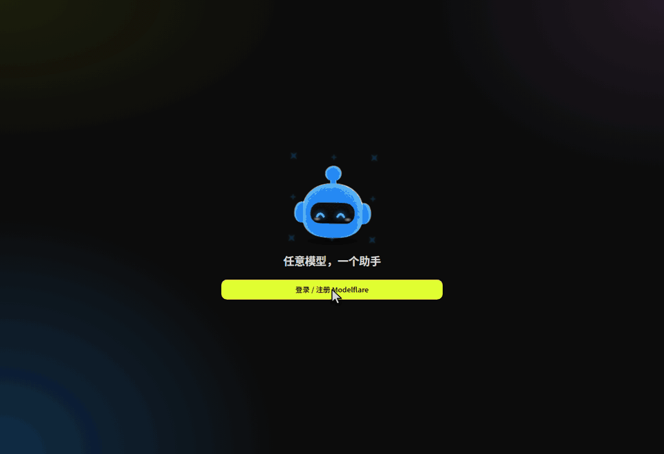
</p>

# 🤖 AnyModelBot

AnyModelBot 是一个本地优先的 AI 智能体应用，支持 Windows、macOS 和 Linux。一个机器人就是一个人设，带着自己的默认模型、工作区和记忆。你可以在应用里和它聊天，也可以在微信、飞书里找它。它能读写文件、执行命令、操作你的桌面，一旦要越出自己的工作区，就会先问你。

对话、记忆、文件和 API Key 都留在你的设备上。模型来自 [Modelflare](https://modelflare.dev)：一个账户，任意模型，按 token 计费。AnyModelBot 本身没有订阅。

📥 [下载](#-下载) · 🌠 [截图](#-截图) · 🌟 [核心功能](#-核心功能) · 🔐 [工作原理与隐私](#-工作原理与隐私)

⭐ 喜欢 AnyModelBot？点个 Star，第一时间收到新版本。

---

<table>
<tr>
<td width="200" align="center" valign="middle">
  <a href="https://modelflare.dev/?utm_source=github&utm_medium=readme&utm_campaign=anymodelbot">
    
  </a>
</td>
<td>

**[Modelflare](https://modelflare.dev/?utm_source=github&utm_medium=readme&utm_campaign=anymodelbot)** 是兼容 OpenAI 接口的 AI API 网关，已有 20 万+ 注册开发者。一个 API Key 就能调用来自 13 家供应商的 70+ 个文本、图片和视频模型，包括 GPT、Claude、Gemini、Grok、DeepSeek、Kimi、GLM 等。请求会在多个供应商之间路由，并按顺序自动回退；每一次请求都记录用量和费用。价格公开，按 token 计费。

**[注册 Modelflare →](https://modelflare.dev/sign-up?utm_source=github&utm_medium=readme&utm_campaign=anymodelbot)** ·
[价格表](https://modelflare.dev/pricing?utm_source=github&utm_medium=readme&utm_campaign=anymodelbot) ·
[API 文档](https://docs.modelflare.dev/) ·
[信任中心](https://modelflare.dev/trust) ·
[X](https://x.com/modelflare_dev)

</td>
</tr>
</table>

**AnyModelBot 怎么用 Modelflare**

- **登录一次就行。** 首次启动会打开浏览器，登录（或注册）Modelflare。之后应用自己把这台设备连上，不用复制 Key。在 Docker 或服务器上运行？改为粘贴一个 API Key。
- **所有模型，一个选择器。** 你的 Modelflare 模型会自动列出，每个模型旁边都有上下文长度、能力标记和参考价。
- **用多少付多少。** 余额、低余额提醒和每日用量都在应用里看。选模型之前，先看公开价格表，和官方价格对比一下。
- **一条诚实的边界。** 模型请求会经过 Modelflare 转发给你选定的供应商，Modelflare 会保留请求日志；保留什么、保留多久，见[信任中心](https://modelflare.dev/trust)。除此之外的内容都留在你的设备上（[详情](#-工作原理与隐私)）。

---

# 📥 下载

选择你的平台。每个 Release 页面都列出全部安装包和 `SHA256SUMS` 校验文件。

| 平台 | 架构 | 安装包 | |
| :--- | :--- | :--- | :--- |
| ![Windows][win-badge] | x64 | `anymodel-bot-<version>-win-x64.exe` | [下载][releases-link] |
| ![Windows][win-badge] | arm64 | `anymodel-bot-<version>-win-arm64.exe` | [下载][releases-link] |
| ![macOS][mac-badge] | Apple 芯片 | `anymodel-bot-<version>-mac-arm64.dmg` | [下载][releases-link] |
| ![macOS][mac-badge] | Intel | `anymodel-bot-<version>-mac-x64.dmg` | [下载][releases-link] |
| ![Linux][linux-badge] | x64 | `anymodel-bot-<version>-linux-x86_64.AppImage` | [下载][releases-link] |
| ![Linux][linux-badge] | arm64 | `anymodel-bot-<version>-linux-arm64.AppImage` | [下载][releases-link] |

<p align="center">
  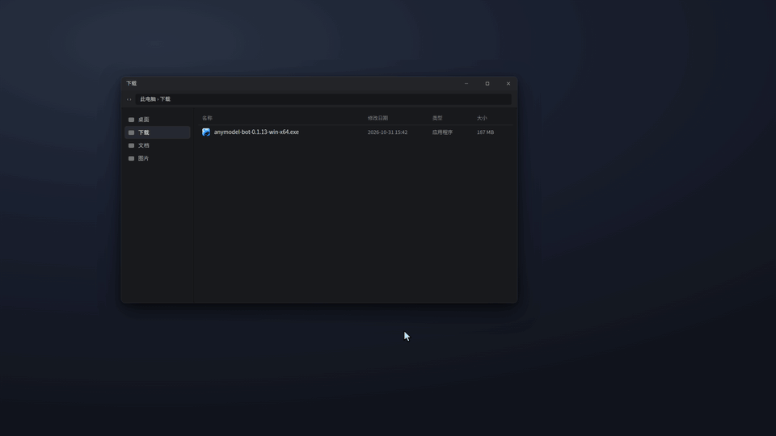
</p>

**首次打开。** 如果系统提示这是从网上下载的应用：Windows 点「更多信息 → 仍要运行」，macOS 在「系统设置 → 隐私与安全性」里点「仍要打开」。Linux 先给 AppImage 加可执行权限（`chmod +x`）再运行。关闭窗口会把 AnyModelBot 收到托盘，要退出请用托盘菜单或设置里的选项。

**校验下载文件。**

```bash
sha256sum -c SHA256SUMS --ignore-missing
```

macOS 用 `shasum -a 256 <文件名>`，Windows PowerShell 用 `Get-FileHash <文件名>`，再和 `SHA256SUMS` 里的值对照。

**用 Docker 部署到 NAS 或服务器**（镜像同时支持 x64 和 arm64）

```bash
docker run -d --name amb -p 3600:3600 -v amb-data:/data ghcr.io/modelflare-ai/anymodel-bot
docker exec amb cat /data/ui-token   # 然后打开 http://<主机>:3600/?token=<令牌>
```

不要把 3600 端口直接暴露到公网。

**从源码运行**

```bash
git clone https://github.com/modelflare-ai/AnyModelBot.git
cd AnyModelBot
npm install
npm run setup      # 拉取并编译内置网关
npm start          # 本地管理界面：http://127.0.0.1:3600/
```

从源码构建需要 Node.js 22.13+ 和 Go 1.26.8+。想自己构建 Docker 镜像，见[开发文档](./docs/development.md)。

# 🌠 截图

应用界面目前为简体中文。

<picture>
  <source media="(prefers-color-scheme: dark)" srcset="docs/assets/screenshots/chat-dark.webp">
  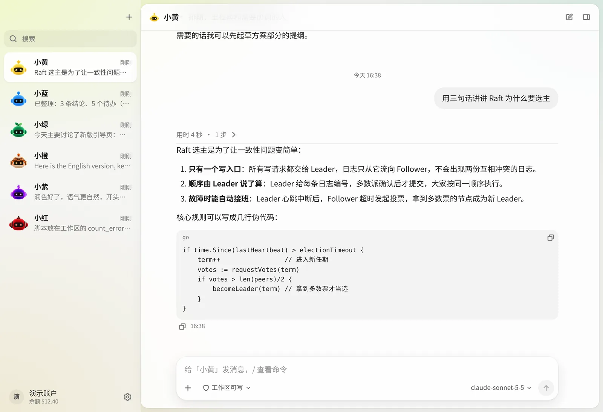
</picture>

<p align="center"><i>和机器人聊天。回复逐字流出，输入框会显示当前用的模型。</i></p>

<picture>
  <source media="(prefers-color-scheme: dark)" srcset="docs/assets/screenshots/agent-dark.webp">
  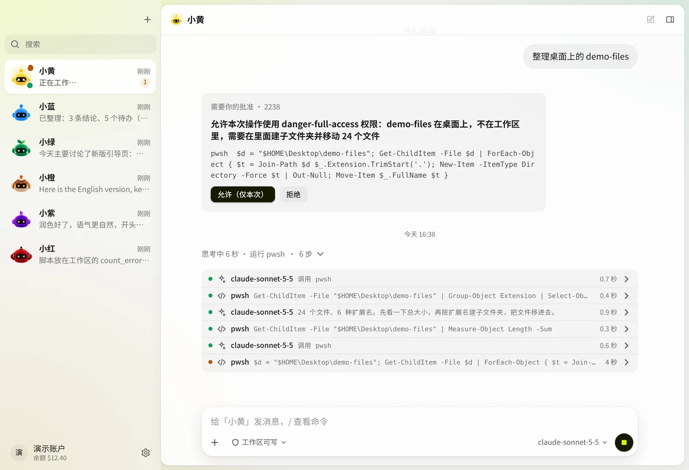
</picture>

<p align="center"><i>智能体做了什么，一步一步看得见。工作区之外的操作要等你批准。</i></p>

<picture>
  <source media="(prefers-color-scheme: dark)" srcset="docs/assets/screenshots/models-dark.webp">
  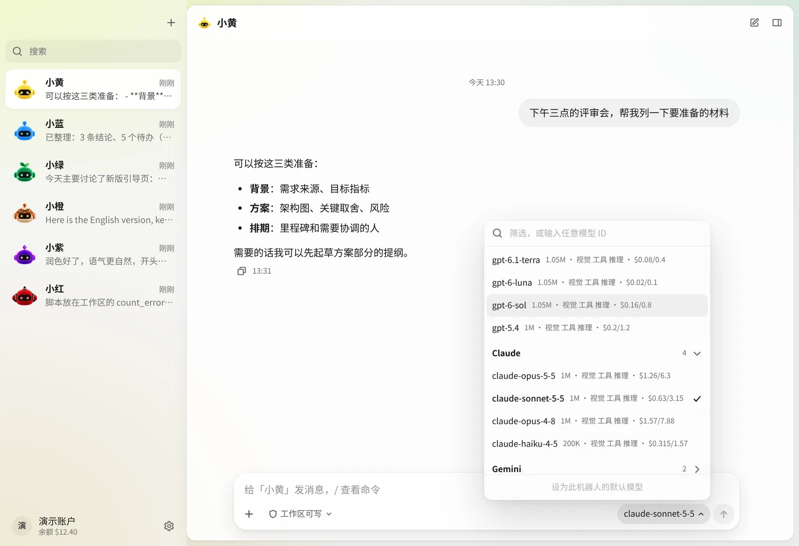
</picture>

<p align="center"><i>每个对话都能选任意 Modelflare 模型，上下文长度、能力和参考价就在旁边。</i></p>

<picture>
  <source media="(prefers-color-scheme: dark)" srcset="docs/assets/screenshots/memory-dark.webp">
  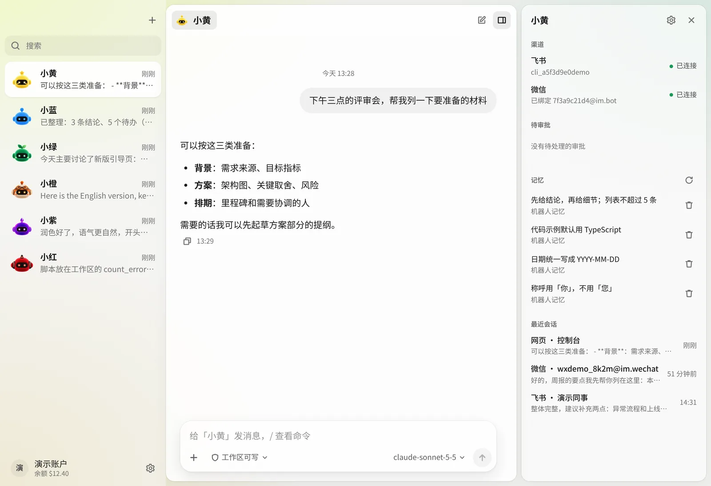
</picture>

<p align="center"><i>每个机器人的记忆、渠道和会话，集中在一个面板里。</i></p>

<picture>
  <source media="(prefers-color-scheme: dark)" srcset="docs/assets/screenshots/modelflare-dark.webp">
  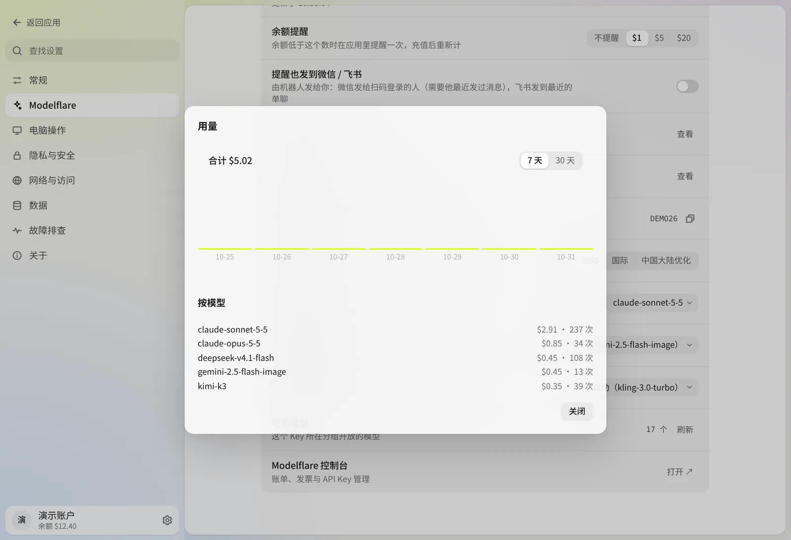
</picture>

<p align="center"><i>应用里的 Modelflare 账户：余额、用量和默认设置。</i></p>

<picture>
  <source media="(prefers-color-scheme: dark)" srcset="docs/assets/screenshots/bots-dark.webp">
  
</picture>

<p align="center"><i>六个角色，帮你分清不同的机器人。它们的眼睛会跟着你的鼠标转。</i></p>

# 🌟 核心功能

## 🤖 真能干活的机器人

机器人不只是一个聊天窗口：它有自己的人设、默认模型、工作区和记忆。

- **想建几个就建几个**，每个都有自己的人设、模型、工作区和头像。
- **真正的文件操作。** 机器人能读写文件、在沙箱里执行命令，并把结果作为文件发回聊天。
- **每个机器人三档权限。** *只读*、*工作区*（默认：只能写自己的文件夹，越界先问你）、*完全权限*（不进沙箱；递归删除仍会先问）。
- **审批卡片，没有意外。** 越界的操作会停下来，等你回答。
- **斜杠命令**，如 `/model`、`/reset`，在应用里和微信、飞书对话中都能用。

<p align="center">
  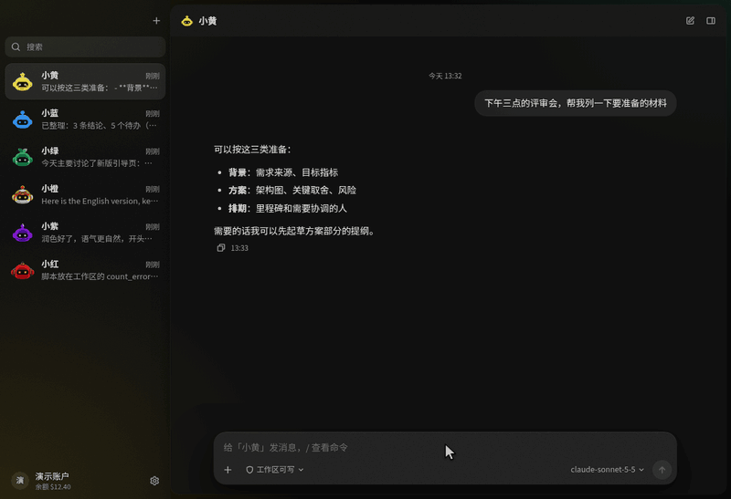
</p>

## 🖥️ 操作你的电脑，生成图片和视频

- **电脑操作**由内置的 [Cua Driver](https://github.com/trycua/cua) 提供。默认自动执行；把某个机器人切到「改变界面前先问我」，每一次点击和输入都要等你点头。读取屏幕内容永远不需要审批。macOS 上的电脑操作是 Beta 功能。
- **图片和视频生成**每次运行前都会先问你，先让你看到模型和提示词，也可以当场换模型。

<p align="center">
  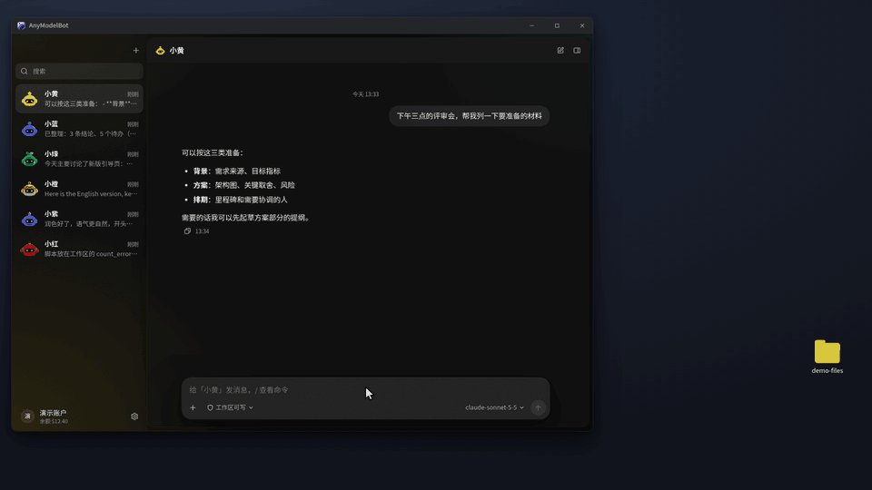
</p>

<p align="center">
  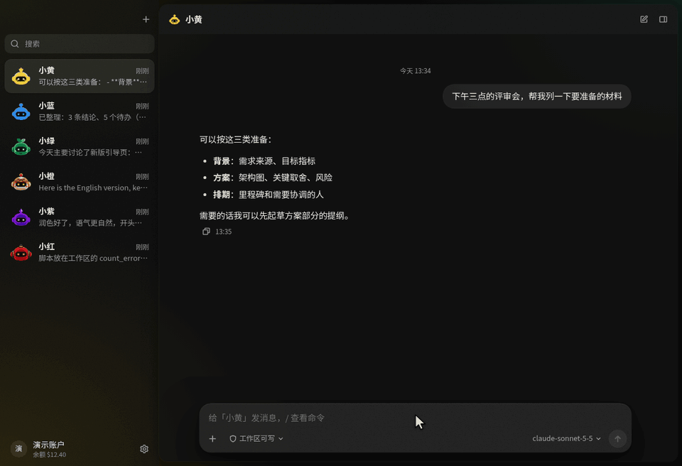
</p>

## 🌐 任意模型，通过 Modelflare

- **登录一次**，你的 Modelflare 模型就会自动出现。更想用 Key？直接粘贴也行。
- **一个选择器，覆盖所有模型。** GPT、Claude、Gemini、Grok、DeepSeek、Kimi、GLM 等，每个都标出上下文长度、能力和参考价。
- **按对话切换**，也可以给每个机器人设默认模型；记忆整理、上下文交接这类后台小任务，还能单独指定一个模型。
- **两条线路。** 国际线路和中国大陆优化线路，由你自己选，AnyModelBot 不会自动来回切换。
- **按量付费。** 钱包余额、低余额提醒、每日用量、每个机器人的预算 Key 都内置。AnyModelBot 没有订阅。

<p align="center">
  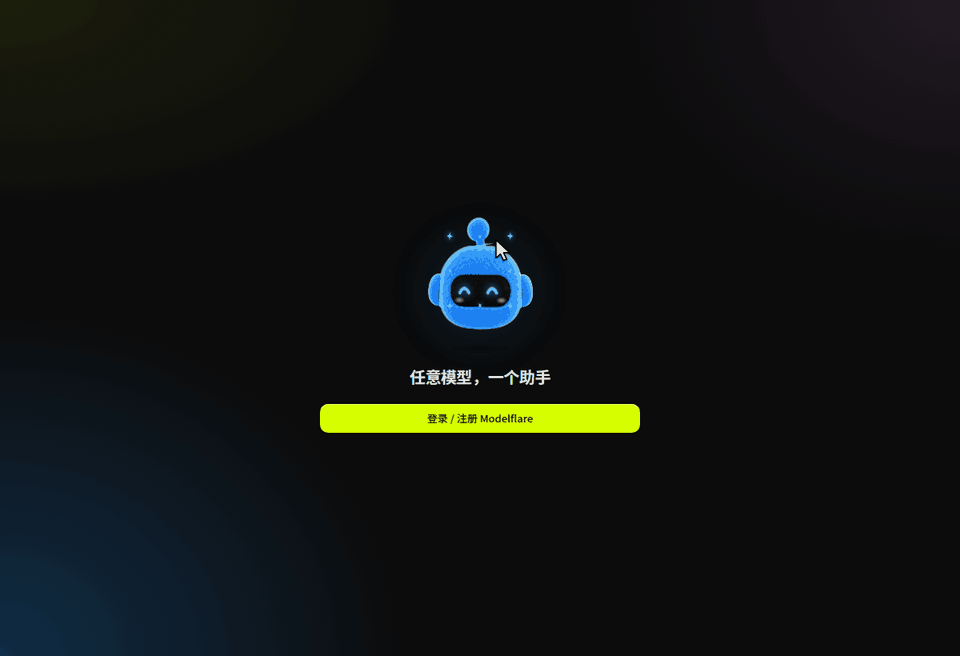
</p>

<p align="center">
  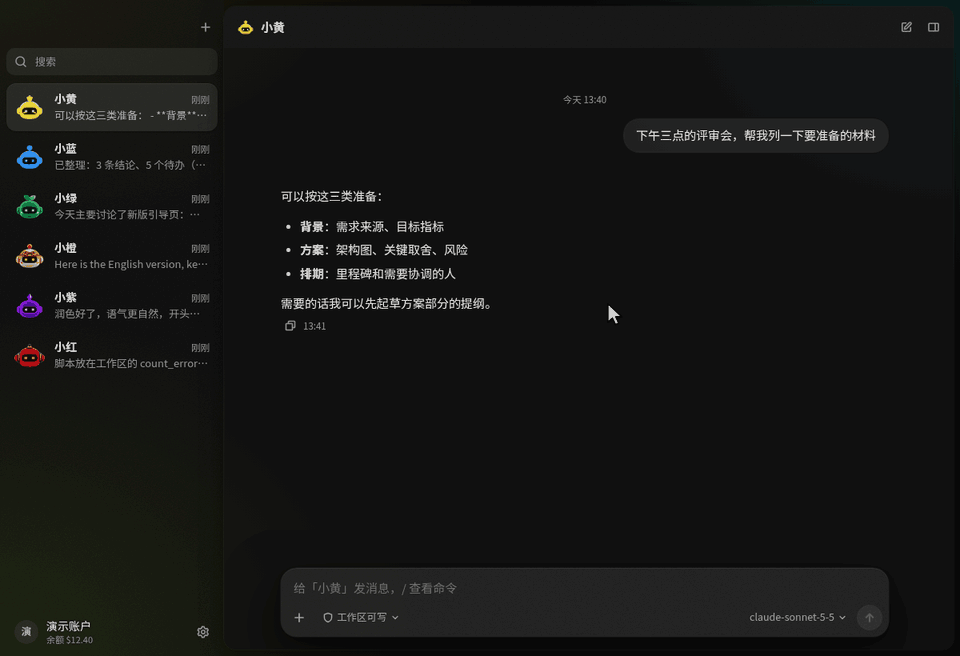
</p>

## 🧠 有记忆，随处可达

- **记忆会延续。** 机器人用 Markdown 保存三层记忆（团队、机器人、群），会过滤看起来像密钥的内容。
- **长对话也能用下去。** 上下文快满之前，上下文管家会压缩，或开一个新段并带上交接摘要。
- **微信和飞书。** 微信扫码连接，飞书机器人支持流式回复卡片；微信还能收发图片和文件。
- **四种运行方式。** 桌面版、命令行、Docker，以及 `127.0.0.1:3600` 的本地网页控制台。

<p align="center">
  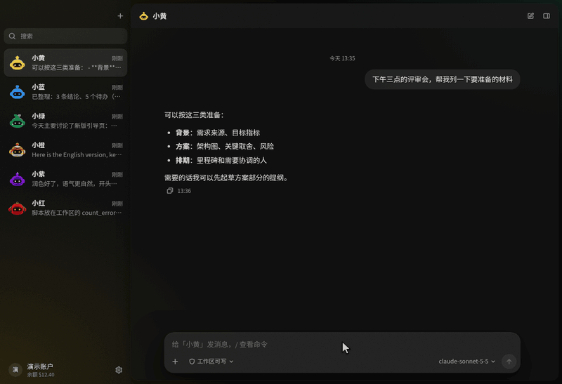
</p>

<p align="center">
  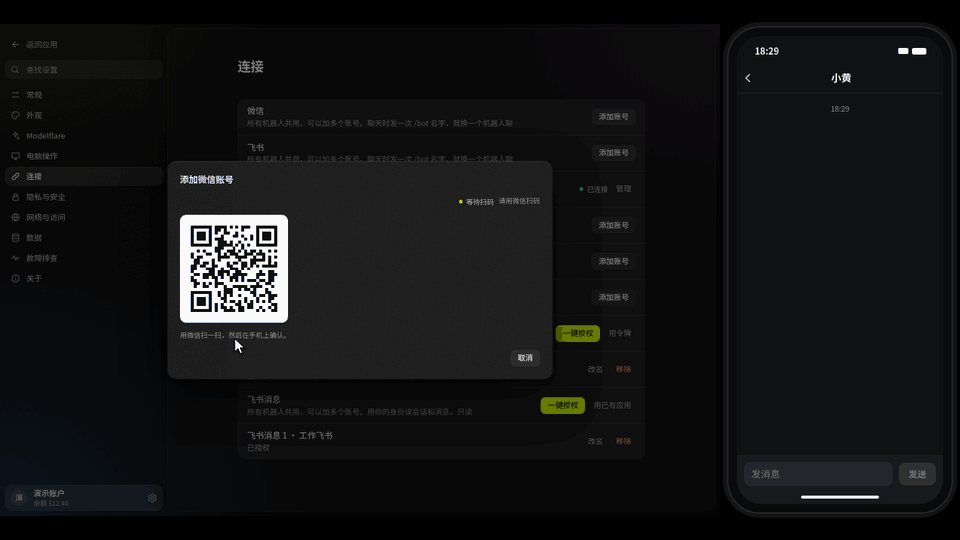
</p>

## 🔒 本地优先，也好看

- **数据留在你手里。** 对话、记忆、文件和 API Key 都存放在你的设备上。本地控制台只监听 `127.0.0.1`，桌面版每次启动都会生成新的访问令牌。
- **遥测保持关闭。** 内置电脑操作驱动的遥测已关闭，内置网关以关闭自动更新的方式运行。
- **浅色、深色或跟随系统。** 六个机器人角色，眼睛会跟着你的鼠标转。
- **托盘与开机自启。** 关闭窗口会收到托盘；macOS 和 Windows 支持开机自启。

<p align="center">
  
</p>

> [!NOTE]
> 功能是否可用取决于你选择的模型、操作系统和授予的权限。电脑操作需要桌面会话，macOS 上的电脑操作为 Beta。模型请求会经过 Modelflare 转发给你选定的供应商，详见[工作原理与隐私](#-工作原理与隐私)。

# 🔐 工作原理与隐私

<picture>
  <source media="(prefers-color-scheme: dark)" srcset="docs/assets/diagrams/data-flow-dark.svg">
  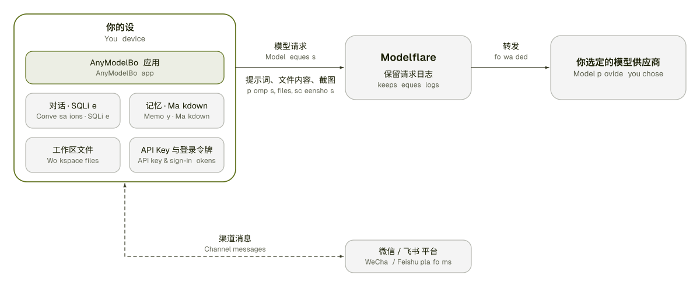
</picture>

| 留在你的设备上 | 会离开你的设备 |
| :--- | :--- |
| 对话与会话（本地 SQLite 数据库） | 模型回答所需的提示词、文件内容和工具结果，经 Modelflare 发给你选定的供应商 |
| 记忆（Markdown 文件） | 你让机器人用电脑操作看屏幕时的屏幕截图 |
| 每个机器人工作区里的文件 | 你通过微信、飞书收发的消息，会经过这两个平台 |
| 你的 API Key 和登录令牌 | 你登录 Modelflare 的过程，发生在 modelflare.dev |
| 设置 | |

Modelflare 会保留请求日志；保留什么、保留多久，见它的[信任中心](https://modelflare.dev/trust)。我们不声称能做到万无一失：凡是你发给模型的内容，都会离开你的设备。完整清单见 [docs/privacy.md](./docs/privacy.md)。

<picture>
  <source media="(prefers-color-scheme: dark)" srcset="docs/assets/diagrams/architecture-dark.svg">
  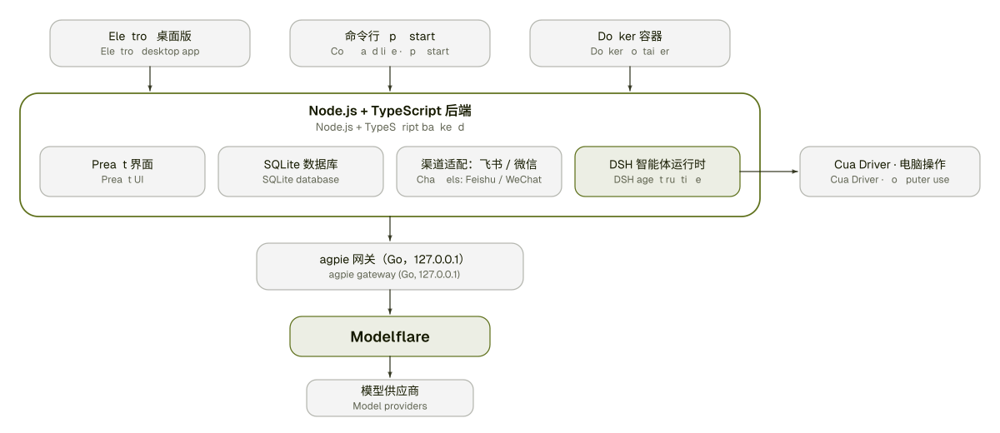
</picture>

| 层 | 技术 |
| :--- | :--- |
| 界面 | Preact + htm，无构建步骤 |
| 后端 | Node.js 22.13+、TypeScript、`node:sqlite` |
| 桌面外壳 | Electron，带托盘 |
| 模型网关 | [magpie](https://github.com/yetone/magpie)（Go，MIT），随应用打包并由应用启动 |
| 智能体运行时 | [DeepSeek Harness](https://github.com/deepseek-ai/deepseek-harness)（MIT），作为独立进程运行 |
| 电脑操作 | [Cua Driver](https://github.com/trycua/cua)，随应用打包 |
| 渠道 | 飞书（长连接 + 流式卡片）、微信（iLink） |
| 测试与 CI | Vitest、GitHub Actions |

# 📝 路线图

我们正在探索的方向。它们不是承诺，顺序也不是排期。

- [ ] **定时任务**：让机器人按时间表自己干活。
- [ ] **群聊**：目前飞书机器人只处理一对一对话。
- [ ] **英文界面**：目前应用界面只有简体中文。
- [ ] **macOS 电脑操作**：在更多真机上验证 direct 模式，让它脱离 Beta。
- [ ] **独立的手机应用**：目前可以从微信或飞书找到你的机器人。

有别的想法？欢迎提 [issue](https://github.com/modelflare-ai/AnyModelBot/issues) 或发起[讨论](https://github.com/modelflare-ai/AnyModelBot/discussions)。我们决定要做的事项，会用 [`roadmap`](https://github.com/modelflare-ai/AnyModelBot/labels/roadmap) 标签跟踪。

# 🤝 参与贡献

欢迎提交 bug 报告、修复、文档和想法。

1. 先看看已有的 [issue](https://github.com/modelflare-ai/AnyModelBot/issues) 和[讨论](https://github.com/modelflare-ai/AnyModelBot/discussions)。带 [`good first issue`](https://github.com/modelflare-ai/AnyModelBot/labels/good%20first%20issue) 标签的 issue 适合入门。
2. Fork 仓库，从 `master` 新建分支。
3. 本地运行并修改：

   ```bash
   npm install
   npm run setup          # 拉取并编译内置网关
   npm run electron:dev   # 开发模式运行桌面版
   npm run typecheck && npm test
   ```

4. 向 `master` 提交 Pull Request，写清楚改了什么、为什么改。比小修复大的改动，请先开 issue，我们先对齐方案。

完整说明见[贡献指南](./CONTRIBUTING.md)。如果要报告安全问题，请按 [SECURITY.md](./SECURITY.md) 处理，不要公开提 issue。

# 🔗 相关项目

- [Modelflare](https://modelflare.dev)：AnyModelBot 模型背后的 AI API 网关。
- [magpie](https://github.com/yetone/magpie)：随应用打包的 Go 网关（MIT）。
- [DeepSeek Harness](https://github.com/deepseek-ai/deepseek-harness)：智能体运行时（MIT）。
- [Cua](https://github.com/trycua/cua)：电脑操作驱动。
- [kimi-computer-use](https://github.com/songkeys/kimi-computer-use)：macOS 的电脑操作桥接。
- [openclaw-weixin](https://github.com/Tencent/openclaw-weixin)：我们移植的微信渠道实现（MIT）。
- [DS Bot](https://github.com/Fei2411/DS-Bot)：记忆与上下文管家的设计来源（Apache-2.0）。

完整的许可证与声明见 [THIRD_PARTY_NOTICES.md](./THIRD_PARTY_NOTICES.md)。

# 💬 社区

- **提问与想法：** [GitHub Discussions](https://github.com/modelflare-ai/AnyModelBot/discussions)
- **Bug 与功能建议：** [GitHub Issues](https://github.com/modelflare-ai/AnyModelBot/issues)
- **邮件联系：** [support@anymodel.bot](mailto:support@anymodel.bot)
- **Modelflare 动态：** [X 上的 @modelflare_dev](https://x.com/modelflare_dev)

# 🚀 贡献者

<a href="https://github.com/modelflare-ai/AnyModelBot/graphs/contributors">
  
</a>

# ⭐️ Star 趋势

<a href="https://www.star-history.com/#modelflare-ai/AnyModelBot&Date">
  <picture>
    <source media="(prefers-color-scheme: dark)" srcset="https://api.star-history.com/svg?repos=modelflare-ai/AnyModelBot&type=Date&theme=dark" />
    <source media="(prefers-color-scheme: light)" srcset="https://api.star-history.com/svg?repos=modelflare-ai/AnyModelBot&type=Date" />
    
  </picture>
</a>

# 📜 许可证

AnyModelBot 以 [MIT 许可证](./LICENSE)发布。随附的第三方软件保留各自的许可证，见 [THIRD_PARTY_NOTICES.md](./THIRD_PARTY_NOTICES.md) 和 [`LICENSES/`](./LICENSES) 目录。

<!-- link & badge references -->
[release-shield]: https://img.shields.io/github/v/release/modelflare-ai/AnyModelBot?include_prereleases&label=release&logo=data:image/svg%2bxml;base64,PHN2ZyB4bWxucz0iaHR0cDovL3d3dy53My5vcmcvMjAwMC9zdmciIHZpZXdCb3g9IjAgMCAxMDAgMTAwIj48cmVjdCB4PSIzIiB5PSI5IiB3aWR0aD0iOTQiIGhlaWdodD0iODIiIHJ4PSIzNiIgZmlsbD0iI2Q3ZmYwMCIvPjxyZWN0IHg9IjI5IiB5PSIzNiIgd2lkdGg9IjEzIiBoZWlnaHQ9IjI4IiByeD0iNi41IiBmaWxsPSIjMTYxYTAwIi8+PHJlY3QgeD0iNTgiIHk9IjM2IiB3aWR0aD0iMTMiIGhlaWdodD0iMjgiIHJ4PSI2LjUiIGZpbGw9IiMxNjFhMDAiLz48L3N2Zz4=&style=flat-square&labelColor=161a00&color=d7ff00
[downloads-shield]: https://img.shields.io/github/downloads/modelflare-ai/AnyModelBot/total?logo=github&logoColor=d7ff00&style=flat-square&labelColor=161a00&color=d7ff00
[stars-shield]: https://img.shields.io/github/stars/modelflare-ai/AnyModelBot?logo=github&logoColor=d7ff00&style=flat-square&labelColor=161a00&color=d7ff00
[license-shield]: https://img.shields.io/github/license/modelflare-ai/AnyModelBot?logo=opensourceinitiative&logoColor=d7ff00&style=flat-square&labelColor=161a00&color=d7ff00
[ci-shield]: https://img.shields.io/github/actions/workflow/status/modelflare-ai/AnyModelBot/ci.yml?branch=master&label=CI&logo=githubactions&logoColor=d7ff00&style=flat-square&labelColor=161a00&color=d7ff00
[platform-shield]: https://img.shields.io/badge/platform-Windows%20%7C%20macOS%20%7C%20Linux%20%7C%20Docker-d7ff00?style=flat-square&labelColor=161a00
[pricing-shield]: https://img.shields.io/badge/pricing-pay--as--you--go-d7ff00?style=flat-square&labelColor=161a00
[modelflare-shield]: https://img.shields.io/badge/Modelflare-modelflare.dev-d7ff00?style=flat-square&labelColor=161a00
[x-shield]: https://img.shields.io/badge/X-@modelflare__dev-d7ff00?style=flat-square&labelColor=161a00&logo=x&logoColor=d7ff00
[win-badge]: https://img.shields.io/badge/Windows-161a00?style=for-the-badge&logo=data:image/svg%2bxml;base64,PHN2ZyB4bWxucz0iaHR0cDovL3d3dy53My5vcmcvMjAwMC9zdmciIHZpZXdCb3g9IjAgMCAyNCAyNCIgZmlsbD0iI2Q3ZmYwMCI+PHJlY3QgeD0iMiIgeT0iMyIgd2lkdGg9IjkuNSIgaGVpZ2h0PSI4LjUiLz48cmVjdCB4PSIxMi41IiB5PSIzIiB3aWR0aD0iOS41IiBoZWlnaHQ9IjguNSIvPjxyZWN0IHg9IjIiIHk9IjEyLjUiIHdpZHRoPSI5LjUiIGhlaWdodD0iOC41Ii8+PHJlY3QgeD0iMTIuNSIgeT0iMTIuNSIgd2lkdGg9IjkuNSIgaGVpZ2h0PSI4LjUiLz48L3N2Zz4=
[mac-badge]: https://img.shields.io/badge/macOS-161a00?style=for-the-badge&logo=apple&logoColor=d7ff00
[linux-badge]: https://img.shields.io/badge/Linux-161a00?style=for-the-badge&logo=linux&logoColor=d7ff00

[releases-link]: https://github.com/modelflare-ai/AnyModelBot/releases
[stars-link]: https://github.com/modelflare-ai/AnyModelBot/stargazers
[license-link]: https://github.com/modelflare-ai/AnyModelBot/blob/master/LICENSE
[ci-link]: https://github.com/modelflare-ai/AnyModelBot/actions/workflows/ci.yml
[pricing-link]: https://modelflare.dev/pricing?utm_source=github&utm_medium=readme&utm_campaign=anymodelbot
[modelflare-link]: https://modelflare.dev/?utm_source=github&utm_medium=readme&utm_campaign=anymodelbot
[x-link]: https://x.com/modelflare_dev
