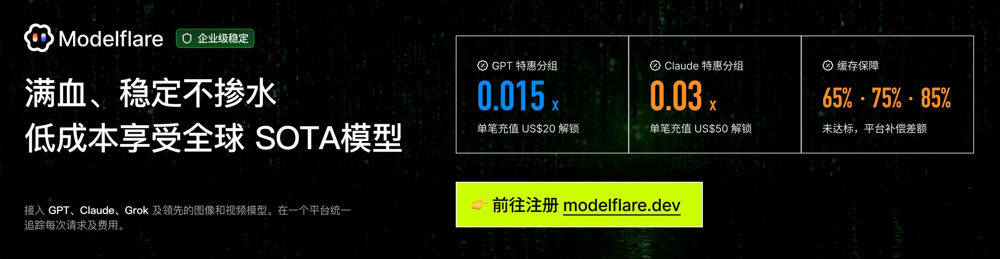

<p align="center">
  <a href="https://github.com/modelflare-ai/AnyModelBot/releases">
    
  </a>
</p>

<h1 align="center">
  <picture>
    <source media="(prefers-color-scheme: dark)" srcset="docs/assets/brand/wordmark-dark.svg">
    
  </picture>
</h1>

<p align="center"><b>跑在你自己电脑上的 AI 机器人团队。任意模型，按量付费。</b></p>

<p align="center">
  <a href="https://anymodel.bot/">官网</a> |
  <a href="https://github.com/modelflare-ai/AnyModelBot/releases">下载</a> |
  简体中文 |
  <a href="./README_en.md">English</a> |
  <a href="./README_ja.md">日本語</a> |
  <a href="./README_ko.md">한국어</a> |
  <a href="./README_ru.md">Русский</a> |
  <a href="./README_es.md">Español</a> |
  <a href="./README_pt.md">Português (Brasil)</a> |
  <a href="https://modelflare.dev/?utm_source=anymodelbot&utm_campaign=amb_readme">Modelflare</a> |
  <a href="https://modelflare.dev/pricing?utm_source=anymodelbot&utm_campaign=amb_readme">价格</a> |
  <a href="./docs/development.md">开发文档</a> |
  <a href="https://github.com/modelflare-ai/AnyModelBot/issues">问题反馈</a>
</p>

<div align="center">

[![Release][release-shield]][releases-link]
[![Downloads][downloads-shield]][releases-link]
[![Stars][stars-shield]][stars-link]
[![License][license-shield]][license-link]
[![CI][ci-shield]][ci-link]

[![Platform][platform-shield]][releases-link]
[![Pricing][pricing-shield]][pricing-link]
[![Modelflare][modelflare-shield]][modelflare-link]
[![X][x-shield]][x-link]

</div>

<p align="center">
  
</p>

# 🤖 AnyModelBot

AnyModelBot 是跑在 Windows / macOS / Linux 上的 AI 机器人团队。每个机器人有自己的人设、默认模型、工作区和记忆；可在应用内聊天，也可接入微信、飞书、Telegram、Slack、Discord。它能读写文件、执行命令、在授权后操作桌面；要写到工作区以外，会先问你。

对话、记忆、文件和 API Key 留在你的设备上。模型可走 [Modelflare](https://modelflare.dev/?utm_source=anymodelbot&utm_campaign=amb_readme)（登录后按用量付费），或使用自己的官方 API Key 直连厂商。AnyModelBot 本身没有订阅费。

装好即可用：后台任务、定时规则和待你确认的事项都已内置。

**0.1.33：** 新增定时页、规则撤销恢复、最长 12 小时补跑、10 个机器人模板，以及右侧文件和网页预览。官方 Bot 工作台和 macOS 权限提示同步改进。 [更新日志](./CHANGELOG.md#0133---2026-11-14)

📥 [下载](#-下载与运行) · 🌠 [截图](#-截图) · 🌟 [核心功能](#-核心功能) · 🆚 [对比](#-对比-grok-bot--openai-dots--claude-duet) · 🔐 [工作原理与隐私](#-工作原理与隐私)

⭐ 喜欢 AnyModelBot？点个 Star，第一时间收到新版本。

---

<a href="https://modelflare.dev/sign-up?utm_source=anymodelbot&utm_campaign=amb_readme">
  
</a>

最省事的用法是 **[Modelflare](https://modelflare.dev/?utm_source=anymodelbot&utm_campaign=amb_readme)**：登录即可使用模型，不用分别申请各家的 Key（想直连厂商，见[任意模型](#-任意模型通过-modelflare-或官方-api)）。可用模型、价格和当前活动以 [Modelflare](https://modelflare.dev/?utm_source=anymodelbot&utm_campaign=amb_readme) 和 [价格表](https://modelflare.dev/pricing?utm_source=anymodelbot&utm_campaign=amb_readme) 为准。

**Bot 额度**：新用户注册即送 Bot 额度，订阅 Modelflare 套餐另送套餐额度 10% 的 Bot 额度，具体以 Modelflare 页面为准。Bot 额度只能在 AnyModelBot 里使用，应用里的请求会先用它，剩余多少在左下角就能看到。

**[注册 Modelflare →](https://modelflare.dev/sign-up?utm_source=anymodelbot&utm_campaign=amb_readme)** ·
[价格表](https://modelflare.dev/pricing?utm_source=anymodelbot&utm_campaign=amb_readme) ·
[API 文档](https://docs.modelflare.dev/?utm_source=anymodelbot&utm_campaign=amb_readme) ·
[信任中心](https://modelflare.dev/trust?utm_source=anymodelbot&utm_campaign=amb_readme) ·
[X](https://x.com/modelflare_dev)

**AnyModelBot 怎么用 Modelflare**

- **登录一次就行。** 首次启动会打开浏览器，登录（或注册）Modelflare。之后应用自己把这台设备连上，不用复制 Key，授权完成后会自动回到应用；还没有默认模型时，会先选好一个支持工具、花费低的模型。在 Docker 或服务器上运行？在任意设备的浏览器里登录，再把登录后的链接贴回应用。
- **所有模型，一个选择器。** 你的 Modelflare 模型会自动列出，每个模型旁边都有上下文长度、能力标记和参考价。
- **用多少付多少。** 余额和充值入口常驻在左下角（有 Bot 额度时还显示它的剩余百分比），低余额提醒和每日用量也都在应用里看。选模型之前，先看公开价格表，和官方价格对比一下。
- **一条诚实的边界。** 模型请求会经过 Modelflare 转发给你选定的供应商，Modelflare 会保留请求日志；保留什么、保留多久，见[信任中心](https://modelflare.dev/trust?utm_source=anymodelbot&utm_campaign=amb_readme)。除此之外的内容都留在你的设备上（[详情](#-工作原理与隐私)）。

---

# 📥 下载与运行

选择你的平台。每个 Release 页面都列出全部安装包和 `SHA256SUMS` 校验文件。

| 平台 | 架构 | 安装包 | |
| :--- | :--- | :--- | :--- |
| ![Windows][win-badge] | x64 | `anymodel-bot-<version>-win-x64.exe` | [下载][releases-link] |
| ![Windows][win-badge] | arm64 | `anymodel-bot-<version>-win-arm64.exe` | [下载][releases-link] |
| ![macOS][mac-badge] | Apple 芯片 | `anymodel-bot-<version>-mac-arm64.dmg` | [下载][releases-link] |
| ![macOS][mac-badge] | Intel | `anymodel-bot-<version>-mac-x64.dmg` | [下载][releases-link] |
| ![Linux][linux-badge] | x64 | `anymodel-bot-<version>-linux-x86_64.AppImage` | [下载][releases-link] |
| ![Linux][linux-badge] | arm64 | `anymodel-bot-<version>-linux-arm64.AppImage` | [下载][releases-link] |

<p align="center">
  
</p>

**首次打开。** Windows 出现系统风险提示时，点「更多信息 → 仍要运行」。macOS 版已完成 Developer ID 签名和苹果公证，将应用拖入「应用程序」后打开；首次出现下载确认时点「打开」。Linux 先给 AppImage 加可执行权限（`chmod +x`）再运行。关闭窗口会把 AnyModelBot 收到托盘，要退出请用托盘菜单或设置里的选项。

**校验下载文件。**

```bash
sha256sum -c SHA256SUMS --ignore-missing
```

macOS 用 `shasum -a 256 <文件名>`，Windows PowerShell 用 `Get-FileHash <文件名>`，再和 `SHA256SUMS` 里的值对照。

**用 Docker 部署到 NAS 或服务器**（镜像同时支持 x64 和 arm64）

```bash
docker run -d --name amb -p 3600:3600 -v amb-data:/data ghcr.io/modelflare-ai/anymodel-bot
docker exec amb cat /data/ui-token   # 然后打开 http://<主机>:3600/?token=<令牌>
```

不要把 3600 端口直接暴露到公网。

**从源码运行**

```bash
git clone https://github.com/modelflare-ai/AnyModelBot.git
cd AnyModelBot
npm install
npm run setup      # 拉取并编译内置网关
npm start          # 本地管理界面：http://127.0.0.1:3600/
```

从源码构建需要 Node.js 22.13+ 和 Go 1.26.8+。想自己构建 Docker 镜像，见[开发文档](./docs/development.md)。

# 🌠 截图

截图是简体中文界面；应用也有英文界面，在设置里切换。

<picture>
  <source media="(prefers-color-scheme: dark)" srcset="docs/assets/screenshots/chat-dark.webp">
  
</picture>

<p align="center"><i>和机器人聊天。回复支持 Markdown 和代码块，输入框会显示当前用的模型。</i></p>

<picture>
  <source media="(prefers-color-scheme: dark)" srcset="docs/assets/screenshots/agent-dark.webp">
  
</picture>

<p align="center"><i>机器人做了什么，一步一步看得见。工作区之外的操作要等你批准。</i></p>

<picture>
  <source media="(prefers-color-scheme: dark)" srcset="docs/assets/screenshots/models-dark.webp">
  
</picture>

<p align="center"><i>每个对话都能选任意 Modelflare 模型，上下文长度、能力和参考价就在旁边。</i></p>

<picture>
  <source media="(prefers-color-scheme: dark)" srcset="docs/assets/screenshots/memory-dark.webp">
  
</picture>

<p align="center"><i>每个机器人的记忆、渠道和会话，集中在一个面板里。</i></p>

<picture>
  <source media="(prefers-color-scheme: dark)" srcset="docs/assets/screenshots/modelflare-dark.webp">
  
</picture>

<p align="center"><i>应用里的 Modelflare 账户：余额、用量和默认设置。</i></p>

<picture>
  <source media="(prefers-color-scheme: dark)" srcset="docs/assets/screenshots/bots-dark.webp">
  
</picture>

<p align="center"><i>六个角色，帮你分清不同的机器人。它们的眼睛会跟着你的鼠标转。</i></p>

# 🌟 核心功能

## 🤖 真能干活的机器人

机器人不只是一个聊天窗口：它有自己的人设、默认模型、工作区和记忆。

- **需要几个就有几个**，每个都有自己的人设、模型、工作区和头像。
- **每个机器人由你来定义。** 人设就是一段话，模板只是起点，每个字都能改；六个头像只管长相，不决定它能做什么。
- **真正的文件操作。** 机器人能读写文件、在沙箱里执行命令，并把结果作为文件发回聊天。
- **每个机器人三档权限。** *只读*、*工作区*（默认：只能写自己的文件夹；要写到工作区以外，得先经过你点头）、*完全权限*（不进沙箱；删除整个文件夹前仍会先问）。
- **导入技能。** 在「机器人设置 → 技能」导入包含 `SKILL.md` 的 ZIP（每包一个技能，最大 20 MB），预览后添加。支持查看、启用、停用、删除；再次导入同名技能可确认替换，改动在当前工作结束后生效。 [使用说明](./docs/skills.md)。
- **审批卡片，没有意外。** 要写到工作区以外的操作会停下来，等你回答。
- **重启了也会告诉你。** 应用退出或崩溃时还没处理完的消息，下次启动会在原对话里说一声，请你重新发送，不会自动重做。
- **群聊。** 建一个群，拉几个机器人进来。@ 谁谁回答，没 @ 时上一个回答的接着答；机器人也能 @ 别的成员请它接手。每个机器人用自己的模型、工作区和记忆，花费分开算。
- **聊天记录搜索。** 侧栏可搜索本机保存的全部消息，按机器人、会话、渠道和日期筛选，点击结果定位原消息。`Ctrl/Cmd+Shift+F` 打开全局搜索，`Ctrl/Cmd+F` 查找当前聊天；搜索不调用模型。没输入时，搜索弹窗按日期列出最近的对话。
- **斜杠命令**，如 `/model`、`/reset`，在应用和各个聊天渠道里都能用；在聊天渠道里发 `/bot` 可以换机器人。

<p align="center">
  
</p>

## 🧩 现成的 Bot

不想自己写人设，可以直接用发现页里的现成机器人。每个都有自己的界面，打开时先看示例，发第一句话才会安装。

官方 Bot 的界面、示例、人设和技能均随安装包内置，首次打开和安装不再下载 Bot 包；更新跟随应用版本发布，已有项目数据保留。模型调用和联网研究仍需要网络。每个 Bot 都是一个桌面工作台：左边是作品列表、右边是内容，「新建」用向导点选几项就能开始；顶栏可以切换到完整的对话，底部输入框也能选模型。

- **尽调助手：** 在你的电脑上做公司尽调，生成可追溯的简报和 PDF。
- **PPT 大师：** 把文档或主题做成可编辑的 PPT，也能改现有的演示文稿。
- **影视创作室：** 做短视频和分集短剧，从剧本、分镜到配音、剪辑和成片。
- **美股研报：** 查阅美股财报和申报文件，写出数据可追溯的研究报告。

影视创作室需要 AnyModelBot 0.1.23 及以上版本、本机 Python 3.10+ 和 FFmpeg（含 ffprobe）。AI 图片和视频通过 Modelflare 按用量计费；项目与素材保存在你的设备上。

完整介绍见[官网的 Bot 页面](https://anymodel.bot/bots)。

## ⏳ 在后台干活，需要你时才来找你

- **后台任务。** 要跑一阵子的事（调研、做报告、整理文件），或者你说一句「后台做」，机器人会开一个后台任务，你可以接着聊别的。做完把结果发回原来的对话。
- **接着问。** 在微信里引用结果、在飞书里回复那条消息，就是继续问这个任务。
- **规则。** 「每天早上 8 点看看 X 的价格，低于 200 告诉我」会建成一条规则，到点就去查，有值得说的才告诉你。想先看看它会怎么做，就说「先观察」：只记下本会说什么，不发消息、不改文件，看过几次再改成执行。
- **「需要你」。** 所有机器人在等你回答、批准或重试的事都在侧栏这一行里；没事时这一行不出现。信息面板的「任务」组列着这个机器人的任务和规则，每一步都看得到。
- **不吵你。** 只推结果、要你决定的事和失败，进展不推。默认 22:00 到 08:00 免打扰；主动消息每天有上限（微信 3 条，其他渠道 5 条），多了合成一条。
- **有预算。** 每个任务、每条规则都有预算（任务默认 1 美元，规则每次 0.1 美元、每月 3 美元），快用完时停下问你，可以在任务详情和规则编辑器里改。
- **随时暂停。** 机器人设置 › 主动消息里一个开关暂停后台工作，聊天照常。
- **用完会清理。** 任务和运行记录留 30 天；任务文件夹 30 天没动过会自动删除，不来问你，任务详情里写着哪天删，想留就点保留。运行记录能导出成 Markdown。

运行时基于 [DeepSeek Harness](https://github.com/deepseek-ai/deepseek-harness)，设计参考了 DeepSeek 的 [Super Agent 原型](https://github.com/deepseek-ai/dsh-superagent-prototype)。完整介绍见[《AnyModelBot 超级智能体》](./docs/blog/superagent.md)。

## 🖥️ 操作你的电脑，生成图片和视频

- **电脑操作**由内置的 [Cua Driver](https://github.com/trycua/cua) 提供。默认自动执行；把某个机器人切到「改变界面前先问我」，每一次点击和输入都要等你点头。读取屏幕内容永远不需要审批。macOS 上的电脑操作是 Beta 功能：第一次用到时才请求「辅助功能」和「屏幕录制」权限，缺哪一项会在聊天里说明怎么开。
- **图片和视频生成**直接生成，要求没说清的按最合理的理解来；预计花费超过 0.5 美元时才先问你，让你看到模型和提示词，也可以当场换模型。想每次都确认，在机器人设置里打开即可。

<p align="center">
  
</p>

<p align="center">
  
</p>

## 🌐 任意模型，通过 Modelflare 或官方 API

- **登录一次**，你的 Modelflare 模型就会自动出现。
- **或者用自己的官方 API Key。** 支持 OpenAI、Anthropic、Google Gemini、xAI、DeepSeek、Kimi、GLM、Qwen、MiniMax 和 Mistral。Key 只存在你的设备上，模型请求直接发给厂商，不经过 Modelflare，费用由厂商收取。生图和生视频目前只能通过 Modelflare 使用。
- **一个选择器，覆盖所有模型。** GPT、Claude、Gemini、Grok、DeepSeek、Kimi、GLM 等，每个都标出上下文长度、能力和参考价。
- **按对话切换**，也可以给每个机器人设默认模型；记忆整理、上下文交接这类后台小任务，还能单独指定一个模型。
- **三个 API 域名。** `modelflare.dev`、`origin.modelflare.dev` 和 `cf.modelflare.dev` 均可选择；可在设置中测速，AnyModelBot 不会自动切换。
- **按量付费。** 钱包余额、低余额提醒、每日用量、每个机器人的预算 Key 都内置。AnyModelBot 本身没有订阅费。

<p align="center">
  
</p>

<p align="center">
  
</p>

## 🧠 有记忆，随处可达

- **记忆会延续。** 机器人、群、团队各有自己的记忆，以 Markdown 保存，互不混用；看起来像密码、密钥的内容不会被记住。
- **长对话也能用下去。** 上下文快满之前，上下文管家会压缩，或开一个新段并带上交接摘要。
- **账号全局共用。** 微信、飞书、Telegram、Slack、Discord 的聊天账号在「设置 › 聊天渠道」里加一次，所有机器人共用，每个渠道可以加多个、起别名。在聊天软件里发一次 `/bot 名字` 就换一个机器人聊。
- **连接应用。** 左下角头像菜单里的「连接应用」内置飞书、腾讯文档、钉钉、高德地图、语雀、Notion、GitHub、Linear、Atlassian、Canva 的连接器，也可以添加自定义 MCP（远程服务或本地命令）。连一次，默认所有机器人都能用，可以按机器人、按工具收窄。只读直接用，写入先问你，删除和对外发送每次都问。
- **微信和飞书。** 微信扫码连接，飞书机器人支持流式回复卡片；微信还能收发图片和文件。
- **Telegram、Slack、Discord。** 在 设置 › 聊天渠道 里填 token 连接，不需要公网地址；回复边写边显示，能收发图片和文件。目前只处理单聊，审批和提问回复文字。
- **四种运行方式。** 桌面版、命令行、Docker，以及 `127.0.0.1:3600` 的本地网页控制台。

<p align="center">
  
</p>

<p align="center">
  
</p>

## 🔒 本地优先，也好看

- **数据留在你手里。** 对话、记忆、文件和 API Key 都存放在你的设备上。本地控制台只监听 `127.0.0.1`，桌面版每次启动都会生成新的访问令牌。
- **只听主人的。** 机器人默认只回应主人（扫码登录的微信；飞书、Telegram、Slack、Discord 连上后第一个给它发消息的人，也就是你）和你允许的人。其他人发消息只会收到一句提示，不会调用模型；你在信息面板里，或在聊天里回复「同意 编号」放行。
- **回复不会丢。** 回复先存到本地再发；网络断了会自动重试，应用重启后接着发；你在微信里超过 24 小时没说话时，回复先留着，等你下次发消息时一起送到。
- **遥测保持关闭。** 内置电脑操作驱动的遥测已关闭，内置网关以关闭自动更新的方式运行。
- **应用内更新。** 从 0.1.29 起，桌面安装版默认开启「设置 → 常规 → 自动下载更新」。新版本在后台下载，完成后提示「重启并更新」，由你点击并在任务空闲时安装；关闭开关后可手动下载。0.1.28 及更早版本需要先手动安装一次 0.1.29 或更高版本。Docker 和源码部署仍手动升级。从 0.1.30 起，升级后第一次打开会说明这次更新了什么；点新版本提示也能先看更新内容再决定是否升级，「设置 → 关于」里随时可以看更新日志。
- **浅色、深色或跟随系统。** 六个机器人角色，眼睛会跟着你的鼠标转。
- **托盘与开机自启。** 关闭窗口会收到托盘；macOS 和 Windows 支持开机自启。

<p align="center">
  
</p>

> [!NOTE]
> 功能是否可用取决于你选择的模型、操作系统和授予的权限。电脑操作需要桌面会话，macOS 上的电脑操作为 Beta。模型请求会发给你选定的供应商（用官方 API Key 时直连，否则经过 Modelflare），详见[工作原理与隐私](#-工作原理与隐私)。

# 🆚 对比 Grok Bot / OpenAI dots / Claude Duet

2026 年下半年，xAI 的 [Grok Bot](https://x.ai/bot)、OpenAI 的 [dots](https://openai.com/index/introducing-dots/) 和 Anthropic 的 Claude Duet 接连发布。它们也是常驻后台、替你干活的 AI，需要你拍板时再来问你。AnyModelBot 做的是同一类事，换了一种做法：开源、跑在你自己的设备上、任意模型都能用。

| | AnyModelBot | Grok Bot | OpenAI dots | Claude Duet |
| :--- | :--- | :--- | :--- | :--- |
| 开源 | ✅ MIT | — | — | — |
| 运行位置 | 你自己的电脑或服务器 | xAI 的云端电脑 | OpenAI 的云端电脑 | Anthropic 的云端 |
| 能用的模型 | GPT、Claude、Gemini、Grok 等（经 Modelflare 或官方 API） | 以 xAI 的 Grok 模型为主 | OpenAI 的模型 | Claude（Opus 5.5） |
| 费用 | 应用免费，模型按 token 计费 | 订阅 | ChatGPT Pro / Business Premium 订阅 | Claude Pro / Max 订阅 |
| 在哪找它 | 桌面应用（Windows、macOS、Linux）、Docker、微信、飞书、Telegram、Slack、Discord | 桌面应用、iPhone | ChatGPT、Slack、Teams | iOS、Android、claude.ai |
| 现在能用吗 | 直接下载 | 测试版 | 部分地区开放 | 研究预览，美国候补名单 |

AnyModelBot 同样能在后台干活：交代的任务可以在后台跑完，再把结果发到你用的聊天渠道；需要你批准或回答时，它会出现在侧栏的「需要你」里。机器人做的每一步都看得见，越出工作区的操作先问你。

> [!NOTE]
> 其他产品的信息来自 2026 年 10 月的公开报道，可能已有变化，以各家官方说明为准。Grok Bot、dots、Claude Duet 分别是 xAI、OpenAI、Anthropic 的产品和商标，AnyModelBot 与它们没有关联。

# 🔐 工作原理与隐私

<picture>
  <source media="(prefers-color-scheme: dark)" srcset="docs/assets/diagrams/data-flow-dark.svg">
  
</picture>

| 留在你的设备上 | 会离开你的设备 |
| :--- | :--- |
| 对话与会话（本地 SQLite 数据库） | 模型回答所需的提示词、文件内容和工具结果，发给你选定的供应商（用官方 API Key 时直连，否则经过 Modelflare） |
| 记忆（Markdown 文件） | 你让机器人用电脑操作看屏幕时的屏幕截图 |
| 每个机器人工作区里的文件 | 你通过聊天渠道收发的消息，会经过对应的平台 |
| 你的 API Key 和登录令牌 | 你登录 Modelflare 的过程，发生在 modelflare.dev |
| 连接应用 | 你连接应用（飞书、Notion、GitHub 等）或添加自定义 MCP 后，机器人会读写其中的内容，读到的内容也会进入模型请求 |

Modelflare 会保留请求日志；保留什么、保留多久，见它的[信任中心](https://modelflare.dev/trust?utm_source=anymodelbot&utm_campaign=amb_readme)。我们不声称能做到万无一失：凡是你发给模型的内容，都会离开你的设备。完整清单见 [docs/privacy.md](./docs/privacy.md)。

<picture>
  <source media="(prefers-color-scheme: dark)" srcset="docs/assets/diagrams/architecture-dark.svg">
  
</picture>

| 层 | 技术 |
| :--- | :--- |
| 界面 | Preact + htm，无构建步骤 |
| 后端 | Node.js 22.13+、TypeScript、`node:sqlite` |
| 桌面外壳 | Electron，带托盘 |
| 模型网关 | [magpie](https://github.com/yetone/magpie)（Go，MIT），随应用打包并由应用启动 |
| 智能体运行时 | [DeepSeek Harness](https://github.com/deepseek-ai/deepseek-harness)（MIT），作为独立进程运行 |
| 电脑操作 | [Cua Driver](https://github.com/trycua/cua)，随应用打包 |
| 渠道 | 飞书（长连接 + 流式卡片）、微信（iLink）、Telegram（长轮询）、Slack（Socket Mode）、Discord（Gateway） |
| 连接应用 | 内置连接器：飞书、腾讯文档、钉钉、高德地图、语雀、Notion、GitHub、Linear、Atlassian、Canva；自定义 MCP：Streamable HTTP（兼容 SSE）、本地命令 |
| 测试与 CI | Vitest、GitHub Actions |

# 📝 路线图

我们正在探索的方向。它们不是承诺，顺序也不是排期。每个版本实际改了什么，见[更新日志](./CHANGELOG.md)。

- [x] **定时任务**：让机器人按时间表自己干活（已上线，就是上面的规则）。
- [x] **应用内群聊**：在应用里建群，拉多个机器人一起聊。
- [ ] **聊天渠道里的群聊**：目前各聊天渠道只处理一对一对话。
- [x] **多语言界面**：支持简体中文、英语、日语、韩语、俄语、西班牙语和葡萄牙语（巴西），可在设置中切换。
- [ ] **macOS 电脑操作**：在更多真机上验证 direct 模式，让它脱离 Beta。
- [ ] **邮箱、日历和事件触发**：接入邮箱和日历账号，规则除了按时间跑，也能在事情发生时马上跑（比如收到某人的邮件、快开会时）。由外部内容触发的运行权限更低，防止别人写的内容给机器人下指令。
- [ ] **常驻运行、备份和迁移**：电脑关机时规则不会跑。让普通用户也能一键部署到自己的服务器，把对话、记忆和账号搬过去，也能备份和恢复。
- [ ] **自己添加 MCP**：目前只能用内置的工具和账号。开放后，可以自己接入 GitHub、Linear 等服务。
- [ ] **机器人之间协作**：让一个机器人把活交给另一个，比如用不同的模型写稿和审稿，花费分开算。
- [ ] **语音消息转写**：Telegram 的语音消息目前听不到内容，微信靠平台自带的转写。
- [ ] **独立的手机应用**：目前可以从微信、飞书、Telegram、Slack、Discord 找到你的机器人。

有别的想法？欢迎提 [issue](https://github.com/modelflare-ai/AnyModelBot/issues) 或发起[讨论](https://github.com/modelflare-ai/AnyModelBot/discussions)。我们决定要做的事项，会用 [`roadmap`](https://github.com/modelflare-ai/AnyModelBot/labels/roadmap) 标签跟踪。

# 🤝 参与贡献

欢迎提交 bug 报告、修复、文档和想法。

1. 先看看已有的 [issue](https://github.com/modelflare-ai/AnyModelBot/issues) 和[讨论](https://github.com/modelflare-ai/AnyModelBot/discussions)。带 [`good first issue`](https://github.com/modelflare-ai/AnyModelBot/labels/good%20first%20issue) 标签的 issue 适合入门。
2. Fork 仓库，从 `master` 新建分支。
3. 本地运行并修改：

   ```bash
   npm install
   npm run setup          # 拉取并编译内置网关
   npm run electron:dev   # 开发模式运行桌面版
   npm run typecheck && npm test
   ```

4. 向 `master` 提交 Pull Request，写清楚改了什么、为什么改。比小修复大的改动，请先开 issue，我们先对齐方案。

完整说明见[贡献指南](./CONTRIBUTING.md)。如果要报告安全问题，请按 [SECURITY.md](./SECURITY.md) 处理，不要公开提 issue。

# 🔗 相关项目

- [Modelflare](https://modelflare.dev/?utm_source=anymodelbot&utm_campaign=amb_readme)：AnyModelBot 模型背后的 AI API 网关。
- [magpie](https://github.com/yetone/magpie)：随应用打包的 Go 网关（MIT）。
- [DeepSeek Harness](https://github.com/deepseek-ai/deepseek-harness)：智能体运行时（MIT）。
- [Cua](https://github.com/trycua/cua)：电脑操作驱动。
- [kimi-computer-use](https://github.com/songkeys/kimi-computer-use)：macOS 的电脑操作桥接。
- [openclaw-weixin](https://github.com/Tencent/openclaw-weixin)：我们移植的微信渠道实现（MIT）。
- [DS Bot](https://github.com/Fei2411/DS-Bot)：记忆与上下文管家的设计来源（Apache-2.0）。

完整的许可证与声明见 [THIRD_PARTY_NOTICES.md](./THIRD_PARTY_NOTICES.md)。

# 💬 社区

- **提问与想法：** [GitHub Discussions](https://github.com/modelflare-ai/AnyModelBot/discussions)
- **Bug 与功能建议：** [GitHub Issues](https://github.com/modelflare-ai/AnyModelBot/issues)
- **邮件联系：** [support@anymodel.bot](mailto:support@anymodel.bot)
- **Modelflare 动态：** [X 上的 @modelflare_dev](https://x.com/modelflare_dev)

# 🚀 贡献者

<a href="https://github.com/modelflare-ai/AnyModelBot/graphs/contributors">
  
</a>

# ⭐️ Star 趋势

<a href="https://www.star-history.com/#modelflare-ai/AnyModelBot&Date">
  <picture>
    <source media="(prefers-color-scheme: dark)" srcset="https://api.star-history.com/svg?repos=modelflare-ai/AnyModelBot&type=Date&theme=dark" />
    <source media="(prefers-color-scheme: light)" srcset="https://api.star-history.com/svg?repos=modelflare-ai/AnyModelBot&type=Date" />
    
  </picture>
</a>

# 📜 许可证

AnyModelBot 以 [MIT 许可证](./LICENSE)发布。随附的第三方软件保留各自的许可证，见 [THIRD_PARTY_NOTICES.md](./THIRD_PARTY_NOTICES.md) 和 [`LICENSES/`](./LICENSES) 目录。

<!-- link & badge references -->
[release-shield]: https://img.shields.io/github/v/release/modelflare-ai/AnyModelBot?include_prereleases&label=release&logo=&style=flat-square&labelColor=161a00&color=d7ff00
[downloads-shield]: https://img.shields.io/github/downloads/modelflare-ai/AnyModelBot/total?logo=github&logoColor=d7ff00&style=flat-square&labelColor=161a00&color=d7ff00
[stars-shield]: https://img.shields.io/github/stars/modelflare-ai/AnyModelBot?logo=github&logoColor=d7ff00&style=flat-square&labelColor=161a00&color=d7ff00
[license-shield]: https://img.shields.io/github/license/modelflare-ai/AnyModelBot?logo=opensourceinitiative&logoColor=d7ff00&style=flat-square&labelColor=161a00&color=d7ff00
[ci-shield]: https://img.shields.io/github/actions/workflow/status/modelflare-ai/AnyModelBot/ci.yml?branch=master&label=CI&logo=githubactions&logoColor=d7ff00&style=flat-square&labelColor=161a00&color=d7ff00
[platform-shield]: https://img.shields.io/badge/platform-Windows%20%7C%20macOS%20%7C%20Linux%20%7C%20Docker-d7ff00?style=flat-square&labelColor=161a00
[pricing-shield]: https://img.shields.io/badge/pricing-pay--as--you--go-d7ff00?style=flat-square&labelColor=161a00
[modelflare-shield]: https://img.shields.io/badge/Modelflare-modelflare.dev-d7ff00?style=flat-square&labelColor=161a00
[x-shield]: https://img.shields.io/badge/X-@modelflare__dev-d7ff00?style=flat-square&labelColor=161a00&logo=x&logoColor=d7ff00
[win-badge]: https://img.shields.io/badge/Windows-161a00?style=for-the-badge&logo=
[mac-badge]: https://img.shields.io/badge/macOS-161a00?style=for-the-badge&logo=apple&logoColor=d7ff00
[linux-badge]: https://img.shields.io/badge/Linux-161a00?style=for-the-badge&logo=linux&logoColor=d7ff00

[releases-link]: https://github.com/modelflare-ai/AnyModelBot/releases
[stars-link]: https://github.com/modelflare-ai/AnyModelBot/stargazers
[license-link]: https://github.com/modelflare-ai/AnyModelBot/blob/master/LICENSE
[ci-link]: https://github.com/modelflare-ai/AnyModelBot/actions/workflows/ci.yml
[pricing-link]: https://modelflare.dev/pricing?utm_source=anymodelbot&utm_campaign=amb_readme
[modelflare-link]: https://modelflare.dev/?utm_source=anymodelbot&utm_campaign=amb_readme
[x-link]: https://x.com/modelflare_dev
