<p align="center">
  <a href="https://github.com/modelflare-ai/AnyModelBot/releases">
    
  </a>
</p>

<h1 align="center">
  <picture>
    <source media="(prefers-color-scheme: dark)" srcset="docs/assets/brand/wordmark-dark.svg">
    
  </picture>
</h1>

<p align="center"><b>Команда ИИ-ботов на вашем компьютере. Любая модель, оплата по использованию.</b></p>

<p align="center">
  <a href="https://anymodel.bot/ru/">Сайт</a> |
  <a href="https://github.com/modelflare-ai/AnyModelBot/releases">Скачать</a> |
  <a href="./README.md">简体中文</a> |
  <a href="./README_en.md">English</a> |
  <a href="./README_ja.md">日本語</a> |
  <a href="./README_ko.md">한국어</a> |
  Русский |
  <a href="./README_es.md">Español</a> |
  <a href="./README_pt.md">Português (Brasil)</a> |
  <a href="https://modelflare.dev/?utm_source=anymodelbot&utm_campaign=amb_readme">Modelflare</a> |
  <a href="https://modelflare.dev/pricing?utm_source=anymodelbot&utm_campaign=amb_readme">Цены</a> |
  <a href="./docs/development_ru.md">Разработка</a> |
  <a href="https://github.com/modelflare-ai/AnyModelBot/issues">Обратная связь</a>
</p>

<div align="center">

[![Версия][release-shield]][releases-link]
[![Загрузки][downloads-shield]][releases-link]
[![Звёзды][stars-shield]][stars-link]
[![Лицензия][license-shield]][license-link]
[![CI][ci-shield]][ci-link]

[![Платформы][platform-shield]][releases-link]
[![Цены][pricing-shield]][pricing-link]
[![Modelflare][modelflare-shield]][modelflare-link]
[![X][x-shield]][x-link]

</div>

<p align="center">
  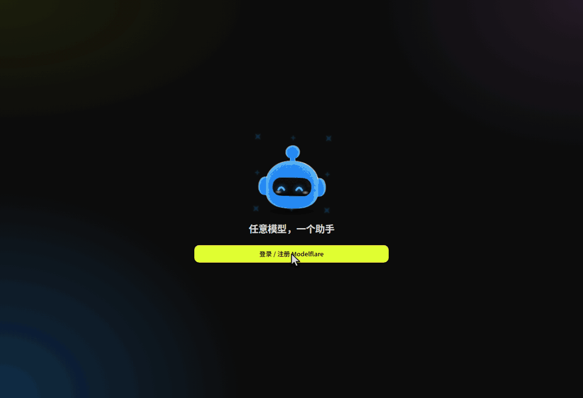
</p>

# 🤖 AnyModelBot

AnyModelBot — команда ИИ-ботов для Windows, macOS и Linux, которая работает на вашем компьютере. У каждого бота свои характер, модель по умолчанию, рабочая папка и память. Общайтесь в приложении или подключите WeChat, Feishu, Telegram, Slack и Discord. Бот читает и записывает файлы, выполняет команды, а после вашего разрешения управляет рабочим столом; перед записью за пределами рабочей папки он спросит вас.

Разговоры, память, файлы и API-ключи остаются на вашем устройстве. Модели можно получать через [Modelflare](https://modelflare.dev/?utm_source=anymodelbot&utm_campaign=amb_readme) (войдите и платите по использованию) или со своими официальными API-ключами напрямую у поставщика. У самого AnyModelBot нет платы за подписку.

Готов к работе сразу после установки: фоновые задачи, правила по расписанию и список того, что ждёт вашего решения, уже встроены.

**0.1.34:** журнал до запроса блокировки, параметр `--diagnose-startup` и улучшенная активация окна при повторном запуске. Это помогает исследовать #71; причина на Win11 Build 26300 ещё не подтверждена. [История изменений](./CHANGELOG_ru.md#0134---2026-11-14)

📥 [Скачать](#-скачать-и-запустить) · 🌠 [Снимки экрана](#-снимки-экрана) · 🌟 [Возможности](#-основные-возможности) · 🆚 [Сравнение](#-anymodelbot-и-grok-bot-openai-dots-и-claude-duet) · 🔐 [Приватность](#-как-это-работает-и-приватность)

⭐ Нравится AnyModelBot? Поставьте звезду репозиторию, чтобы следить за новыми выпусками.

---

<a href="https://modelflare.dev/sign-up?utm_source=anymodelbot&utm_campaign=amb_readme">
  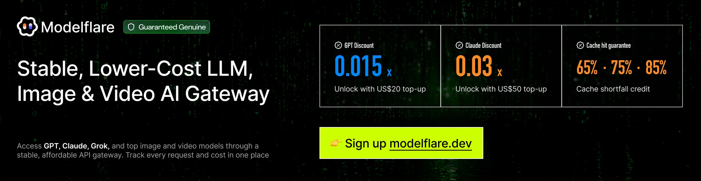
</a>

Проще всего получить модели через **[Modelflare](https://modelflare.dev/?utm_source=anymodelbot&utm_campaign=amb_readme)**: войдите и пользуйтесь моделями, не запрашивая отдельные ключи у каждого поставщика (о прямом подключении см. раздел [Любая модель](#-любая-модель-через-modelflare-или-официальные-api)). Доступные модели, цены и текущие предложения смотрите на [Modelflare](https://modelflare.dev/?utm_source=anymodelbot&utm_campaign=amb_readme) и в [прайс-листе](https://modelflare.dev/pricing?utm_source=anymodelbot&utm_campaign=amb_readme).

**Кредиты Bot:** новые аккаунты получают кредиты Bot при регистрации, а подписка Modelflare добавляет ещё 10% от объёма тарифа; актуальные условия — на сайте Modelflare. Кредиты Bot можно тратить только в AnyModelBot: запросы из приложения расходуют их в первую очередь, а остаток виден в левом нижнем углу.

**[Зарегистрироваться в Modelflare →](https://modelflare.dev/sign-up?utm_source=anymodelbot&utm_campaign=amb_readme)** ·
[Цены](https://modelflare.dev/pricing?utm_source=anymodelbot&utm_campaign=amb_readme) ·
[Документация API](https://docs.modelflare.dev/?utm_source=anymodelbot&utm_campaign=amb_readme) ·
[Центр доверия](https://modelflare.dev/trust?utm_source=anymodelbot&utm_campaign=amb_readme) ·
[X](https://x.com/modelflare_dev)

**Как AnyModelBot использует Modelflare**

- **Один вход.** При первом запуске откроется браузер для входа или регистрации в Modelflare. Приложение само подключит устройство — копировать ключ не нужно, а после подтверждения вы вернётесь в приложение. Если модели по умолчанию ещё нет, приложение выберет недорогую модель с поддержкой инструментов. В Docker или на сервере войдите в браузере на любом устройстве и вставьте полученную ссылку в приложение.
- **Все модели в одном списке.** Модели Modelflare появляются автоматически; рядом указаны размер контекста, возможности и ориентировочные цены.
- **Оплата по использованию.** Баланс и ссылка «Пополнить» всегда видны в левом нижнем углу (вместе с остатком кредитов Bot в процентах, если они есть), а уведомления о снижении баланса и расходы по дням — в приложении. Перед выбором модели можно свериться с открытым прайс-листом и официальными ценами.
- **Понятные границы.** Запросы проходят через Modelflare к выбранному поставщику, а Modelflare хранит журналы запросов. Что именно и как долго хранится, описано в [Центре доверия](https://modelflare.dev/trust?utm_source=anymodelbot&utm_campaign=amb_readme). Остальные данные остаются на устройстве ([подробнее](#-как-это-работает-и-приватность)).

---

# 📥 Скачать и запустить

Выберите платформу. На странице каждого выпуска есть все установщики и файл `SHA256SUMS`.

| Платформа | Архитектура | Установщик | |
| :--- | :--- | :--- | :--- |
| ![Windows][win-badge] | x64 | `anymodel-bot-<version>-win-x64.exe` | [Скачать][releases-link] |
| ![Windows][win-badge] | arm64 | `anymodel-bot-<version>-win-arm64.exe` | [Скачать][releases-link] |
| ![macOS][mac-badge] | Apple silicon | `anymodel-bot-<version>-mac-arm64.dmg` | [Скачать][releases-link] |
| ![macOS][mac-badge] | Intel | `anymodel-bot-<version>-mac-x64.dmg` | [Скачать][releases-link] |
| ![Linux][linux-badge] | x64 | `anymodel-bot-<version>-linux-x86_64.AppImage` | [Скачать][releases-link] |
| ![Linux][linux-badge] | arm64 | `anymodel-bot-<version>-linux-arm64.AppImage` | [Скачать][releases-link] |

<p align="center">
  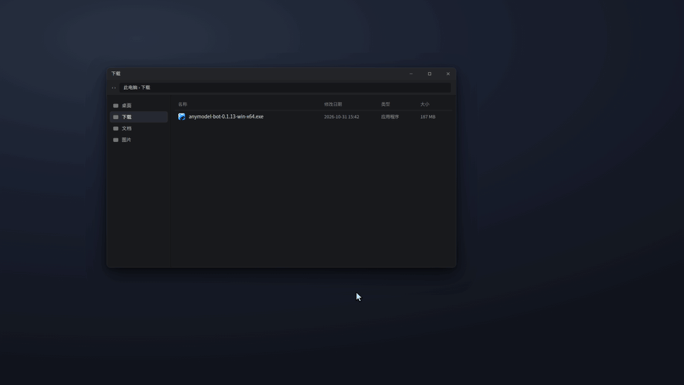
</p>

**Первый запуск.** Если Windows показывает предупреждение, выберите *«Подробнее → Выполнить в любом случае»*. Приложение для macOS подписано Developer ID и прошло нотарификацию Apple: перенесите его в «Программы», запустите и нажмите «Открыть», если появится подтверждение загрузки из интернета. В Linux разрешите выполнение AppImage (`chmod +x`) и запустите его. Закрытие окна прячет AnyModelBot в трей; выйти можно из меню трея или настроек.

**Проверка загрузки.**

```bash
sha256sum -c SHA256SUMS --ignore-missing
```

В macOS используйте `shasum -a 256 <file>`, в Windows PowerShell — `Get-FileHash <file>`. Сравните результат со строкой в `SHA256SUMS`.

**Запуск в Docker на NAS или сервере** — образ поддерживает x64 и arm64.

```bash
docker run -d --name amb -p 3600:3600 -v amb-data:/data ghcr.io/modelflare-ai/anymodel-bot
docker exec amb cat /data/ui-token   # затем откройте http://<host>:3600/?token=<token>
```

Не открывайте порт 3600 напрямую в интернет.

**Запуск из исходников**

```bash
git clone https://github.com/modelflare-ai/AnyModelBot.git
cd AnyModelBot
npm install
npm run setup      # загружает и собирает встроенный шлюз
npm start          # запускает локальную консоль на http://127.0.0.1:3600/
```

Для сборки из исходников нужны Node.js 22.13+ и Go 1.26.8+. Сборка своего Docker-образа описана в [руководстве разработчика](./docs/development_ru.md).

# 🌠 Снимки экрана

На снимках показан интерфейс на упрощённом китайском. Приложение также поддерживает английский, японский, корейский, русский, испанский и португальский (Бразилия); язык переключается в настройках.

<picture>
  <source media="(prefers-color-scheme: dark)" srcset="docs/assets/screenshots/chat-dark.webp">
  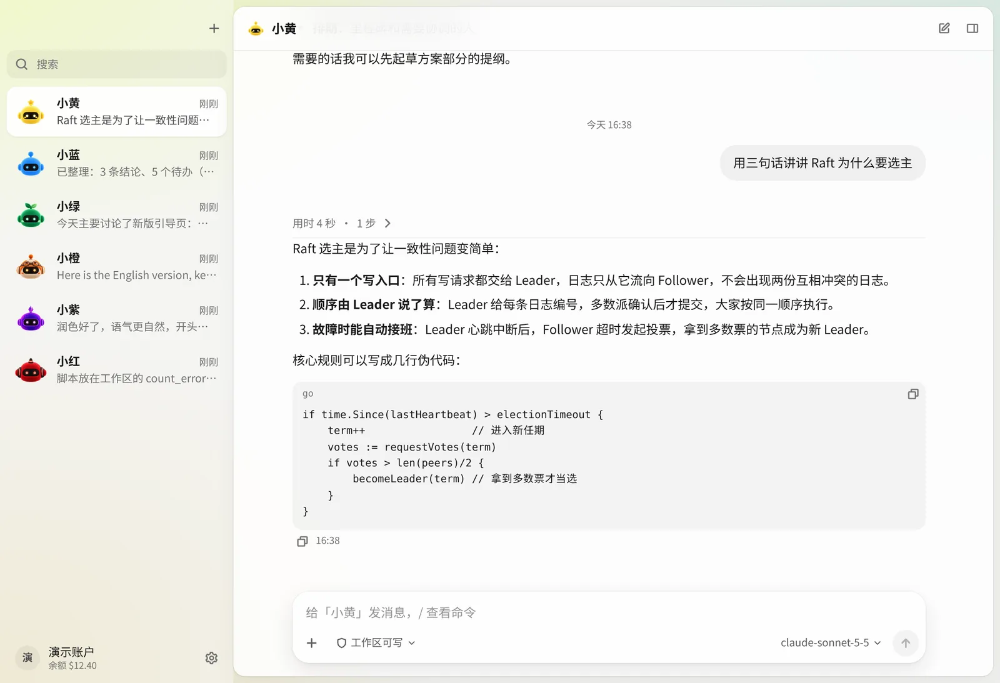
</picture>

<p align="center"><i>Разговор с ботом. Ответы поддерживают Markdown и код; в поле ввода видна текущая модель.</i></p>

<picture>
  <source media="(prefers-color-scheme: dark)" srcset="docs/assets/screenshots/agent-dark.webp">
  
</picture>

<p align="center"><i>Каждый шаг бота виден. Действия за пределами рабочей папки ждут вашего разрешения.</i></p>

<picture>
  <source media="(prefers-color-scheme: dark)" srcset="docs/assets/screenshots/models-dark.webp">
  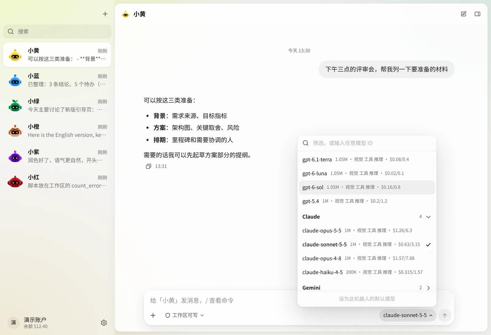
</picture>

<p align="center"><i>Выбирайте модель Modelflare отдельно для каждого разговора. Рядом указаны контекст, возможности и ориентировочные цены.</i></p>

<picture>
  <source media="(prefers-color-scheme: dark)" srcset="docs/assets/screenshots/memory-dark.webp">
  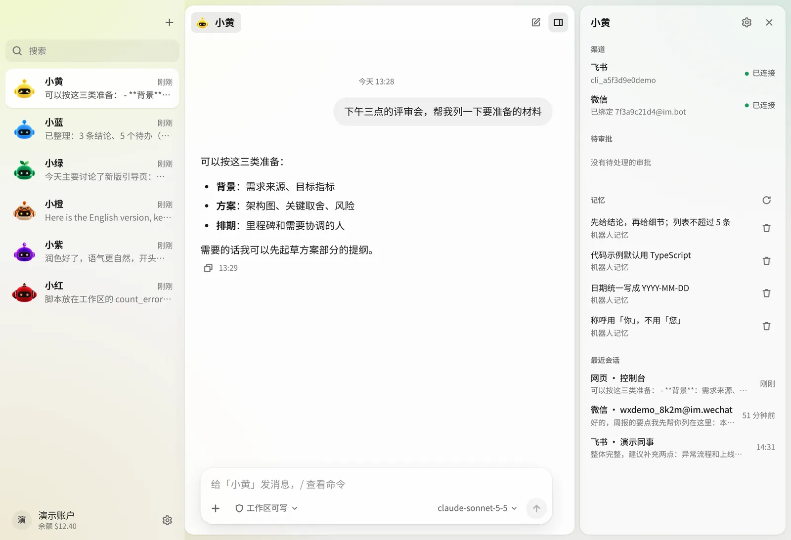
</picture>

<p align="center"><i>Память, каналы и сеансы каждого бота на одной панели.</i></p>

<picture>
  <source media="(prefers-color-scheme: dark)" srcset="docs/assets/screenshots/modelflare-dark.webp">
  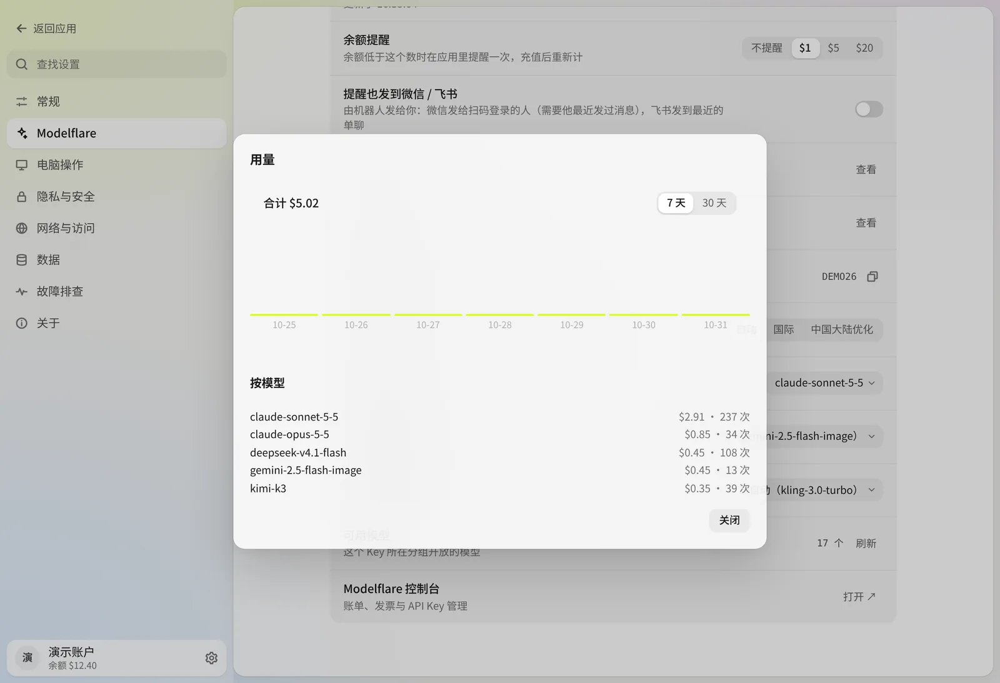
</picture>

<p align="center"><i>Аккаунт Modelflare в приложении: баланс, расходы и настройки по умолчанию.</i></p>

<picture>
  <source media="(prefers-color-scheme: dark)" srcset="docs/assets/screenshots/bots-dark.webp">
  
</picture>

<p align="center"><i>Шесть персонажей помогают различать ботов. Их глаза следят за указателем.</i></p>

# 🌟 Основные возможности

## 🤖 Боты, которые делают работу

Бот — больше, чем окно чата: у него есть характер, модель по умолчанию, собственные рабочая папка и память.

- **Столько ботов, сколько нужно**: у каждого свои характер, модель, рабочая папка и аватар.
- **Каким будет каждый бот, решаете вы.** Описание роли — обычный текст, а шаблоны служат отправной точкой. Шесть аватаров меняют внешность, но не возможности.
- **Настоящая работа с файлами.** Боты читают и записывают файлы, выполняют команды в песочнице и отправляют результаты файлами в чат.
- **Три режима разрешений для каждого бота.** *Только чтение*, *Запись в рабочую папку* (по умолчанию: запись в собственную папку; перед записью за её пределами бот спросит вас) и *Полный доступ* (без песочницы; даже при полном доступе бот спросит, прежде чем удалить папку целиком).
- **Импорт навыков.** В разделе «Настройки бота → Навыки» выберите ZIP с `SKILL.md` (один навык на ZIP, до 20 МБ), просмотрите описание и добавьте навык. Навыки можно просматривать, включать, отключать и удалять; повторный импорт с тем же именем предлагает замену. Изменения вступают в силу после завершения текущей работы. [Руководство по навыкам](./docs/skills_ru.md).
- **Карточки подтверждения.** Действия с записью за пределами рабочей папки останавливаются до вашего ответа.
- **Уведомление после перезапуска.** Если приложение закрыли или оно завершилось с ошибкой во время обработки, при следующем запуске в разговоре появится уведомление. Запрос можно отправить заново; автоматически он не повторяется.
- **Групповые чаты.** Создайте группу и добавьте ботов. Отвечает тот, кого вы упомянули через @; без упоминания продолжает последний ответивший. Боты тоже могут передавать слово другим участникам через @. У каждого остаются свои модель, папка и память; расходы учитываются отдельно.
- **Поиск по переписке.** Ищите все сообщения, сохранённые на устройстве, через боковую панель. Фильтруйте по боту, чату, каналу и дате и переходите к исходному сообщению. `Ctrl/Cmd+Shift+F` открывает общий поиск, `Ctrl/Cmd+F` — поиск в текущем чате. Модель при поиске не вызывается. Пока вы ничего не ввели, окно поиска показывает недавние чаты по датам.
- **Команды со слешем**, например `/model` и `/reset`, работают в приложении и всех каналах. В мессенджерах `/bot` переключает бота.

<p align="center">
  
</p>

## 🧩 Готовые боты

Если не хотите писать персону сами, используйте готового бота из раздела «Обзор». У каждого бота свой интерфейс: при открытии он показывает пример, а устанавливается только после первого сообщения.

Интерфейсы, примеры, инструкции и навыки официальных ботов входят в установщик. При первом открытии и установке пакеты ботов не скачиваются. Обновления приходят вместе с приложением и сохраняют данные существующих проектов. Вызовам моделей и исследованиям в интернете нужна сеть. Каждый бот — это рабочее пространство: список работ слева, содержимое справа, «Создать» открывает пошаговую форму, верхняя панель переключает на полный чат, а в поле ввода можно выбрать модель.

- **Исследование компаний:** Изучает компании на вашем компьютере: сводки и PDF со ссылками на источники.
- **Мастер PPT:** Делает редактируемые слайды из документов и тем, правит готовые презентации.
- **Киностудия:** Короткие видео и сериалы: от сценария и раскадровки до озвучки и монтажа.
- **Анализ акций США:** Изучает компании США по документам SEC, каждое число в отчёте можно проверить.

Для Киностудии нужны AnyModelBot 0.1.23 или новее, Python 3.10+ и FFmpeg (включая ffprobe) на вашем устройстве. Изображения и видео создаются через Modelflare с оплатой по использованию; проекты и медиа хранятся на вашем устройстве.

Подробнее на [странице ботов на нашем сайте](https://anymodel.bot/ru/bots).

## ⏳ Работает в фоне и обращается только по делу

- **Фоновые задачи.** Долгую работу — исследование, отчёт, сортировку файлов — или прямую просьбу «сделай в фоне» бот превращает в фоновую задачу, а вы продолжаете общаться. Результат приходит в исходный разговор.
- **Дополнения к задачам.** Процитируйте результат в WeChat или ответьте на него в Feishu, чтобы продолжить работу над той же задачей.
- **Правила.** Просьба «каждое утро в 8 проверяй цену X и сообщай, если она ниже 200» создаёт правило с проверкой по расписанию и уведомлениями только о важном. Чтобы сначала оценить поведение, скажите «сначала наблюдай»: бот запишет предполагаемые сообщения, ничего не отправляя и не меняя файлы. Когда результат устроит, включите выполнение.
- **Требует внимания.** Ответы, разрешения и повторные попытки, которых боты ждут от вас, собраны в одной строке боковой панели. Она появляется только при необходимости. В разделе «Задачи» панели сведений видны задачи, правила и каждый шаг их работы.
- **Тишина по умолчанию.** Отправляются только результаты, вопросы для решения и ошибки, без промежуточного прогресса. Тихие часы — с 22:00 до 08:00. Самостоятельные сообщения ограничены за день: 3 в WeChat, 5 в других каналах; остальные объединяются в одно.
- **Бюджеты.** У каждой задачи и правила есть бюджет: 1 доллар США на задачу, 0,10 на запуск правила и 3 в месяц. При исчерпании бот останавливается и спрашивает вас. Значения меняются в сведениях о задаче и редакторе правила.
- **Пауза в любой момент.** Переключатель в настройках бота › «Инициативные сообщения» приостанавливает фоновую работу; чат продолжает работать.
- **Уборка за собой.** Задачи и журналы запусков хранятся 30 дней. Папка задачи, не использовавшаяся 30 дней, удаляется без подтверждения. Дата видна в сведениях о задаче; кнопка «Сохранить» предотвращает удаление. Журналы экспортируются в Markdown.

Среда выполнения построена на [DeepSeek Harness](https://github.com/deepseek-ai/deepseek-harness), а архитектура опирается на [прототип суперагента DeepSeek](https://github.com/deepseek-ai/dsh-superagent-prototype). Подробная статья на китайском: [Суперагент AnyModelBot](./docs/blog/superagent.md).

## 🖥️ Управляет компьютером, создаёт изображения и видео

- **Управление компьютером** работает через встроенный [Cua Driver](https://github.com/trycua/cua). По умолчанию действия автоматические. Включите у бота *подтверждение изменений интерфейса*, и каждый клик и ввод будут ждать вас. Чтение экрана не требует подтверждения. В macOS это бета-возможность: разрешения «Универсальный доступ» и «Запись экрана» запрашиваются, только когда они впервые понадобятся боту, а в чате указано, какого не хватает.
- **Создание изображений и видео** начинается сразу: при неточном запросе бот выбирает разумное толкование. Он спрашивает только при оценке стоимости выше 0,50 доллара США: показывает модель и запрос, позволяя сразу сменить модель. Постоянное подтверждение включается в настройках бота.

<p align="center">
  
</p>

<p align="center">
  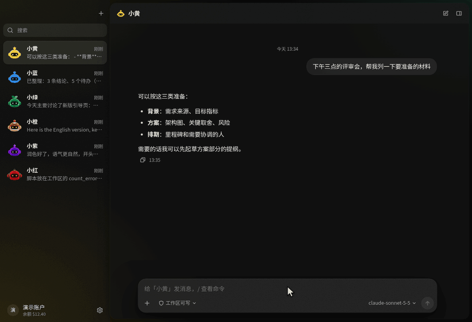
</p>

## 🌐 Любая модель через Modelflare или официальные API

- **Войдите один раз**, и модели Modelflare появятся автоматически.
- **Или используйте свои официальные API-ключи.** Поддерживаются OpenAI, Anthropic, Google Gemini, xAI, DeepSeek, Kimi, GLM, Qwen, MiniMax и Mistral. Ключи хранятся на вашем устройстве, запросы идут напрямую поставщику, минуя Modelflare, а счёт выставляет сам поставщик. Генерация изображений и видео пока доступна только через Modelflare.
- **Один список для всех.** GPT, Claude, Gemini, Grok, DeepSeek, Kimi, GLM и другие — с размером контекста, метками возможностей и ориентировочной ценой.
- **Выбор для каждого разговора** или модель по умолчанию для бота. Для упорядочивания памяти и передачи контекста можно назначить отдельную модель.
- **Три домена API.** Выберите `modelflare.dev`, `origin.modelflare.dev` или `cf.modelflare.dev` и сравните время ответа в настройках. AnyModelBot не переключает домены автоматически.
- **Оплата по использованию.** Встроены баланс кошелька, уведомления о его снижении, расходы по дням и отдельные бюджетные ключи ботов. У самого AnyModelBot нет платы за подписку.

<p align="center">
  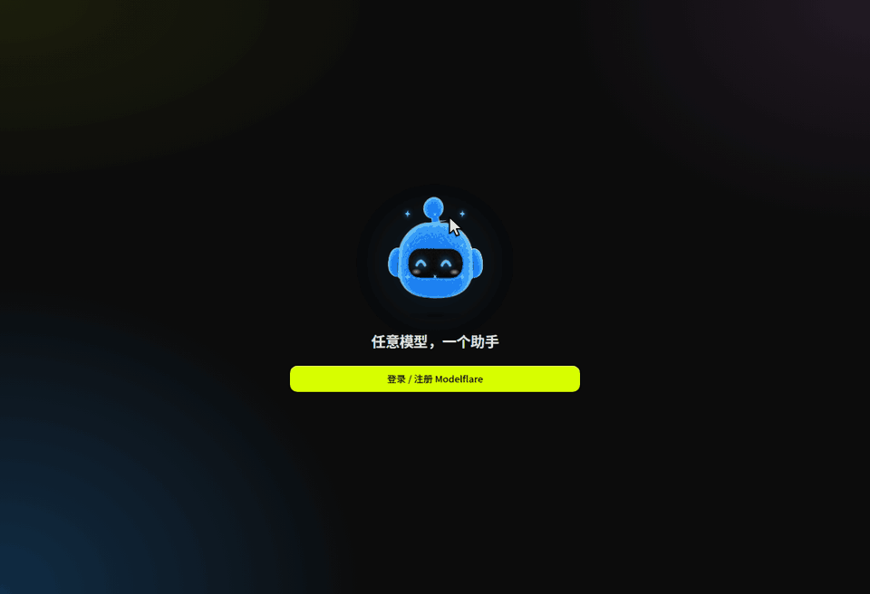
</p>

<p align="center">
  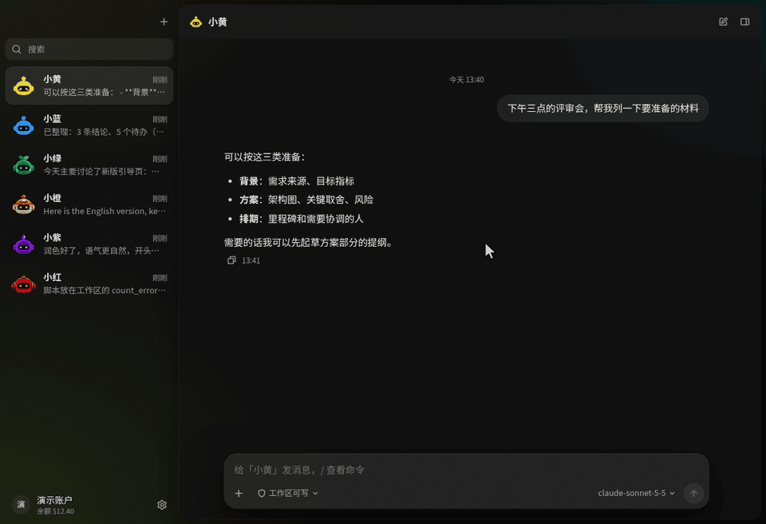
</p>

## 🧠 Помнит важное и доступен отовсюду

- **Память между разговорами.** У каждого бота, группы и команды своя память в Markdown — они не смешиваются. То, что похоже на пароли или ключи, не запоминается.
- **Длинные чаты остаются удобными.** Управление контекстом сжимает его или начинает новый сегмент с краткой заметкой до заполнения окна.
- **Аккаунты общие для всех ботов.** Добавьте аккаунты WeChat, Feishu, Telegram, Slack и Discord один раз в разделе «Настройки › Каналы чата». Все боты используют их; для каждого канала можно добавить несколько аккаунтов с именами. В мессенджере отправьте `/bot name`, чтобы сменить бота.
- **Подключение приложений.** В пункте «Подключить приложения» меню аватара есть встроенные коннекторы для Feishu, Tencent Docs, DingTalk, Amap, Yuque, Notion, GitHub, Linear, Atlassian и Canva; можно добавить и собственные коннекторы MCP (удалённые сервисы или локальные команды). Достаточно подключить один раз — по умолчанию приложение доступно всем ботам, доступ можно сузить по ботам и по инструментам. Чтение выполняется сразу, перед записью бот спрашивает, а удаление и отправка наружу всегда требуют подтверждения.
- **WeChat и Feishu.** Подключите WeChat по QR-коду или бота Feishu с потоковыми карточками ответов. WeChat также поддерживает изображения и файлы.
- **Telegram, Slack и Discord.** Вставьте токен в разделе «Настройки › Каналы чата». Публичный адрес не нужен. Ответы появляются по мере написания; изображения и файлы работают в обе стороны. Пока доступны только личные сообщения; на вопросы и запросы разрешения отвечают текстом.
- **Четыре способа запуска.** Настольное приложение, командная строка, Docker или локальная веб-консоль `127.0.0.1:3600`.

<p align="center">
  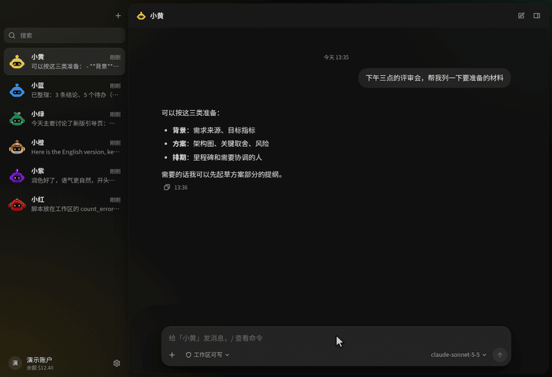
</p>

<p align="center">
  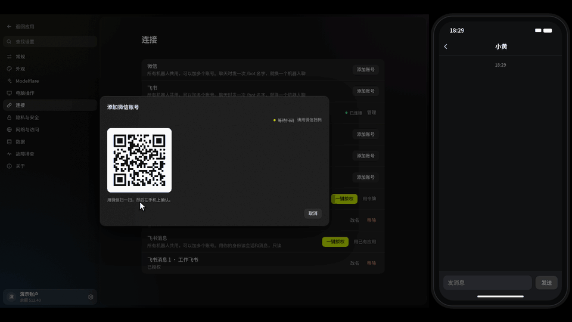
</p>

## 🔒 Локальные данные и приятный интерфейс

- **Данные остаются у вас.** Разговоры, память, файлы и API-ключи хранятся на устройстве. Локальная консоль слушает только `127.0.0.1`; настольное приложение создаёт новый токен доступа при каждом запуске.
- **Бот подчиняется вам.** По умолчанию он отвечает владельцу и разрешённым пользователям. В WeChat владелец — аккаунт, отсканировавший QR-код; в Feishu, Telegram, Slack и Discord — первый написавший после подключения, то есть вы. Остальные получают короткое уведомление без вызова модели. Разрешить доступ можно на панели сведений или ответом `yes <code>` в чате.
- **Ответы не теряются.** Ответ сохраняется локально до отправки. Сетевые ошибки вызывают повторные попытки, после перезапуска отправка продолжается. При закрытом 24-часовом окне WeChat ответ ждёт вашего следующего сообщения.
- **Телеметрия выключена.** Телеметрия встроенного драйвера управления компьютером отключена; встроенный шлюз запускается без автообновления.
- **Обновления из приложения.** Начиная с 0.1.29, в установленном настольном приложении по умолчанию включено «Настройки → Общие → Автоматически скачивать обновления». Новая версия скачивается в фоне, затем появляется «Перезапустить и обновить». Установка запускается по вашему нажатию, когда нет выполняющихся задач. Отключите настройку для ручного скачивания. Пользователям 0.1.28 и более ранних версий нужно один раз вручную установить 0.1.29 или новее. Docker и запуск из исходников обновляются вручную. Начиная с 0.1.30, после обновления при первом запуске показывается, что изменилось; уведомление о новой версии показывает описание до обновления, а история изменений всегда доступна в «Настройки → О приложении».
- **Светлая, тёмная или системная тема.** Шесть персонажей-ботов следят глазами за указателем.
- **Трей и автозапуск.** Закройте окно, чтобы спрятать его в трей. В macOS и Windows доступен автозапуск.

<p align="center">
  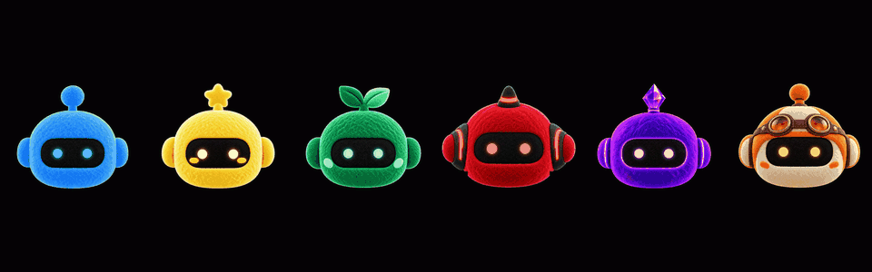
</p>

> [!NOTE]
> Возможности зависят от модели, операционной системы и выданных разрешений. Управлению компьютером нужен сеанс рабочего стола; в macOS эта функция находится в бета-версии. Запросы идут выбранному поставщику (напрямую с официальным API-ключом, иначе через Modelflare); см. [принцип работы и приватность](#-как-это-работает-и-приватность).

# 🆚 AnyModelBot и Grok Bot, OpenAI dots и Claude Duet

Во второй половине 2026 года один за другим вышли [Grok Bot](https://x.ai/bot) от xAI, [dots](https://openai.com/index/introducing-dots/) от OpenAI и Claude Duet от Anthropic. Они тоже работают за вас в фоне и обращаются к вам, когда нужно решение. AnyModelBot решает похожие задачи по-другому: у него открытый код, он работает на вашем устройстве и поддерживает широкий выбор моделей.

| | AnyModelBot | Grok Bot | OpenAI dots | Claude Duet |
| :--- | :--- | :--- | :--- | :--- |
| Открытый код | ✅ MIT | — | — | — |
| Где работает | Ваш компьютер или сервер | Облачный компьютер xAI | Облачный компьютер OpenAI | Облако Anthropic |
| Модели | GPT, Claude, Gemini, Grok и другие через Modelflare или официальные API | В основном Grok от xAI | Модели OpenAI | Claude (Opus 5.5) |
| Стоимость | Приложение бесплатно, модели — по токенам | Подписка | Подписка ChatGPT Pro / Business Premium | Подписка Claude Pro / Max |
| Где общаться | Приложение для Windows, macOS и Linux, Docker, WeChat, Feishu, Telegram, Slack, Discord | Настольное приложение, iPhone | ChatGPT, Slack, Teams | iOS, Android, claude.ai |
| Доступность | Можно скачать сейчас | Бета | Отдельные рынки | Исследовательская предварительная версия, очередь в США |

AnyModelBot тоже работает в фоне: переданная ему задача может завершиться и прислать результат в мессенджер, а всё, что требует вашего разрешения или ответа, появится в разделе «Требует внимания» на боковой панели. Все шаги видны; действия вне рабочей папки требуют подтверждения.

> [!NOTE]
> Информация о других продуктах взята из открытых публикаций по состоянию на октябрь 2026 года и могла измениться. Сверяйтесь с официальными источниками поставщиков. Grok Bot, dots и Claude Duet — продукты и товарные знаки xAI, OpenAI и Anthropic соответственно. AnyModelBot с ними не связан.

# 🔐 Как это работает и приватность

<picture>
  <source media="(prefers-color-scheme: dark)" srcset="docs/assets/diagrams/data-flow-dark.svg">
  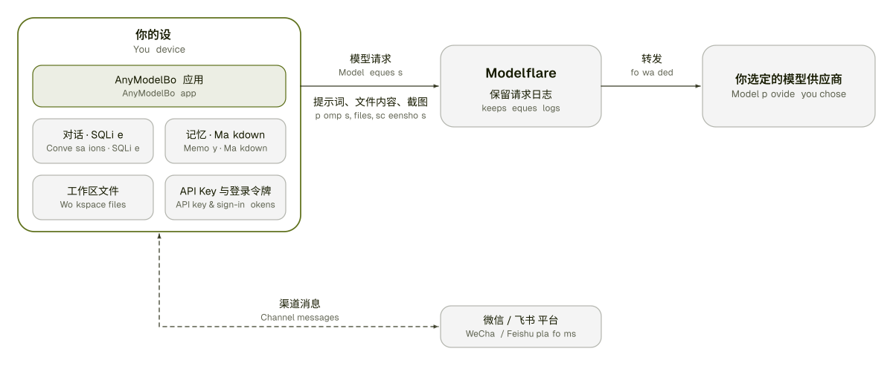
</picture>

| Остаётся на устройстве | Покидает устройство |
| :--- | :--- |
| Разговоры и сеансы в локальной SQLite | Запросы, файлы и результаты инструментов, нужные модели; передаются выбранному поставщику (напрямую с официальным API-ключом, иначе через Modelflare) |
| Память в Markdown-файлах | Снимки экрана, когда вы просите бота посмотреть на экран при управлении компьютером |
| Файлы в рабочей папке каждого бота | Сообщения мессенджеров, проходящие через их платформы |
| API-ключ и токены входа | Вход в Modelflare на modelflare.dev |
| Подключение приложений | После подключения приложений (Feishu, Notion, GitHub и других) или добавления коннектора MCP боты читают и изменяют их содержимое; прочитанные данные также включаются в запросы к моделям |

Modelflare хранит журналы запросов; состав и сроки хранения описаны в [Центре доверия](https://modelflare.dev/trust?utm_source=anymodelbot&utm_campaign=amb_readme). Мы не заявляем, что данные полностью защищены от любых рисков: всё отправляемое модели покидает устройство. Полный перечень — в [документе о приватности](./docs/privacy_ru.md).

<picture>
  <source media="(prefers-color-scheme: dark)" srcset="docs/assets/diagrams/architecture-dark.svg">
  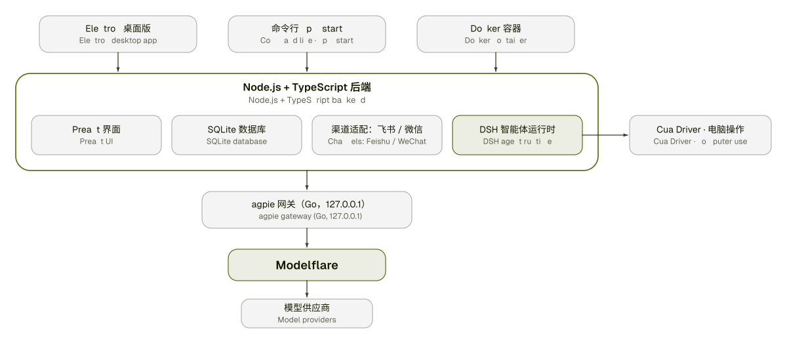
</picture>

| Уровень | Технологии |
| :--- | :--- |
| Интерфейс | Preact + htm, без этапа сборки |
| Серверная часть | Node.js 22.13+, TypeScript, `node:sqlite` |
| Настольная оболочка | Electron с треем |
| Шлюз моделей | [magpie](https://github.com/yetone/magpie) (Go, MIT), встроен и запускается приложением |
| Среда агента | [DeepSeek Harness](https://github.com/deepseek-ai/deepseek-harness) (MIT), отдельный процесс |
| Управление компьютером | Встроенный [Cua Driver](https://github.com/trycua/cua) |
| Каналы | Feishu (постоянное соединение и потоковые карточки), WeChat (iLink), Telegram (long polling), Slack (Socket Mode), Discord (Gateway) |
| Подключение приложений | Встроенные коннекторы: Feishu, Tencent Docs, DingTalk, Amap, Yuque, Notion, GitHub, Linear, Atlassian, Canva; пользовательские MCP: Streamable HTTP (совместимо с SSE), локальные команды |
| Тесты и CI | Vitest, GitHub Actions |

# 📝 Планы

Направления, которые мы изучаем. Это не обещания, а порядок не является расписанием. Изменения выпущенных версий — в [истории изменений](./CHANGELOG_ru.md).

- [x] **Задачи по расписанию:** выполнение по таймеру, реализовано как правила выше.
- [x] **Групповые чаты в приложении:** создавайте группы и общайтесь с несколькими ботами сразу.
- [ ] **Группы в мессенджерах:** сейчас каналы поддерживают личные чаты.
- [x] **Многоязычный интерфейс:** упрощённый китайский, английский, японский, корейский, русский, испанский и португальский (Бразилия); выбор в настройках.
- [ ] **Управление macOS:** проверить прямой режим на большем числе реальных устройств и вывести из бета-версии.
- [ ] **Почта, календарь и запуск по событиям:** подключать аккаунты и запускать правила при событии — письме от определённого человека или скором начале встречи, — а не только по таймеру. События из внешнего содержимого получают меньше прав, чтобы чужой текст не мог отдавать боту команды.
- [ ] **Постоянный хостинг, резервирование и перенос:** при выключенном компьютере правила не работают. Хотим упростить развёртывание на своём сервере в один клик, перенос чатов, памяти и аккаунтов, резервное копирование и восстановление.
- [ ] **Свои MCP-серверы:** сейчас доступны только встроенные инструменты и аккаунты. Открытая настройка позволит самостоятельно подключать GitHub, Linear и другие сервисы.
- [ ] **Совместная работа ботов:** передача задач между ботами, например подготовка и проверка текста разными моделями с отдельным учётом расходов.
- [ ] **Расшифровка голосовых:** сейчас боты не слышат голосовые Telegram, а WeChat зависит от расшифровки самой платформы.
- [ ] **Отдельное мобильное приложение:** пока боты доступны через WeChat, Feishu, Telegram, Slack и Discord.

Есть другая идея? Создайте [issue](https://github.com/modelflare-ai/AnyModelBot/issues) или [обсуждение](https://github.com/modelflare-ai/AnyModelBot/discussions). Взятые в работу идеи отмечаются меткой [`roadmap`](https://github.com/modelflare-ai/AnyModelBot/labels/roadmap).

# 🤝 Участие в разработке

Будем рады сообщениям об ошибках, исправлениям, документации и идеям.

1. Сначала проверьте существующие [issues](https://github.com/modelflare-ai/AnyModelBot/issues) и [обсуждения](https://github.com/modelflare-ai/AnyModelBot/discussions). Начать удобно с задач с меткой [`good first issue`](https://github.com/modelflare-ai/AnyModelBot/labels/good%20first%20issue).
2. Сделайте форк и создайте ветку от `master`.
3. Запустите локально и внесите изменения:

   ```bash
   npm install
   npm run setup          # загружает и собирает встроенный шлюз
   npm run electron:dev   # настольное приложение в режиме разработки
   npm run typecheck && npm test
   ```

4. Откройте pull request в `master`, объяснив, что изменилось и зачем. Для изменений крупнее небольшого исправления сначала создайте issue и согласуйте подход.

Полное [руководство по участию](./CONTRIBUTING_ru.md). Об уязвимостях сообщайте по [правилам безопасности](./SECURITY_ru.md), не создавая публичный issue.

# 🔗 Связанные проекты

- [Modelflare](https://modelflare.dev/?utm_source=anymodelbot&utm_campaign=amb_readme): шлюз ИИ-API, предоставляющий модели AnyModelBot.
- [magpie](https://github.com/yetone/magpie): встроенный шлюз на Go (MIT).
- [DeepSeek Harness](https://github.com/deepseek-ai/deepseek-harness): среда агента (MIT).
- [Cua](https://github.com/trycua/cua): драйвер управления компьютером.
- [kimi-computer-use](https://github.com/songkeys/kimi-computer-use): мост управления macOS.
- [openclaw-weixin](https://github.com/Tencent/openclaw-weixin): исходная реализация канала WeChat, которую мы портировали (MIT).
- [DS Bot](https://github.com/Fei2411/DS-Bot): источник идей памяти и управления контекстом (Apache-2.0).

Все лицензии и уведомления: [THIRD_PARTY_NOTICES_ru.md](./THIRD_PARTY_NOTICES_ru.md).

# 💬 Сообщество

- **Вопросы и идеи:** [GitHub Discussions](https://github.com/modelflare-ai/AnyModelBot/discussions)
- **Ошибки и пожелания:** [GitHub Issues](https://github.com/modelflare-ai/AnyModelBot/issues)
- **Почта:** [support@anymodel.bot](mailto:support@anymodel.bot)
- **Новости Modelflare:** [@modelflare_dev в X](https://x.com/modelflare_dev)

# 🚀 Участники

<a href="https://github.com/modelflare-ai/AnyModelBot/graphs/contributors">
  
</a>

# ⭐️ История звёзд

<a href="https://www.star-history.com/#modelflare-ai/AnyModelBot&Date">
  <picture>
    <source media="(prefers-color-scheme: dark)" srcset="https://api.star-history.com/svg?repos=modelflare-ai/AnyModelBot&type=Date&theme=dark" />
    <source media="(prefers-color-scheme: light)" srcset="https://api.star-history.com/svg?repos=modelflare-ai/AnyModelBot&type=Date" />
    
  </picture>
</a>

# 📜 Лицензия

AnyModelBot распространяется под [лицензией MIT](./LICENSE). Встроенное стороннее ПО сохраняет собственные лицензии; см. [THIRD_PARTY_NOTICES_ru.md](./THIRD_PARTY_NOTICES_ru.md) и папку [`LICENSES/`](./LICENSES).

<!-- link & badge references -->
[release-shield]: https://img.shields.io/github/v/release/modelflare-ai/AnyModelBot?include_prereleases&label=release&logo=data:image/svg%2bxml;base64,PHN2ZyB4bWxucz0iaHR0cDovL3d3dy53My5vcmcvMjAwMC9zdmciIHZpZXdCb3g9IjAgMCAxMDAgMTAwIj48cmVjdCB4PSIzIiB5PSI5IiB3aWR0aD0iOTQiIGhlaWdodD0iODIiIHJ4PSIzNiIgZmlsbD0iI2Q3ZmYwMCIvPjxyZWN0IHg9IjI5IiB5PSIzNiIgd2lkdGg9IjEzIiBoZWlnaHQ9IjI4IiByeD0iNi41IiBmaWxsPSIjMTYxYTAwIi8+PHJlY3QgeD0iNTgiIHk9IjM2IiB3aWR0aD0iMTMiIGhlaWdodD0iMjgiIHJ4PSI2LjUiIGZpbGw9IiMxNjFhMDAiLz48L3N2Zz4=&style=flat-square&labelColor=161a00&color=d7ff00
[downloads-shield]: https://img.shields.io/github/downloads/modelflare-ai/AnyModelBot/total?logo=github&logoColor=d7ff00&style=flat-square&labelColor=161a00&color=d7ff00
[stars-shield]: https://img.shields.io/github/stars/modelflare-ai/AnyModelBot?logo=github&logoColor=d7ff00&style=flat-square&labelColor=161a00&color=d7ff00
[license-shield]: https://img.shields.io/github/license/modelflare-ai/AnyModelBot?logo=opensourceinitiative&logoColor=d7ff00&style=flat-square&labelColor=161a00&color=d7ff00
[ci-shield]: https://img.shields.io/github/actions/workflow/status/modelflare-ai/AnyModelBot/ci.yml?branch=master&label=CI&logo=githubactions&logoColor=d7ff00&style=flat-square&labelColor=161a00&color=d7ff00
[platform-shield]: https://img.shields.io/badge/platform-Windows%20%7C%20macOS%20%7C%20Linux%20%7C%20Docker-d7ff00?style=flat-square&labelColor=161a00
[pricing-shield]: https://img.shields.io/badge/pricing-pay--as--you--go-d7ff00?style=flat-square&labelColor=161a00
[modelflare-shield]: https://img.shields.io/badge/Modelflare-modelflare.dev-d7ff00?style=flat-square&labelColor=161a00
[x-shield]: https://img.shields.io/badge/X-@modelflare__dev-d7ff00?style=flat-square&labelColor=161a00&logo=x&logoColor=d7ff00
[win-badge]: https://img.shields.io/badge/Windows-161a00?style=for-the-badge&logo=data:image/svg%2bxml;base64,PHN2ZyB4bWxucz0iaHR0cDovL3d3dy53My5vcmcvMjAwMC9zdmciIHZpZXdCb3g9IjAgMCAyNCAyNCIgZmlsbD0iI2Q3ZmYwMCI+PHJlY3QgeD0iMiIgeT0iMyIgd2lkdGg9IjkuNSIgaGVpZ2h0PSI4LjUiLz48cmVjdCB4PSIxMi41IiB5PSIzIiB3aWR0aD0iOS41IiBoZWlnaHQ9IjguNSIvPjxyZWN0IHg9IjIiIHk9IjEyLjUiIHdpZHRoPSI5LjUiIGhlaWdodD0iOC41Ii8+PHJlY3QgeD0iMTIuNSIgeT0iMTIuNSIgd2lkdGg9IjkuNSIgaGVpZ2h0PSI4LjUiLz48L3N2Zz4=
[mac-badge]: https://img.shields.io/badge/macOS-161a00?style=for-the-badge&logo=apple&logoColor=d7ff00
[linux-badge]: https://img.shields.io/badge/Linux-161a00?style=for-the-badge&logo=linux&logoColor=d7ff00

[releases-link]: https://github.com/modelflare-ai/AnyModelBot/releases
[stars-link]: https://github.com/modelflare-ai/AnyModelBot/stargazers
[license-link]: https://github.com/modelflare-ai/AnyModelBot/blob/master/LICENSE
[ci-link]: https://github.com/modelflare-ai/AnyModelBot/actions/workflows/ci.yml
[pricing-link]: https://modelflare.dev/pricing?utm_source=anymodelbot&utm_campaign=amb_readme
[modelflare-link]: https://modelflare.dev/?utm_source=anymodelbot&utm_campaign=amb_readme
[x-link]: https://x.com/modelflare_dev
