<p align="center">
  <a href="https://github.com/modelflare-ai/AnyModelBot/releases">
    
  </a>
</p>

<h1 align="center">
  <picture>
    <source media="(prefers-color-scheme: dark)" srcset="docs/assets/brand/wordmark-dark.svg">
    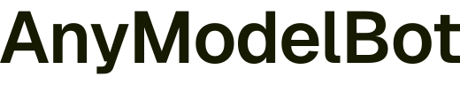
  </picture>
</h1>

<p align="center"><b>Kendi bilgisayarında bir yapay zeka bot ekibi. Her model, kullandıkça öde.</b></p>

<p align="center">
  <a href="https://anymodel.bot/tr/">Site</a> |
  <a href="https://github.com/modelflare-ai/AnyModelBot/releases">İndir</a> |
  <a href="./README.md">简体中文</a> |
  <a href="./README_zh-TW.md">繁體中文（台灣）</a> |
  <a href="./README_en.md">English</a> |
  <a href="./README_ja.md">日本語</a> |
  <a href="./README_ko.md">한국어</a> |
  <a href="./README_ru.md">Русский</a> |
  <a href="./README_es.md">Español</a> |
  <a href="./README_pt.md">Português (Brasil)</a> |
  Türkçe |
  <a href="https://modelflare.dev/?utm_source=anymodelbot&utm_campaign=amb_readme">Modelflare</a> |
  <a href="https://modelflare.dev/pricing?utm_source=anymodelbot&utm_campaign=amb_readme">Fiyatlar</a> |
  <a href="./docs/development_tr.md">Geliştirme</a> |
  <a href="https://github.com/modelflare-ai/AnyModelBot/issues">Geri bildirim</a>
</p>

<div align="center">

[![Sürüm][release-shield]][releases-link]
[![İndirme][downloads-shield]][releases-link]
[![Yıldız][stars-shield]][stars-link]
[![Lisans][license-shield]][license-link]
[![CI][ci-shield]][ci-link]

[![Platform][platform-shield]][releases-link]
[![Fiyat][pricing-shield]][pricing-link]
[![Modelflare][modelflare-shield]][modelflare-link]
[![X][x-shield]][x-link]

[![Discord][discord-shield]][discord-link]
[![Telegram][telegram-shield]][telegram-link]

</div>

<p align="center">
  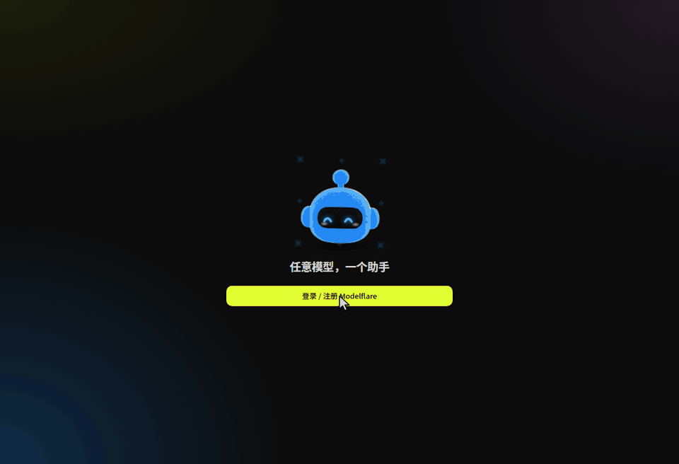
</p>

# 🤖 AnyModelBot

AnyModelBot, Windows, macOS ve Linux için kendi bilgisayarında çalışan bir yapay zeka bot ekibidir. Her botun kendi kişiliği, varsayılan modeli, çalışma alanı ve belleği vardır. Uygulamada sohbet edebilir veya WeChat, Feishu, Telegram, Slack ya da Discord bağlayabilirsin. İzin verdikten sonra dosya okuyup yazabilir, komut çalıştırabilir ve masaüstünü kullanabilir; çalışma alanının dışına yazmadan önce sorar.

Sohbetler, bellek, dosyalar ve API anahtarları cihazında kalır. Modeller [Modelflare](https://modelflare.dev/?utm_source=anymodelbot&utm_campaign=amb_readme) üzerinden gelebilir (oturum aç, kullandıkça öde) veya kendi resmi API anahtarlarından, doğrudan sağlayıcıya gider. AnyModelBot'un kendisinin abonelik ücreti yoktur.

Kurulumdan sonra kullanıma hazır: arka plan görevleri, zamanlanmış kurallar ve onayını bekleyen öğeler yerleşiktir.

**0.1.49:** Geleneksel Çince (Tayvan) desteği eklendi. Ayarlar → Genel → Dil bölümünde 繁體中文（台灣） seçeneğini veya sistem dilini seçin. [Değişiklik günlüğü](./CHANGELOG_tr.md#0149---2026-11-26)

📥 [İndir](#-paketi-indir-ve-çalıştır) · 🌠 [Ekran görüntüleri](#-ekran-görüntüleri) · 🌟 [Özellikler](#-temel-özellikler) · 🆚 [Karşılaştır](#-anymodelbot-vs-grok-bot-openai-dots-ve-claude-duet) · 🔐 [Gizlilik](#-nasıl-çalışır-ve-gizlilik)

⭐ AnyModelBot hoşuna gittiyse yeni sürümleri izlemek için depoya yıldız ver.

---

<a href="https://modelflare.dev/sign-up?utm_source=anymodelbot&utm_campaign=amb_readme">
  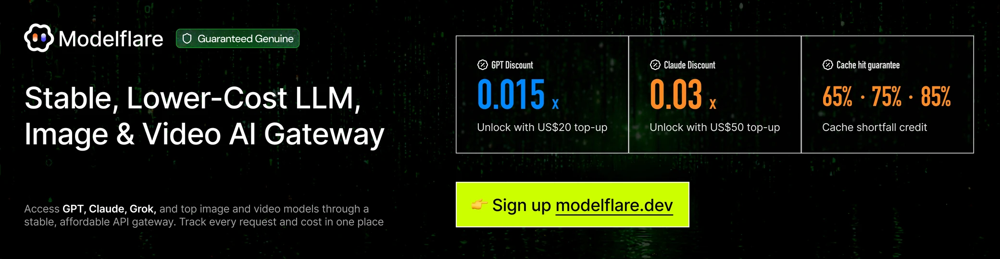
</a>

Modellere ulaşmanın en kolay yolu **[Modelflare](https://modelflare.dev/?utm_source=anymodelbot&utm_campaign=amb_readme)**: oturum aç ve modelleri kullan; her sağlayıcıdan ayrı bir anahtar istemene gerek yok (doğrudan bir sağlayıcıya gitmek için [Her model](#-her-model-modelflare-veya-resmi-api-üzerinden) bölümüne bak). Kullanılabilir modeller, fiyatlar ve güncel teklifler [Modelflare](https://modelflare.dev/?utm_source=anymodelbot&utm_campaign=amb_readme) ve [fiyat listesinde](https://modelflare.dev/pricing?utm_source=anymodelbot&utm_campaign=amb_readme).

**Bot kredisi**: yeni hesaplar kaydolunca bot kredisi alır ve Modelflare abonelikleri planın %10'u değerinde bot kredisi ekler; güncel koşullar için Modelflare sitesine bak. Bot kredisi yalnızca AnyModelBot'ta kullanılabilir. Uygulamadan gelen istekler önce onu kullanır ve Ayarlar → Modeller kalan tutarı gösterir.

**[Modelflare'e kaydol →](https://modelflare.dev/sign-up?utm_source=anymodelbot&utm_campaign=amb_readme)** ·
[Fiyat listesi](https://modelflare.dev/pricing?utm_source=anymodelbot&utm_campaign=amb_readme) ·
[API belgeleri](https://docs.modelflare.dev/?utm_source=anymodelbot&utm_campaign=amb_readme) ·
[Güven Merkezi](https://modelflare.dev/trust?utm_source=anymodelbot&utm_campaign=amb_readme) ·
[X](https://x.com/modelflare_dev)

**AnyModelBot Modelflare'i nasıl kullanır**

- **Bir kez oturum aç.** İlk açılış, Modelflare'de oturum açman (veya kaydolman) için tarayıcını açar. Uygulama sonra bu cihazı kendisi bağlar, kopyalanacak bir anahtar yoktur ve sen onaylayınca seni geri getirir. Henüz varsayılan modelin yoksa araç destekleyen düşük maliyetli bir model seçer. Docker'da veya bir sunucuda mı çalıştırıyorsun? Herhangi bir cihazdaki tarayıcıdan oturum aç, sonra aldığın bağlantıyı uygulamaya yapıştır.
- **Her model, tek seçici.** Modelflare modellerin kendiliğinden listelenir; her birinin yanında bağlam uzunluğu, yetenekler ve liste fiyatları durur.
- **Kullandığın kadar öde.** Bakiyen ve Bakiye yükle bağlantısı Ayarlar → Modeller içindedir (varsa kalan bot kredisi ve yüzdesiyle birlikte) ve düşük bakiye anımsatmaları ile günlük kullanım uygulamanın içinde görünür. Bir model seçmeden önce genel fiyat listesine bak ve resmi tarifelerle karşılaştır.
- **Dürüst bir sınır.** Model istekleri Modelflare üzerinden seçtiğin sağlayıcıya gider ve Modelflare istek günlüklerini tutar. Neyin ne kadar tutulduğu [Güven Merkezi](https://modelflare.dev/trust?utm_source=anymodelbot&utm_campaign=amb_readme) içindedir. Geri kalan her şey cihazında kalır ([ayrıntılar](#-nasıl-çalışır-ve-gizlilik)).

---

# 📥 Paketi indir ve çalıştır

Platformunu seç. Her sürüm sayfası tüm yükleyicileri ve bir `SHA256SUMS` dosyasını listeler.

| Platform | Mimari | Yükleyici | |
| :--- | :--- | :--- | :--- |
| ![Windows][win-badge] | x64 | `anymodel-bot-<version>-win-x64.exe` | [İndir][releases-link] |
| ![Windows][win-badge] | arm64 | `anymodel-bot-<version>-win-arm64.exe` | [İndir][releases-link] |
| ![macOS][mac-badge] | Apple silicon | `anymodel-bot-<version>-mac-arm64.dmg` | [İndir][releases-link] |
| ![macOS][mac-badge] | Intel | `anymodel-bot-<version>-mac-x64.dmg` | [İndir][releases-link] |
| ![Linux][linux-badge] | x64 | `anymodel-bot-<version>-linux-x86_64.AppImage` | [İndir][releases-link] |
| ![Linux][linux-badge] | arm64 | `anymodel-bot-<version>-linux-arm64.AppImage` | [İndir][releases-link] |

<p align="center">
  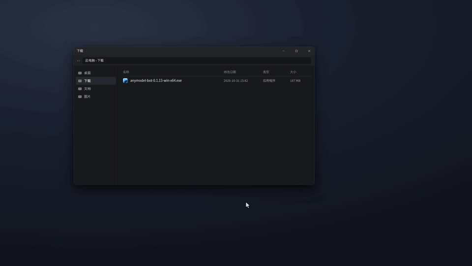
</p>

**İlk açılış.** Windows bir güvenlik uyarısı gösterirse *Daha fazla bilgi → Yine de çalıştır*ı seç. macOS uygulaması Developer ID ile imzalıdır ve Apple tarafından noter onaylıdır: Uygulamalar'a sürükle, aç ve bir internet indirmesini onaylaman istenirse Aç'ı seç. Linux'ta AppImage'ı çalıştırılabilir işaretle (`chmod +x`) ve çalıştır. Pencereyi kapatmak AnyModelBot'u sistem tepsisine gizler; sistem tepsisi menüsünden veya Ayarlar'dan çık.

**Bir indirmeyi doğrula.**

```bash
sha256sum -c SHA256SUMS --ignore-missing
```

macOS'ta `shasum -a 256 <file>` kullan; Windows PowerShell'de `Get-FileHash <file>`. Sonucu `SHA256SUMS` içindeki satırla karşılaştır.

**Bir NAS veya sunucuda Docker ile çalıştır** (imaj hem x64 hem arm64 kapsar)

```bash
docker run -d --name amb -p 3600:3600 -v amb-data:/data ghcr.io/modelflare-ai/anymodel-bot
docker exec amb cat /data/ui-token   # sonra http://<host>:3600/?token=<token> adresini aç
```

3600 portunu doğrudan internete açma.

**Kaynaktan çalıştır**

```bash
git clone https://github.com/modelflare-ai/AnyModelBot.git
cd AnyModelBot
npm install
npm run setup      # paketlenmiş ağ geçidini alır ve derler
npm start          # yerel konsolu http://127.0.0.1:3600/ adresinde açar (ilk seferde yazdırdığı belirteçli adresi kullan)
```

Kaynaktan derlemek için gereksinimler: Node.js 22.13+ ve Go 1.26.8+. Docker imajını kendin derlemek için [geliştirme kılavuzuna](./docs/development_tr.md) bak.

# 🌠 Ekran görüntüleri

Bu ekran görüntüleri Basitleştirilmiş Çince arayüzü gösterir. Uygulama ayrıca Geleneksel Çince (Tayvan), İngilizce, Japonca, Korece, Rusça, İspanyolca, Portekizce (Brezilya) ve Türkçeyi destekler; Ayarlar'dan değiştir.

<picture>
  <source media="(prefers-color-scheme: dark)" srcset="docs/assets/screenshots/chat-dark.webp">
  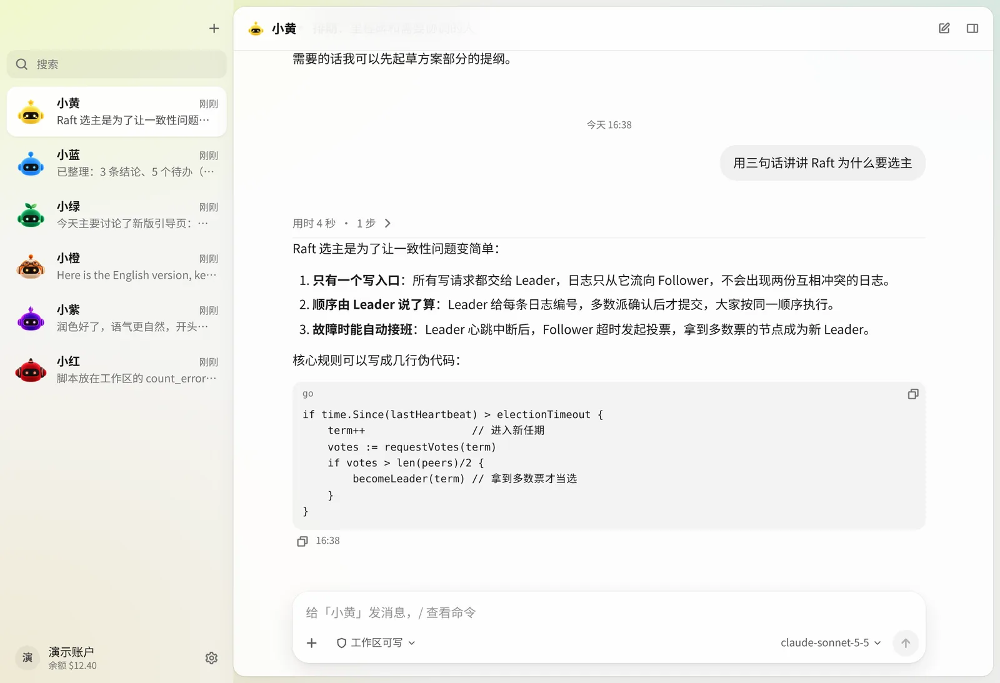
</picture>

<p align="center"><i>Bir botla sohbet et. Yanıtlar Markdown ve kodu işler, yazma alanı hangi modelin kullanıldığını gösterir.</i></p>

<picture>
  <source media="(prefers-color-scheme: dark)" srcset="docs/assets/screenshots/agent-dark.webp">
  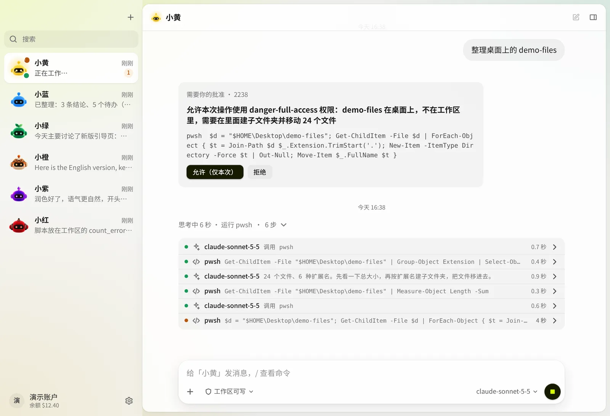
</picture>

<p align="center"><i>Botun ne yaptığı adım adım görünür. Çalışma alanının dışındaki her şey senin onayını bekler.</i></p>

<picture>
  <source media="(prefers-color-scheme: dark)" srcset="docs/assets/screenshots/models-dark.webp">
  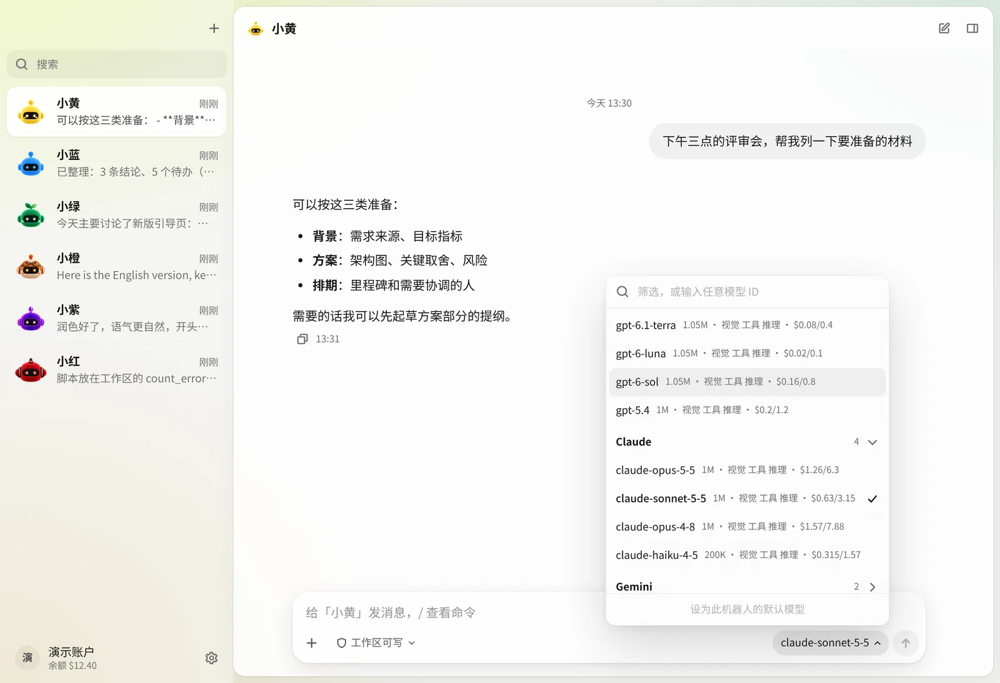
</picture>

<p align="center"><i>Sohbet başına istediğin Modelflare modelini seç. Bağlam uzunluğu, yetenekler ve liste fiyatları her birinin yanında durur.</i></p>

<picture>
  <source media="(prefers-color-scheme: dark)" srcset="docs/assets/screenshots/memory-dark.webp">
  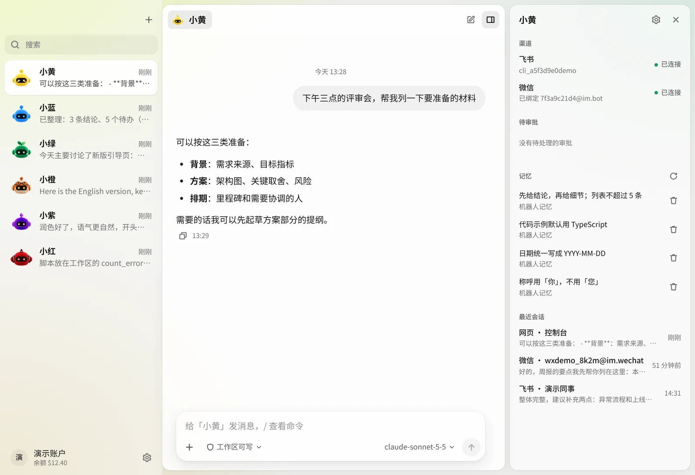
</picture>

<p align="center"><i>Her bot için bellek, kanallar ve oturumlar tek panelde.</i></p>

<picture>
  <source media="(prefers-color-scheme: dark)" srcset="docs/assets/screenshots/modelflare-dark.webp">
  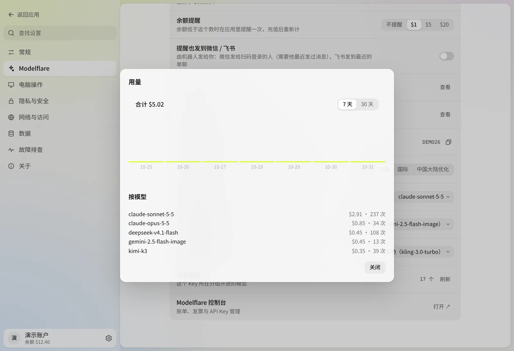
</picture>

<p align="center"><i>Modelflare hesabın uygulamanın içinde: bakiye, kullanım ve varsayılanlar.</i></p>

<picture>
  <source media="(prefers-color-scheme: dark)" srcset="docs/assets/screenshots/bots-dark.webp">
  
</picture>

<p align="center"><i>Botlarını ayırt etmek için altı karakter. Gözleri imlecini izler.</i></p>

# 🌟 Temel özellikler

## 🤖 İşi yapan botlar

Bir bot bir sohbet penceresinden fazlasıdır: bir kişiliği, bir varsayılan modeli, kendi çalışma alanı ve kendi belleği vardır.

- **İhtiyacın kadar**, her birinin kendi kişiliği, modeli, çalışma alanı ve avatarı.
- **Her botu sen tanımlarsın.** Bir kişilik yalnızca metindir ve şablonlar yalnızca bir başlangıç noktasıdır. Altı avatar bir botun görünüşünü değiştirir, ne yapabileceğini değil.
- **Gerçek dosya işi.** Botlar dosya okur ve yazar, bir kum havuzunda komut çalıştırır ve sonuçları sohbete dosya olarak geri gönderir.
- **Bot başına üç izin hazır ayarı.** *Salt okunur*, *Çalışma alanı* (varsayılan: botun kendi klasörünün içinde yazar; çalışma alanının dışına yazmadan önce sorar) ve *Tam erişim* (kum havuzu yok; tam erişimde bile bir klasörün tamamını silmeden önce sorar).
- **Beceriler: kur, içe aktar veya kendininkini kaydet.** **Uygulamalar ve beceriler** içindeki kitaplıktan bir beceri seç, sonra kurulum istemini veya GitHub bağlantısını bir bota gönder ve kartı onayla; ya da **Bot ayarları → Beceriler** içinde `SKILL.md` içeren bir ZIP içe aktar (ZIP başına bir beceri, en çok 20 MB). Bir bot bir şeyi doğru yapınca “beceri olarak kaydet” de veya `/skill` gönder ve taslak kartı onayla; Becerilerim'de kalsın, birkaç botta kullan, ZIP olarak dışa aktar veya zamanla. Değişiklikler geçerli iş bitince yürürlüğe girer. [Beceri kılavuzu](./docs/skills_tr.md).
- **Sürpriz değil, onay kartları.** Çalışma alanının dışına yazan eylemler durur ve yanıtını bekler.
- **Yeniden başlatmadan sonra söylenir.** Uygulama çıkınca veya çökünce hâlâ süren bir mesaj, sonraki açılışta sohbetinde işaretlenir, böylece yeniden gönderebilirsin; hiçbir şey kendiliğinden yinelenmez.
- **Grup sohbetleri.** Bir grup oluştur ve birkaç bot ekle. Kimi @lersen o yanıtlar; @ yoksa son yanıtlayan bot sürdürür. Botlar devretmek için başka bir üyeyi de @leyebilir. Her bot kendi modelini, çalışma alanını ve belleğini korur ve maliyetler bot başına izlenir.
- **Birbirine mesaj atan botlar.** Uygulamada bir bota “bunu B'ye ver” de: B kendi modeli, izinleri ve bütçesiyle arka planda çalışır ve bitince yanıtlar; ilk bot sonucu sana söylemeden önce denetler. B onayları aynı sohbette kendi adıyla ister ve konuşmalarını istediğin zaman okuyabilirsin. Modelflare'de oturum açmak gerekir ve iki bot da Modelflare modellerinde olmalıdır.
- **Sohbet geçmişinde ara.** Kenar çubuğundan cihazında kayıtlı tüm mesajlarda ara, bota, sohbete, kanala veya tarihe göre süz ve özgün mesaja atla. `Ctrl/Cmd+Shift+F` genel aramayı açar; `Ctrl/Cmd+F` geçerli sohbeti arar. Aramalar bir model çağırmaz. Yazmadan önce arama iletişim kutusu son sohbetleri tarihe göre listeler.
- **Çalışma klasörleri ve ZIP.** Masaüstü uygulamasında mesaj kutusunun üstünden bir klasör seçin; bot dosyaları yerinde okur ve düzenler (çalışma alanı erişimiyle bu klasördeki değişiklikler her seferinde onay istemez). Bir ZIP'i sohbete sürükleyin; ne yapılacağını söyleyince bot onu güvenle açar.
- **Görseller oluşturma referansı olarak.** Modelflare'e giriş yapıp sohbete görsel ekleyin ve “Görsel oluşturmada referans olarak kullan”ı açın: sağ altta seçili model bunlardan yeni bir görsel oluşturur. Bir görsel oluşturma modeli seçip tek cümleyle de görsel oluşturabilirsiniz. Bir engel olduğunda mesaj kutusunun üstündeki not nedenini söyler.
- **Bu bilgisayardan beceri içe aktarma.** Masaüstü uygulaması Claude Code, Codex, Cursor ve benzeri araçların bu bilgisayara kurduğu becerileri bulur ve gözden geçirdikten sonra tek seferde Beceri kitaplığıma aktarır; kitaplık her becerinin tek kopyasını tutar, açıp açmamaya her bot kendisi karar verir.
- **Eğik çizgi komutları** olan `/model` ve `/reset` uygulamada ve her sohbet kanalında çalışır. Bir sohbet kanalında `/bot` başka bir bota geçer.

<p align="center">
  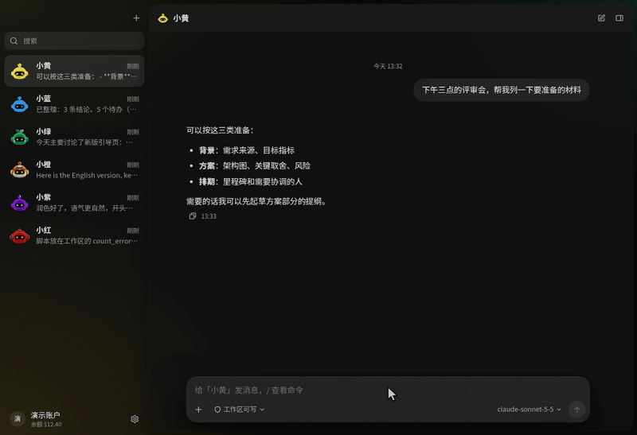
</p>

## 🧩 Hazır botlar

Bir kişilik yazmak istemezsen Keşfet'ten hazır bir bot kullan. Her birinin kendi görünümü vardır. Birini açmak bir örnek gösterir ve yalnızca ilk mesajını gönderince kurulur.

Resmi botlar arayüzlerini, örneklerini, kişiliklerini ve becerilerini yükleyiciye koyar. İlk önizleme ve kurulum bot paketi indirmesi gerektirmez. Güncellemeler uygulama sürümleriyle gelir ve var olan proje verisini korur. Model çağrıları ve çevrimiçi araştırma yine bir ağ bağlantısı ister. Her bot bir masaüstü çalışma alanıdır: işin solda listelenir, içerik sağdadır, Yeni kısa bir yönlendirmeli form başlatır, üst çubuk tam sohbete geçer ve giriş kutusunda model seçici vardır.

- **Company Research:** Kaynaklı özetler ve PDF raporlarla, bilgisayarında şirket araştırması.
- **PPT Master:** Belgeleri veya konuları düzenlenebilir slaytlara çevir ya da elindeki desteleri düzenle.
- **Film Studio:** Kısa videolar ve diziler: senaryo, storyboard, ses, kurgu ve son kesim.
- **US Stock Research:** SEC kayıtlarından ABD'de işlem gören şirketleri araştır; her sayı izlenebilir.

Film Studio, cihazında AnyModelBot 0.1.23 veya üstünü, Python 3.10+ ve FFmpeg'i (ffprobe dahil) ister. Yapay zeka görüntüleri ve videoları Modelflare kullanır ve kullanıma göre ücretlenir; projeler ve ortam cihazında kalır.

Ayrıntılar için [sitemizdeki botlar sayfasına](https://anymodel.bot/tr/bots) bak.

## ⏳ Arka planda çalışır ve yalnızca gerektiğinde sana gelir

- **Arka plan görevleri.** Bir süre süren işler için (araştırma, bir rapor, dosya ayıklama) veya “arka planda yap” dediğinde bot bir arka plan görevi başlatır ve sen sohbete devam edersin. Sonuç, onu isteyen sohbete geri gelir.
- **Sürdürme.** O görevle konuşmaya devam etmek için sonucu WeChat'te alıntıla veya Feishu'da yanıtla.
- **Kurallar.** “Her sabah 8'de X'in fiyatına bak ve 200'ün altına düşerse söyle” zamanında denetleyen ve yalnızca önemli bir şey olunca söyleyen bir kural olur. Önce nasıl davrandığını görmek için “önce gözle” de: ne söyleyeceğini kaydeder, hiçbir şey göndermez ve dosya değiştirmez. Doğru görünürse eyleme geçir.
- **Seni bekliyor.** Herhangi bir botun senden beklediği her şey, bir yanıt, bir onay veya bir yeniden deneme, yalnızca bir şey sana gerektiğinde duran tek bir kenar çubuğu satırında durur. Bilgi panelinin Görevler grubu botun görevlerini ve kurallarını, her adım görünür biçimde listeler.
- **Varsayılan olarak sessiz.** Yalnızca sonuçlar, kararlar ve başarısızlıklar itilir, ilerleme hiç itilmez. Sessiz saatler 22:00–08:00'dır ve kendiliğinden mesajlar günde sınırlıdır (WeChat'te 3, diğer kanallarda 5); kalanı tek mesajda birleşir.
- **Bütçeler.** Her görev ve kuralın bir bütçesi vardır (görev başına 1 ABD doları; kural çalışması başına 0,10 ve ayda 3) ve bitince iş durup sorar. Görev ayrıntılarında ve kural düzenleyicide değiştir.
- **İstediğin zaman duraklat.** Bot ayarları › Kendiliğinden mesajlar içindeki bir anahtar arka plan işini duraklatır; sohbet sürer.
- **Kendinden sonra toplar.** Görevler ve çalışma günlükleri 30 gün tutulur. 30 gün kullanılmayan bir görev klasörü sormadan silinir; görev ayrıntıları tarihi gösterir ve Tut onu elinde tutar. Çalışma günlükleri Markdown olarak dışa aktarılır.

Çalışma zamanı [DeepSeek Harness](https://github.com/deepseek-ai/deepseek-harness) üzerine kuruludur ve tasarım DeepSeek'in [süper ajan prototipinden](https://github.com/deepseek-ai/dsh-superagent-prototype) yararlanır. Tam öykü, Çince: [AnyModelBot 超级智能体](./docs/blog/superagent.md).

## 🖥️ Bilgisayarını kullanır, görüntü ve video üretir

- **Bilgisayar kullanımı** paketlenmiş [Cua Driver](https://github.com/trycua/cua) ile çalışır. Varsayılan olarak eylemler kendiliğinden çalışır. Bir botu *ekranı değiştirmeden önce sor* konumuna alırsan her tıklama ve tuş vuruşu seni bekler. Ekranı okumak hiç onay istemez. macOS'ta bilgisayar kullanımı bir Beta özelliğidir: Erişilebilirlik ve Ekran Kaydı izinleri yalnızca bir bot ilk kez onlara gerek duyunca istenir ve sohbet hangisinin eksik olduğunu açıklar.
- **Görüntü ve video üretimi** hemen çalışır ve gevşek bir isteğin en makul okumasını alır. Yalnızca tahmini maliyet 0,50 ABD dolarının üstündeyse önce sorar; modeli ve istemi görürsün ve modeli yerinde değiştirebilirsin. Her seferinde sorulmak için botun ayarlarında aç.

<p align="center">
  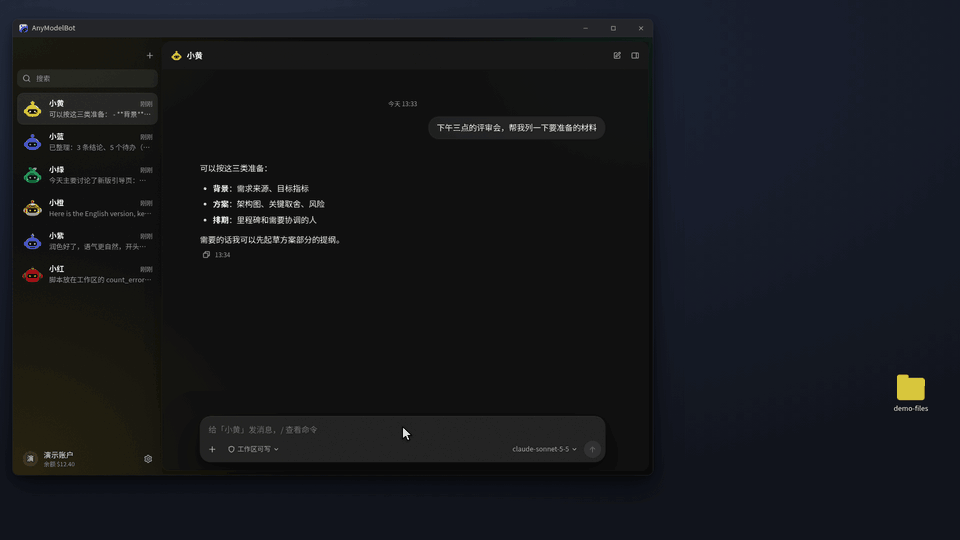
</p>

<p align="center">
  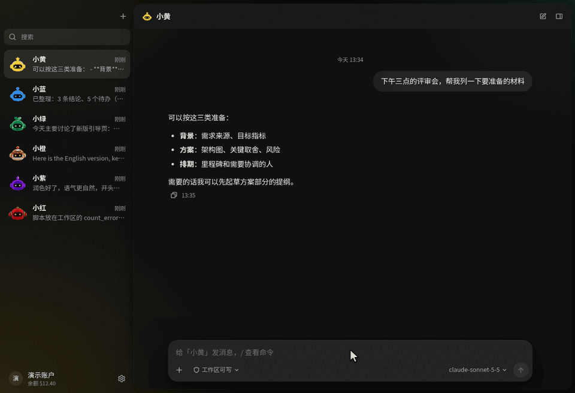
</p>

## 🌐 Her model, Modelflare veya resmi API üzerinden

- **Bir kez oturum aç** ve Modelflare modellerin kendiliğinden görünür.
- **Ya da kendi resmi API anahtarlarını getir.** OpenAI, Anthropic, Google Gemini, xAI, DeepSeek, Kimi, GLM, Qwen, MiniMax ve Mistral desteklenir. Anahtarlar cihazında kalır, model istekleri Modelflare'den geçmeden doğrudan sağlayıcıya gider ve sağlayıcı sana fatura keser. Görüntü ve video üretimi şimdilik yalnızca Modelflare üzerinden kullanılabilir.
- **Her şey için tek seçici.** GPT, Claude, Gemini, Grok, DeepSeek, Kimi, GLM ve daha fazlası; her birinde bağlam uzunluğu, yetenek etiketleri ve bir liste fiyatı.
- **Sohbet başına değiştir** veya bot başına bir varsayılan ayarla. Belleği düzenlemek ve bağlam devri gibi arka plan işleri kendi ayrı modellerini kullanabilir.
- **Üç API etki alanı.** `modelflare.dev`, `origin.modelflare.dev` veya `cf.modelflare.dev` seç ve yanıt sürelerini Ayarlar'da karşılaştır; AnyModelBot hiç kendiliğinden geçiş yapmaz.
- **Kullandıkça öde.** Cüzdan bakiyesi, düşük bakiye anımsatmaları, günlük kullanım ve bot başına bütçe anahtarları yerleşiktir. AnyModelBot'un kendisinin abonelik ücreti yoktur.

<p align="center">
  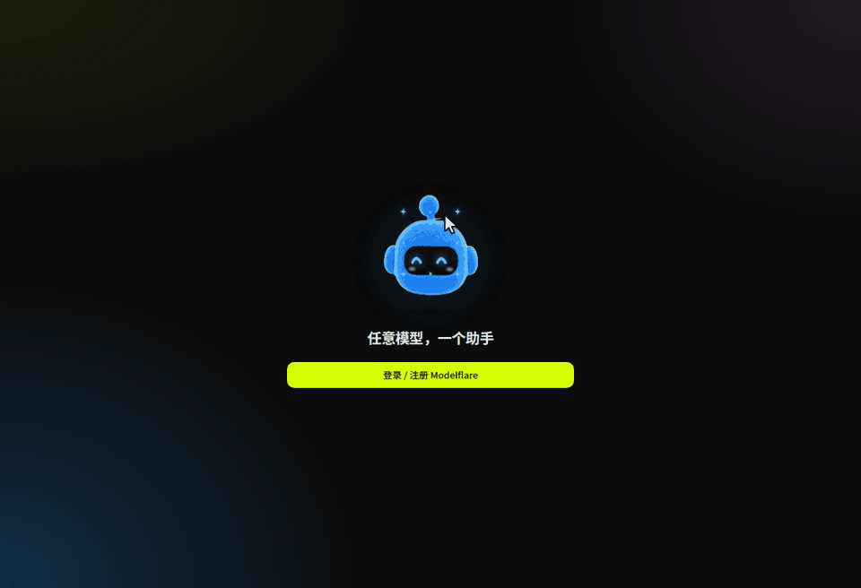
</p>

<p align="center">
  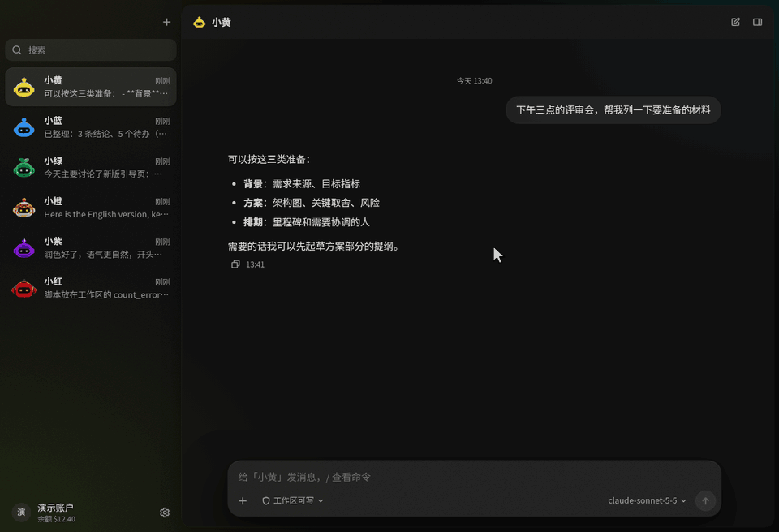
</p>

## 🧠 Bellek ve her yerden ulaşım

- **Taşınan bellek.** Seninle ilgili şeyler Hakkımda'da durur ve tüm botların paylaşır: bir kez söyle, her bot bilsin; Ayarlar'da görüntüleyebilir, düzenleyebilir veya geri alabilirsin. Botlar bir adres, telefon numarası veya e-postayı kaydetmeden önce sorar. Her botun ve grubun ayrıca kendi belleği vardır; Markdown olarak tutulur ve ayrı durur. Parola veya anahtar gibi görünen içerik kaydedilmez.
- **Uzun sohbetler kullanılabilir kalır.** Bir bağlam kâhyası, pencere dolmadan önce sıkıştırır veya bir devir özetiyle yeni bir kesim başlatır.
- **Tüm botların paylaştığı hesaplar.** WeChat, Feishu, Telegram, Slack ve Discord sohbet hesaplarını Ayarlar › Sohbet kanalları altında bir kez ekle. Her bot onları paylaşır ve her kanalın takma adlı birkaç hesabı olabilir. Başka bir botla konuşmak için bir sohbet uygulamasında bir kez `/bot name` gönder.
- **Uygulamaları bağla.** Avatar menüsündeki Uygulamalar ve beceriler, Feishu, Tencent Docs, DingTalk, Amap, Yuque, Notion, GitHub, Linear, Atlassian ve Canva için bağlayıcılarla gelir ve özel MCP bağlayıcıları ekleyebilirsin (uzak sunucular veya yerel komutlar). Bir kez bağla, her bot varsayılan olarak kullanabilsin; bot başına ve araç başına daralt. Salt okunur araçlar hemen çalışır, yazmalar önce sorar ve silmeler veya başka insanlara giden her şey her zaman sorar.
- **WeChat ve Feishu.** WeChat bağlamak için bir QR kodu tara veya akışlı yanıt kartlarıyla bir Feishu botu bağla. WeChat görüntü ve dosya da taşır.
- **Telegram, Slack ve Discord.** Ayarlar › Sohbet kanalları içinde bir belirteç yapıştır. Genel bir adres gerekmez. Yanıtlar yazıldıkça görünür ve görüntü ile dosya iki yönde de çalışır. Şimdilik yalnızca doğrudan mesajlar; onaylar ve sorular metinle yanıtlanır.
- **Çalıştırmanın dört yolu.** Masaüstü uygulaması, komut satırı, Docker veya `127.0.0.1:3600` adresindeki yerel web konsolu.

<p align="center">
  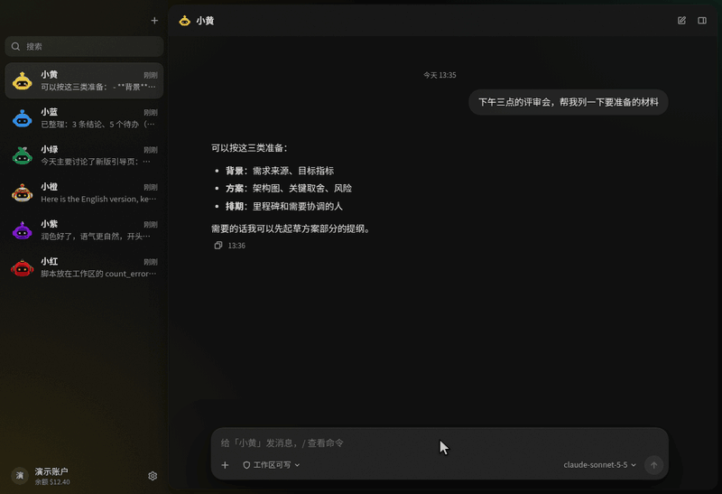
</p>

<p align="center">
  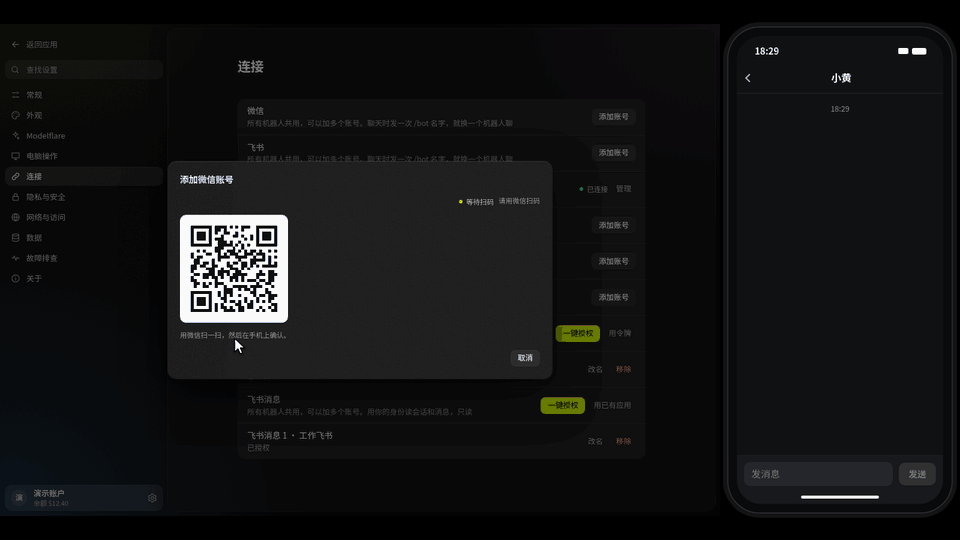
</p>

## 🔒 Önce cihazında, göze de kolay

- **Verin sende kalır.** Sohbetler, bellek, dosyalar ve API anahtarları cihazında tutulur. Yerel konsol yalnızca `127.0.0.1` üzerinde dinler ve yalnızca erişim belirteciyle açılır (masaüstü uygulaması her açılışta yenisini üretir).
- **Sana hesap verir.** Varsayılan olarak bir bot yalnızca sahibine (QR kodunu tarayan WeChat hesabı; Feishu, Telegram, Slack ve Discord'da bağladıktan sonra ona ilk mesajı atan kişi, yani sen) ve izin verdiklerine yanıt verir. Başkası tek satırlık bir uyarı alır ve model çağrılmaz; onları bilgi panelinden veya sohbette `yes <code>` yanıtlayarak içeri alırsın.
- **Yanıtlar kaybolmaz.** Bir yanıt gönderilmeden önce yerelde kaydedilir; ağ hataları yeniden denenir, gönderme yeniden başlatmadan sonra sürer ve WeChat'in 24 saatlik penceresi kapanmışsa yanıt bekler ve sonraki mesajınla gelir.
- **Telemetri kapalı tutulur.** Paketlenmiş bilgisayar kullanımı sürücüsündeki telemetri kapatılır ve yerleşik ağ geçidi otomatik güncelleme kapalı çalışır.
- **Uygulama içi güncellemeler.** 0.1.29'dan itibaren kurulu masaüstü uygulamaları Ayarlar → Genel → Güncellemeleri otomatik indir seçeneğini varsayılan olarak açar. Yeni sürümler arka planda iner ve hazır olunca Yeniden başlat ve güncelle sunar. Kurulum senin tıklamanı ve çalışan görev olmamasını ister; elle indirmek için ayarı kapat. 0.1.28 veya daha eskisinde olanlar 0.1.29 veya üstünü bir kez elle kurmalıdır. Docker ve kaynak kurulumları hâlâ elle güncellenir. 0.1.30'dan itibaren bir güncellemeden sonraki ilk açılış neyin değiştiğini gösterir, kenar çubuğundaki hesabının yanındaki güncelleme düğmesi güncellemeyi indirir ve hazır olunca kurmak için yeniden başlar ve değişiklik günlüğü her zaman Ayarlar → Hakkında içindedir.
- **Açık, koyu veya sistemi izle.** Altı bot karakteri ve gözleri imlecini izler.
- **Sistem tepsisi ve otomatik başlatma.** Pencereyi kapatınca sistem tepsisine gizlenir; otomatik başlatma macOS ve Windows'ta vardır.

<p align="center">
  
</p>

> [!NOTE]
> Özellikler seçtiğin modele, işletim sistemine ve verdiğin izinlere bağlıdır. Bilgisayar kullanımı bir masaüstü oturumu ister ve macOS bilgisayar kullanımı Beta'dadır. Model istekleri seçtiğin sağlayıcıya gider (kendi resmi API anahtarınla doğrudan, yoksa Modelflare üzerinden); [Nasıl çalışır ve gizlilik](#-nasıl-çalışır-ve-gizlilik) bölümüne bak.

# 🆚 AnyModelBot vs Grok Bot, OpenAI dots ve Claude Duet

2026'nın ikinci yarısında xAI'nin [Grok Bot](https://x.ai/bot) ürünü, OpenAI'nin [dots](https://openai.com/index/introducing-dots/) ürünü ve Anthropic'in Claude Duet'i art arda çıktı. Onlar da senin için arka planda çalışır ve karar senin olunca haber verir. AnyModelBot aynı tür işi başka bir yolla yapar: açık kaynaktır, kendi cihazında çalışır ve geniş bir model yelpazesiyle çalışır.

| | AnyModelBot | Grok Bot | OpenAI dots | Claude Duet |
| :--- | :--- | :--- | :--- | :--- |
| Açık kaynak | ✅ MIT | — | — | — |
| Nerede çalışır | Kendi bilgisayarın veya sunucun | xAI'nin bulut bilgisayarı | OpenAI'nin bulut bilgisayarı | Anthropic'in bulutu |
| Modeller | GPT, Claude, Gemini, Grok ve daha fazlası (Modelflare veya resmi API üzerinden) | Ağırlıkla xAI'nin Grok modelleri | OpenAI'nin modelleri | Claude (Opus 5.5) |
| Maliyet | Ücretsiz uygulama, modeller belirteç başına ücretlenir | Abonelik | ChatGPT Pro / Business Premium aboneliği | Claude Pro / Max aboneliği |
| Nereden ulaşırsın | Masaüstü uygulaması (Windows, macOS, Linux), Docker, WeChat, Feishu, Telegram, Slack, Discord | Masaüstü uygulaması, iPhone | ChatGPT, Slack, Teams | iOS, Android, claude.ai |
| Kullanılabilirlik | Şimdi indir | Beta | Seçili pazarlar | Araştırma önizlemesi, ABD bekleme listesi |

AnyModelBot da arka planda çalışır: devrettiğin bir görev arka planda bitebilir ve sonucunu sohbet uygulamana gönderebilir; onayını veya yanıtını isteyen her şey kenar çubuğunda “Seni bekliyor” altında görünür. Bir botun attığı her adım görünür ve çalışma alanının dışındaki her şey önce sana sorar.

> [!NOTE]
> Diğer ürünlerle ilgili ayrıntılar Ekim 2026 itibarıyla kamuya açık raporlardan gelir ve değişmiş olabilir; her satıcının resmi bilgisine bak. Grok Bot, dots ve Claude Duet sırasıyla xAI, OpenAI ve Anthropic'in ürünleri ve ticari markalarıdır. AnyModelBot onlarla bağlantılı değildir.

# 🔐 Nasıl çalışır ve gizlilik

<picture>
  <source media="(prefers-color-scheme: dark)" srcset="docs/assets/diagrams/data-flow-dark.svg">
  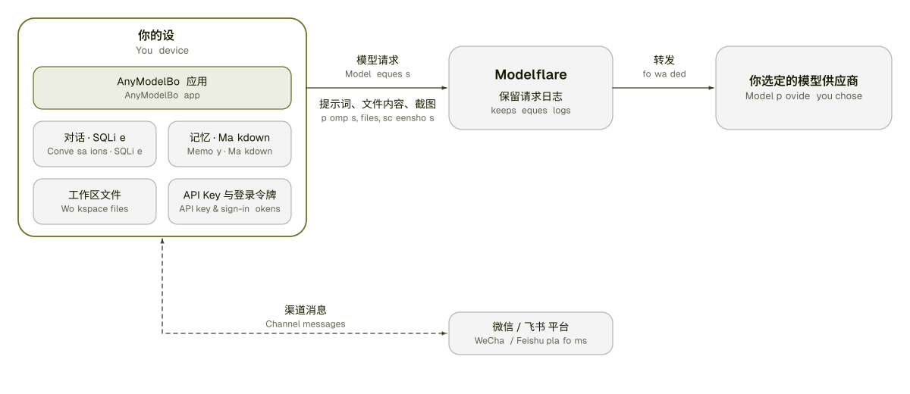
</picture>

| Cihazında kalan | Cihazından çıkan |
| :--- | :--- |
| Sohbetler ve oturumlar (yerel SQLite veritabanı) | Bir modelin yanıtlamak için gerek duyduğu istemler, dosyalar ve araç sonuçları; seçtiğin sağlayıcıya gönderilir (kendi resmi API anahtarınla doğrudan, yoksa Modelflare üzerinden) |
| Bellek (Markdown dosyaları) | Bilgisayar kullanımıyla ekranına bakmasını istediğinde ekran görüntüleri |
| Her botun çalışma alanındaki dosyalar | Sohbet kanalları üzerinden karşılıklı gönderdiğin mesajlar; o platformlardan geçer |
| API anahtarın ve oturum belirteçlerin | modelflare.dev üzerinde olan Modelflare oturumun |
| Uygulamaları bağla | Uygulamaları bağladıktan sonra (Feishu, Notion, GitHub ve benzeri) veya özel bir MCP bağlayıcısı ekledikten sonra botlar içeriklerini okur ve yazar; okudukları da model isteklerine girer |

Modelflare istek günlüklerini tutar; [Güven Merkezi](https://modelflare.dev/trust?utm_source=anymodelbot&utm_campaign=amb_readme) neyin ne kadar tutulduğunu açıklar. Verilerinin her riskin ötesinde olduğunu söylemiyoruz: bir modele gönderdiğin her şey cihazından çıkar. Tam envanter [docs/privacy_tr.md](./docs/privacy_tr.md) içindedir.

<picture>
  <source media="(prefers-color-scheme: dark)" srcset="docs/assets/diagrams/architecture-dark.svg">
  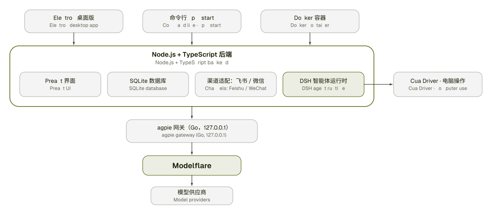
</picture>

| Katman | Teknoloji |
| :--- | :--- |
| Arayüz | Preact + htm, derleme adımı yok |
| Arka uç | Node.js 22.13+, TypeScript, `node:sqlite` |
| Masaüstü kabuğu | Electron, sistem tepsisiyle |
| Model ağ geçidi | [magpie](https://github.com/yetone/magpie) (Go, MIT), paketlenir ve uygulamaca başlatılır |
| Ajan çalışma zamanı | [DeepSeek Harness](https://github.com/deepseek-ai/deepseek-harness) (MIT), ayrı bir süreç olarak çalışır |
| Bilgisayar kullanımı | [Cua Driver](https://github.com/trycua/cua), paketlenmiş |
| Kanallar | Feishu (uzun bağlantı + akışlı kartlar), WeChat (iLink), Telegram (uzun yoklama), Slack (Socket Mode), Discord (Gateway) |
| Uygulamaları bağla | Yerleşik bağlayıcılar: Feishu, Tencent Docs, DingTalk, Amap, Yuque, Notion, GitHub, Linear, Atlassian, Canva; özel MCP: Streamable HTTP (SSE uyumlu), yerel komutlar |
| Testler ve CI | Vitest, GitHub Actions |

# 📝 Yol haritası

Üzerinde düşündüğümüz yönler. Söz değildir ve sıra bir takvim değildir. Her sürümde neyin değiştiği için [değişiklik günlüğüne](./CHANGELOG_tr.md) bak.

- [x] **Zamanlanmış görevler**: bir botun işi bir zamanlayıcıyla çalıştırmasını sağla (yukarıda kurallar olarak yayınlandı).
- [x] **Uygulama içi grup sohbetleri**: uygulamada bir grup oluştur ve birkaç botla birden sohbet et.
- [ ] **Sohbet kanallarında grup sohbetleri**: sohbet kanalları bugün bire bir sohbetleri ele alır.
- [x] **Çok dilli arayüz**: uygulama Basitleştirilmiş Çince, Geleneksel Çince (Tayvan), İngilizce, Japonca, Korece, Rusça, İspanyolca, Portekizce (Brezilya) ve Türkçeyi destekler; Ayarlar'dan değiştir.
- [ ] **macOS bilgisayar kullanımı**: doğrudan kipi daha çok gerçek makinede doğrula ve Beta'dan çıkar.
- [ ] **E-posta, takvim ve olay tetikleri**: e-posta ve takvim hesaplarını bağla ve kuralların yalnızca bir zamanlayıcıda değil, bir şey olduğu anda çalışmasını sağla (belirli bir kişiden mesaj, başlamak üzere olan bir toplantı). Dışarıdan içerikle tetiklenen çalışmalar daha düşük izin alır, böylece başkasının yazdığı metin botuna emir veremez.
- [ ] **Her zaman açık barındırma, yedekleme ve taşıma**: bilgisayarın kapalıyken kurallar çalışmaz. Herkesin kendi sunucusuna tek tıklamayla kurmasını, sohbetlerini, belleğini ve hesaplarını taşımasını ve yedekleyip geri yüklemesini olanaklı kıl.
- [ ] **Kendi MCP sunucularını ekle**: bugün yalnızca yerleşik araçları ve hesapları kullanabilirsin. Bunu açmak GitHub ve Linear gibi hizmetleri kendin bağlamanı sağlar.
- [ ] **Birlikte çalışan botlar**: bir botun işi bir başkasına vermesini sağla; örneğin farklı modellerle taslak ve gözden geçirme, maliyetler ayrı izlensin.
- [ ] **Sesli mesaj dökümü**: botlar bugün Telegram sesli mesajlarını duyamaz ve WeChat platformun kendi dökümüne dayanır.
- [ ] **Bağımsız bir mobil uygulama**: bugün botlarına WeChat, Feishu, Telegram, Slack veya Discord'dan ulaşırsın.

Başka bir fikrin mi var? Bir [issue](https://github.com/modelflare-ai/AnyModelBot/issues) aç veya bir [tartışma](https://github.com/modelflare-ai/AnyModelBot/discussions) başlat. Ele aldığımız maddeler [`roadmap`](https://github.com/modelflare-ai/AnyModelBot/labels/roadmap) etiketiyle izlenir.

# 🤝 Katkı

Hata bildirimleri, düzeltmeler, belgeler ve fikirler hoş gelir.

1. Önce var olan [issue'lara](https://github.com/modelflare-ai/AnyModelBot/issues) ve [tartışmalara](https://github.com/modelflare-ai/AnyModelBot/discussions) bak. [`good first issue`](https://github.com/modelflare-ai/AnyModelBot/labels/good%20first%20issue) etiketli issue'lar iyi bir başlangıçtır.
2. Depoyu forkla ve `master` üzerinden bir dal oluştur.
3. Yerelde çalıştır ve değişikliğini yap:

   ```bash
   npm install
   npm run setup          # paketlenmiş ağ geçidini alır ve derler
   npm run electron:dev   # geliştirme modunda masaüstü uygulaması
   npm run typecheck && npm test
   ```

4. `master` hedefine bir pull request aç ve neyin neden değiştiğini anlat. Küçük bir düzeltmeden büyük her şey için, yaklaşımda anlaşmak üzere önce bir issue aç.

Tam [katkı kılavuzunu](./CONTRIBUTING_tr.md) oku. Bir güvenlik sorununu bildirmek için açık bir issue açmak yerine [güvenlik politikasını](./SECURITY_tr.md) izle.

# 🔗 İlgili projeler

- [Modelflare](https://modelflare.dev/?utm_source=anymodelbot&utm_campaign=amb_readme): AnyModelBot modellerinin arkasındaki yapay zeka API ağ geçidi.
- [magpie](https://github.com/yetone/magpie): uygulamayla paketlenmiş Go ağ geçidi (MIT).
- [DeepSeek Harness](https://github.com/deepseek-ai/deepseek-harness): ajan çalışma zamanı (MIT).
- [Cua](https://github.com/trycua/cua): bilgisayar kullanımı sürücüsü.
- [kimi-computer-use](https://github.com/songkeys/kimi-computer-use): macOS bilgisayar kullanımı köprüsü.
- [openclaw-weixin](https://github.com/Tencent/openclaw-weixin): WeChat kanalını taşıdığımız yer (MIT).
- [DS Bot](https://github.com/Fei2411/DS-Bot): bellek ve bağlam kâhyamızın tasarım kaynağı (Apache-2.0).

Tam lisanslar ve bildirimler: [THIRD_PARTY_NOTICES_tr.md](./THIRD_PARTY_NOTICES_tr.md).

# 💬 Topluluk

- **Sorular ve fikirler:** [GitHub Discussions](https://github.com/modelflare-ai/AnyModelBot/discussions)
- **Hatalar ve özellik istekleri:** [GitHub Issues](https://github.com/modelflare-ai/AnyModelBot/issues)
- **İstekler ve Geri Bildirim:** hesap menüsü → İstekler ve Geri Bildirim (kullanım senaryoları ve fikirler, sorunlar, kurumsal ve ortaklıklar; Modelflare'e giriş yaptıysan hesabında gizli bir talep olur, iletişim bilgisi yalnızca onay verirsen eklenir)
- **Toplulukla sohbet:** [Discord](https://discord.gg/umBN6wX3zJ) · [Telegram](https://t.me/+Tx6Payfzxqk2ZGVl)
- **E-posta:** [support@anymodel.bot](mailto:support@anymodel.bot)
- **Modelflare'den haberler:** [X'te @modelflare_dev](https://x.com/modelflare_dev)

# 🚀 Katkıda bulunanlar

<a href="https://github.com/modelflare-ai/AnyModelBot/graphs/contributors">
  
</a>

# ⭐️ Yıldız geçmişi

<a href="https://www.star-history.com/#modelflare-ai/AnyModelBot&Date">
  <picture>
    <source media="(prefers-color-scheme: dark)" srcset="https://api.star-history.com/svg?repos=modelflare-ai/AnyModelBot&type=Date&theme=dark" />
    <source media="(prefers-color-scheme: light)" srcset="https://api.star-history.com/svg?repos=modelflare-ai/AnyModelBot&type=Date" />
    
  </picture>
</a>

# 📜 Lisans

AnyModelBot [MIT Lisansı](./LICENSE) altında yayınlanır. Paketlenmiş üçüncü taraf yazılım kendi lisanslarını korur; [THIRD_PARTY_NOTICES_tr.md](./THIRD_PARTY_NOTICES_tr.md) ve [`LICENSES/`](./LICENSES) klasörüne bak.

<!-- link & badge references -->
[release-shield]: https://img.shields.io/github/v/release/modelflare-ai/AnyModelBot?include_prereleases&label=release&logo=&style=flat-square&labelColor=161a00&color=d7ff00
[downloads-shield]: https://img.shields.io/github/downloads/modelflare-ai/AnyModelBot/total?logo=github&logoColor=d7ff00&style=flat-square&labelColor=161a00&color=d7ff00
[stars-shield]: https://img.shields.io/github/stars/modelflare-ai/AnyModelBot?logo=github&logoColor=d7ff00&style=flat-square&labelColor=161a00&color=d7ff00
[license-shield]: https://img.shields.io/github/license/modelflare-ai/AnyModelBot?logo=opensourceinitiative&logoColor=d7ff00&style=flat-square&labelColor=161a00&color=d7ff00
[ci-shield]: https://img.shields.io/github/actions/workflow/status/modelflare-ai/AnyModelBot/ci.yml?branch=master&label=CI&logo=githubactions&logoColor=d7ff00&style=flat-square&labelColor=161a00&color=d7ff00
[platform-shield]: https://img.shields.io/badge/platform-Windows%20%7C%20macOS%20%7C%20Linux%20%7C%20Docker-d7ff00?style=flat-square&labelColor=161a00
[pricing-shield]: https://img.shields.io/badge/pricing-pay--as--you--go-d7ff00?style=flat-square&labelColor=161a00
[modelflare-shield]: https://img.shields.io/badge/Modelflare-modelflare.dev-d7ff00?style=flat-square&labelColor=161a00
[x-shield]: https://img.shields.io/badge/X-@modelflare__dev-d7ff00?style=flat-square&labelColor=161a00&logo=x&logoColor=d7ff00
[qq-shield]: https://img.shields.io/badge/QQ-1132903119-d7ff00?style=flat-square&labelColor=161a00&logo=qq&logoColor=d7ff00
[telegram-shield]: https://img.shields.io/badge/Telegram-chat-d7ff00?style=flat-square&labelColor=161a00&logo=telegram&logoColor=d7ff00
[discord-shield]: https://img.shields.io/badge/Discord-chat-d7ff00?style=flat-square&labelColor=161a00&logo=discord&logoColor=d7ff00
[win-badge]: https://img.shields.io/badge/Windows-161a00?style=for-the-badge&logo=
[mac-badge]: https://img.shields.io/badge/macOS-161a00?style=for-the-badge&logo=apple&logoColor=d7ff00
[linux-badge]: https://img.shields.io/badge/Linux-161a00?style=for-the-badge&logo=linux&logoColor=d7ff00

[releases-link]: https://github.com/modelflare-ai/AnyModelBot/releases
[stars-link]: https://github.com/modelflare-ai/AnyModelBot/stargazers
[license-link]: https://github.com/modelflare-ai/AnyModelBot/blob/master/LICENSE
[ci-link]: https://github.com/modelflare-ai/AnyModelBot/actions/workflows/ci.yml
[pricing-link]: https://modelflare.dev/pricing?utm_source=anymodelbot&utm_campaign=amb_readme
[modelflare-link]: https://modelflare.dev/?utm_source=anymodelbot&utm_campaign=amb_readme
[x-link]: https://x.com/modelflare_dev
[qq-link]: https://qm.qq.com/q/yHN9KrvlGa
[telegram-link]: https://t.me/+Tx6Payfzxqk2ZGVl
[discord-link]: https://discord.gg/umBN6wX3zJ
