<p align="center">
  <a href="https://github.com/modelflare-ai/AnyModelBot/releases">
    
  </a>
</p>

<h1 align="center">
  <picture>
    <source media="(prefers-color-scheme: dark)" srcset="docs/assets/brand/wordmark-dark.svg">
    
  </picture>
</h1>

<p align="center"><b>在你自己的電腦上執行的 AI 機器人團隊。任意模型，依用量付費。</b></p>

<p align="center">
  <a href="https://anymodel.bot/zh-TW/">官方網站</a> |
  <a href="https://github.com/modelflare-ai/AnyModelBot/releases">下載</a> |
  <a href="./README.md">简体中文</a> |
  繁體中文（台灣） |
  <a href="./README_en.md">English</a> |
  <a href="./README_ja.md">日本語</a> |
  <a href="./README_ko.md">한국어</a> |
  <a href="./README_ru.md">Русский</a> |
  <a href="./README_es.md">Español</a> |
  <a href="./README_pt.md">Português (Brasil)</a> |
  <a href="./README_tr.md">Türkçe</a> |
  <a href="https://modelflare.dev/?utm_source=anymodelbot&utm_campaign=amb_readme">Modelflare</a> |
  <a href="https://modelflare.dev/pricing?utm_source=anymodelbot&utm_campaign=amb_readme">價格</a> |
  <a href="./docs/development_zh-TW.md">開發文件</a> |
  <a href="https://github.com/modelflare-ai/AnyModelBot/issues">問題意見回饋</a>
</p>

<div align="center">

[![Release][release-shield]][releases-link]
[![Downloads][downloads-shield]][releases-link]
[![Stars][stars-shield]][stars-link]
[![License][license-shield]][license-link]
[![CI][ci-shield]][ci-link]

[![Platform][platform-shield]][releases-link]
[![Pricing][pricing-shield]][pricing-link]
[![Modelflare][modelflare-shield]][modelflare-link]
[![X][x-shield]][x-link]

[![Discord][discord-shield]][discord-link]
[![Telegram][telegram-shield]][telegram-link]

[](https://www.opensourcealternatives.to)

</div>

<p align="center">
  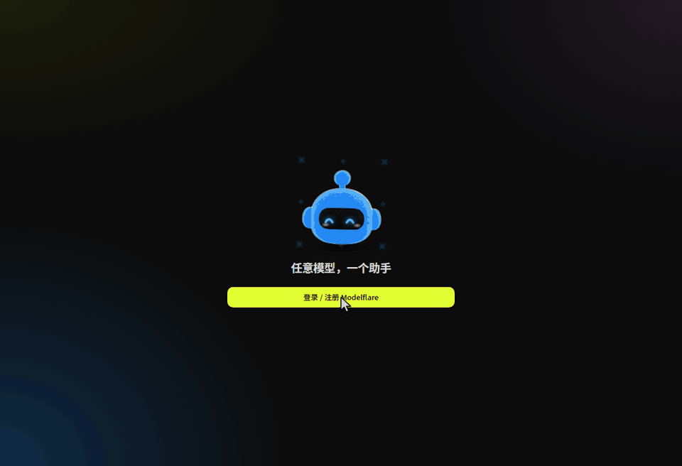
</p>

# 🤖 AnyModelBot

AnyModelBot 是執行於 Windows / macOS / Linux 上的 AI 機器人團隊。每個機器人有自己的人設、預設模型、工作區和記憶；可在應用程式內聊天，也可連接微信、飛書、Telegram、Slack、Discord。它能讀寫檔案、執行指令、在授權後操作桌面；要寫到工作區以外，會先問你。

對話、記憶、檔案和 API Key 留在你的裝置上。模型可走 [Modelflare](https://modelflare.dev/?utm_source=anymodelbot&utm_campaign=amb_readme)（登入後按用量付費），或使用自己的官方 API Key 直連廠商。AnyModelBot 本身沒有訂閱費。

裝好即可用：背景任務、排程規則和待你確認的事項都已內建。

**0.1.49：** 新增台灣繁體中文。開啟「設定 → 一般 → 語言」，選擇「繁體中文（台灣）」，也可以跟隨系統語言。 [更新紀錄](./CHANGELOG_zh-TW.md#0149---2026-11-26)

📥 [下載](#-下載與執行) · 🌠 [螢幕截圖](#-螢幕截圖) · 🌟 [核心功能](#-核心功能) · 🆚 [對比](#-對比-grok-bot--openai-dots--claude-duet) · 🔐 [工作原理與隱私](#-工作原理與隱私)

⭐ 喜歡 AnyModelBot？點個 Star，第一時間收到新版本。

---

<a href="https://modelflare.dev/sign-up?utm_source=anymodelbot&utm_campaign=amb_readme">
  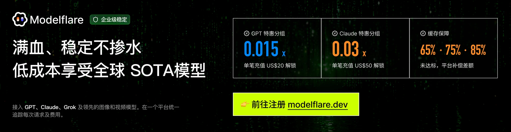
</a>

最省事的用法是 **[Modelflare](https://modelflare.dev/?utm_source=anymodelbot&utm_campaign=amb_readme)**：登入即可使用模型，不用分別申請各家的 Key（想直連廠商，見[任意模型](#-任意模型通過-modelflare-或官方-api)）。可用模型、價格和目前活動以 [Modelflare](https://modelflare.dev/?utm_source=anymodelbot&utm_campaign=amb_readme) 和 [價格表](https://modelflare.dev/pricing?utm_source=anymodelbot&utm_campaign=amb_readme) 為準。

**Bot 額度**：新使用者註冊即送 Bot 額度，訂閱 Modelflare 套餐另送套餐額度 10% 的 Bot 額度，具體以 Modelflare 頁面為準。Bot 額度只能在 AnyModelBot 裡使用，應用程式裡的請求會先用它，剩餘額度可在「設定 → 模型」查看。

**[註冊 Modelflare →](https://modelflare.dev/sign-up?utm_source=anymodelbot&utm_campaign=amb_readme)** ·
[價格表](https://modelflare.dev/pricing?utm_source=anymodelbot&utm_campaign=amb_readme) ·
[API 文件](https://docs.modelflare.dev/?utm_source=anymodelbot&utm_campaign=amb_readme) ·
[信任中心](https://modelflare.dev/trust?utm_source=anymodelbot&utm_campaign=amb_readme) ·
[X](https://x.com/modelflare_dev)

**AnyModelBot 怎麼用 Modelflare**

- **登入一次就行。** 首次啟動會開啟瀏覽器，登入（或註冊）Modelflare。之後應用程式自己把這台裝置連上，不用複製 Key，授權完成後會自動回到應用程式；還沒有預設模型時，會先選好一個支援工具、花費低的模型。在 Docker 或伺服器上執行？在任意裝置的瀏覽器中登入，再把登入後的連結貼回應用程式。
- **所有模型，一個選擇器。** 你的 Modelflare 模型會自動列出，每個模型旁邊都有上下文長度、能力標記和參考價。
- **用多少付多少。** 餘額和充值入口集中在「設定 → 模型」（有 Bot 額度時還顯示剩餘額度和百分比），低餘額提醒和每日用量也都在應用程式裡看。選模型之前，先看公開價格表，和官方價格對比一下。
- **一條誠實的邊界。** 模型請求會經過 Modelflare 轉送給你選定的供應商，Modelflare 會保留請求記錄；保留什麼、保留多久，見[信任中心](https://modelflare.dev/trust?utm_source=anymodelbot&utm_campaign=amb_readme)。除此之外的內容都留在你的裝置上（[詳情](#-工作原理與隱私)）。

---

# 📥 下載與執行

選擇你的平台。每個 Release 頁面都列出全部安裝套件和 `SHA256SUMS` 驗證檔案。

| 平台 | 架構 | 安裝套件 | |
| :--- | :--- | :--- | :--- |
| ![Windows][win-badge] | x64 | `anymodel-bot-<version>-win-x64.exe` | [下載][releases-link] |
| ![Windows][win-badge] | arm64 | `anymodel-bot-<version>-win-arm64.exe` | [下載][releases-link] |
| ![macOS][mac-badge] | Apple 芯片 | `anymodel-bot-<version>-mac-arm64.dmg` | [下載][releases-link] |
| ![macOS][mac-badge] | Intel | `anymodel-bot-<version>-mac-x64.dmg` | [下載][releases-link] |
| ![Linux][linux-badge] | x64 | `anymodel-bot-<version>-linux-x86_64.AppImage` | [下載][releases-link] |
| ![Linux][linux-badge] | arm64 | `anymodel-bot-<version>-linux-arm64.AppImage` | [下載][releases-link] |

<p align="center">
  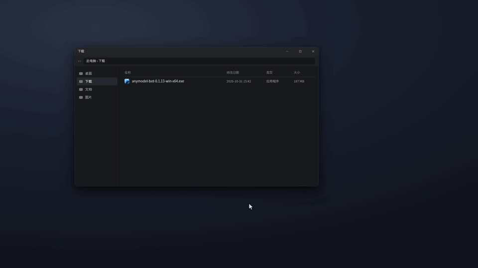
</p>

**首次開啟。** Windows 出現系統風險提示時，點「更多資訊 → 仍要執行」。macOS 版已完成 Developer ID 簽名和蘋果公證，將套用拖入「應用程式」後開啟；首次出現下載確認時點「開啟」。Linux 先給 AppImage 加可執行權限（`chmod +x`）再執行。關閉視窗會把 AnyModelBot 收到系統匣，要結束請用系統匣選單或設定中的選項。

**驗證下載檔案。**

```bash
sha256sum -c SHA256SUMS --ignore-missing
```

macOS 用 `shasum -a 256 <檔名>`，Windows PowerShell 用 `Get-FileHash <檔名>`，再和 `SHA256SUMS` 裡的值對照。

**用 Docker 部署到 NAS 或伺服器**（映像檔同時支援 x64 和 arm64）

```bash
docker run -d --name amb -p 3600:3600 -v amb-data:/data ghcr.io/modelflare-ai/anymodel-bot
docker exec amb cat /data/ui-token   # 然後開啟 http://<主機>:3600/?token=<權杖>
```

不要把 3600 連接埠直接暴露到公用網路。

**從原始碼執行**

```bash
git clone https://github.com/modelflare-ai/AnyModelBot.git
cd AnyModelBot
npm install
npm run setup      # 拉取並編譯內建閘道
npm start          # 本機管理介面：http://127.0.0.1:3600/（首次用終端機裡列印的帶權杖位址開啟）
```

從從原始碼建置需要 Node.js 22.13+ 和 Go 1.26.8+。想自己建置 Docker 映像檔，見[開發文件](./docs/development_zh-TW.md)。

# 🌠 螢幕截圖

下方截圖採用簡體中文介面。開啟「設定 → 一般 → 語言」，即可選擇「繁體中文（台灣）」。

<picture>
  <source media="(prefers-color-scheme: dark)" srcset="docs/assets/screenshots/chat-dark.webp">
  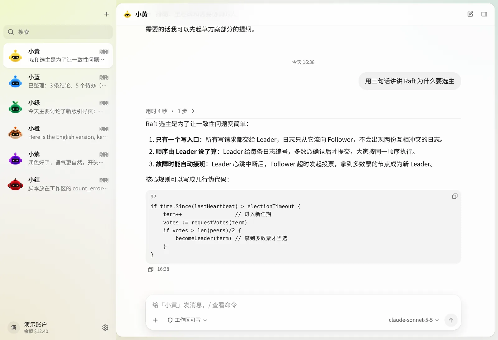
</picture>

<p align="center"><i>和機器人聊天。回覆支援 Markdown 和程式碼塊，輸入欄位會顯示目前用的模型。</i></p>

<picture>
  <source media="(prefers-color-scheme: dark)" srcset="docs/assets/screenshots/agent-dark.webp">
  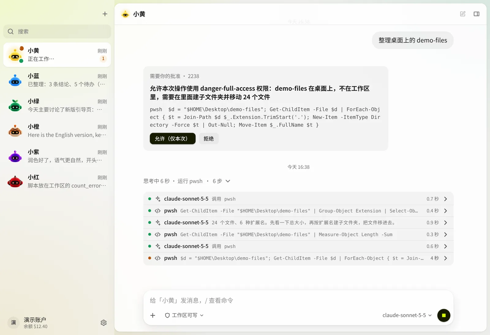
</picture>

<p align="center"><i>機器人做了什麼，一步一步看得見。工作區之外的操作要等你核准。</i></p>

<picture>
  <source media="(prefers-color-scheme: dark)" srcset="docs/assets/screenshots/models-dark.webp">
  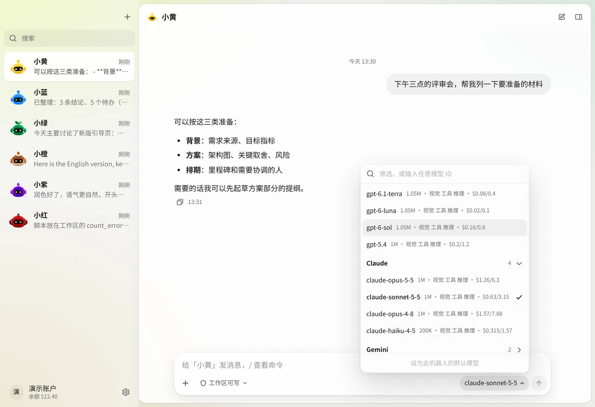
</picture>

<p align="center"><i>每個對話都能選任意 Modelflare 模型，上下文長度、能力和參考價就在旁邊。</i></p>

<picture>
  <source media="(prefers-color-scheme: dark)" srcset="docs/assets/screenshots/memory-dark.webp">
  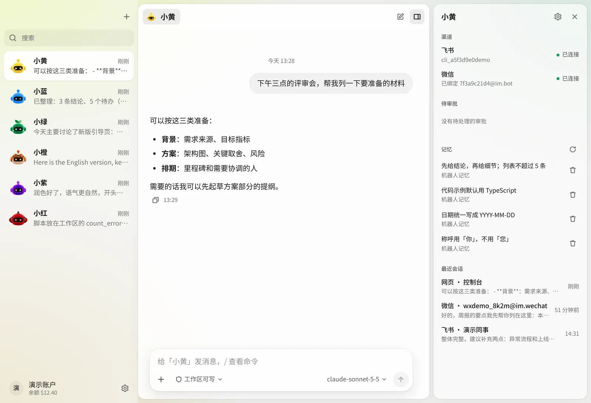
</picture>

<p align="center"><i>每個機器人的記憶、管道和對話，集中在一個面板裡。</i></p>

<picture>
  <source media="(prefers-color-scheme: dark)" srcset="docs/assets/screenshots/modelflare-dark.webp">
  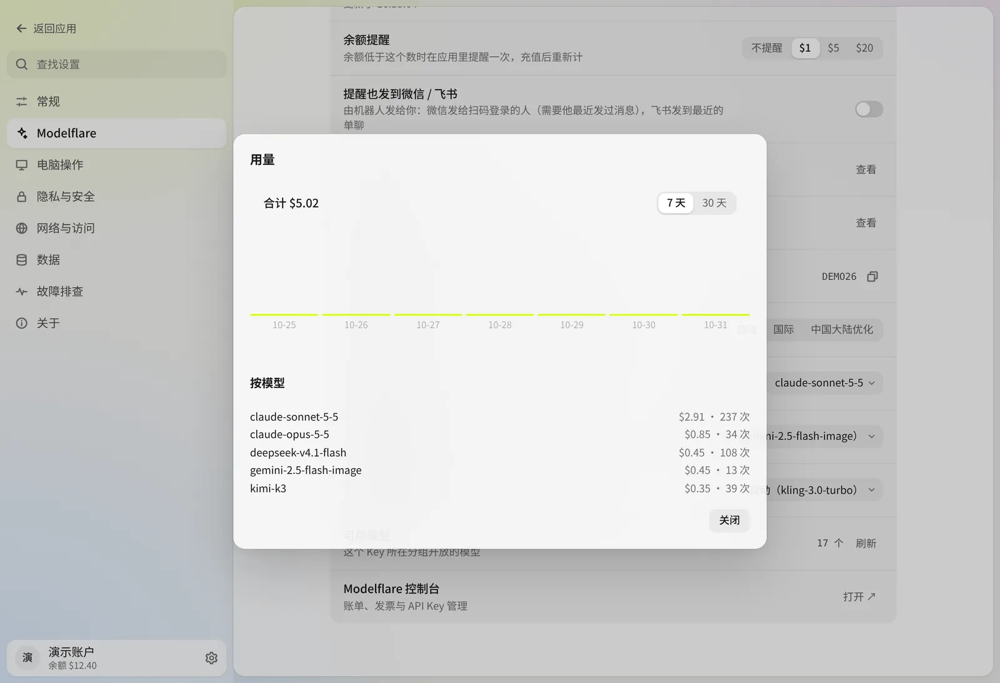
</picture>

<p align="center"><i>應用程式裡的 Modelflare 帳號：餘額、用量和預設設定。</i></p>

<picture>
  <source media="(prefers-color-scheme: dark)" srcset="docs/assets/screenshots/bots-dark.webp">
  
</picture>

<p align="center"><i>六個角色，幫你分清不同的機器人。它們的眼睛會跟著你的滑鼠轉。</i></p>

# 🌟 核心功能

## 🤖 真能幹活的機器人

機器人不只是一個聊天視窗：它有自己的人設、預設模型、工作區和記憶。

- **需要幾個就有幾個**，每個都有自己的人設、模型、工作區和大頭貼。
- **每個機器人由你來定義。** 人設就是一段話，範本只是起點，每個字都能改；六個大頭貼只管長相，不決定它能做什麼。
- **真正的檔案操作。** 機器人能讀寫檔案、在沙箱裡執行指令，並把結果作為檔案發回聊天。
- **每個機器人三檔權限。** *唯讀*、*工作區*（預設：只能寫自己的資料夾；要寫到工作區以外，得先經過你點頭）、*完全權限*（不進沙箱；刪除整個資料夾前仍會先問）。
- **技能：匯入、安裝和自己存。** 在「應用程式與技能」的技能庫裡挑技能，複製安裝指令或直接把 GitHub 連結發給機器人，確認卡片後即可安裝；也能在「機器人設定 → 技能」匯入包含 `SKILL.md` 的 ZIP（每包一個技能，最大 20 MB）。和機器人把一件事做對後，說「存成技能」或發 `/skill`，確認草稿卡就存進「我的技能」，可以在多個機器人上用、匯出 ZIP，也能設成排程。改動在目前工作結束後生效。 [使用說明](./docs/skills_zh-TW.md)。
- **核准卡片，沒有意外。** 要寫到工作區以外的操作會停下來，等你回答。
- **重新啟動了也會告訴你。** 應用程式結束或崩潰時還沒處理完的訊息，下次啟動會在原對話裡說一聲，請你重新傳送，不會自動重做。
- **群聊。** 建一個群，拉幾個機器人進來。@ 誰誰回答，沒 @ 時上一個回答的接著答；機器人也能 @ 別的成員請它接手。每個機器人用自己的模型、工作區和記憶，花費分開算。
- **機器人之間傳送訊息。** 在應用程式裡對一個機器人說「交給 B」，B 用自己的模型、權限和預算在背景做完回訊息，原來的機器人核對後告訴你；要核準時以 B 的名義在同一個對話裡問你，兩個機器人的往來隨時能看。需要登入 Modelflare，兩邊都用 Modelflare 模型。
- **聊天記錄搜尋。** 側欄可搜尋本機儲存的全部訊息，按機器人、對話、管道和日期篩選，點選結果定位原訊息。`Ctrl/Cmd+Shift+F` 開啟全域搜尋，`Ctrl/Cmd+F` 尋找目前聊天；搜尋不呼叫模型。沒輸入時，搜尋快顯視窗按日期列出最近的對話。
- **工作資料夾和 ZIP。** 桌面版在輸入欄位上方選一個資料夾，機器人就在原位置讀寫（工作區權限下改這個資料夾不用逐次核准）；ZIP 拖進對話，說清要做什麼後，機器人才會安全解壓縮。
- **圖片用作生圖參考。** 登入 Modelflare 帳號後，給對話加上圖片並開啟「用作生圖參考」，右下角選的模型就按這些圖片生成新圖；也可以直接選圖片生成模型，寫一句話生圖。條件不滿足時輸入欄位上方會說明原因。
- **從本機匯入技能。** 桌面版能找到 Claude Code、Codex、Cursor 等工具在這台電腦上裝好的技能，預覽後一次匯入「我的技能庫」；庫裡每個技能只存一份，各機器人自己決定開不開。
- **斜槓指令**，如 `/model`、`/reset`，在應用程式和各個聊天管道裡都能用；在聊天管道裡發 `/bot` 可以換機器人。

<p align="center">
  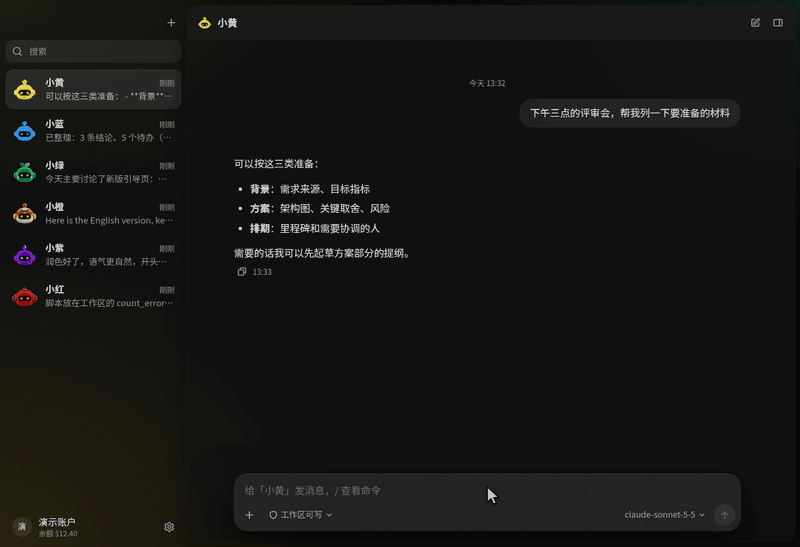
</p>

## 🧩 現成的 Bot

不想自己撰寫人設，可以直接用發現頁裡的現成機器人。每個都有自己的介面，開啟時先看範例，發第一句話才會安裝。

官方 Bot 的介面、範例、人設和技能均隨安裝套件內建，首次開啟和安裝不再下載 Bot 包；更新跟隨應用程式版本發布，已有專案資料保留。模型呼叫和連線上網研究仍需要網路。每個 Bot 都是一個桌面工作台：左邊是作品清單、右邊是內容，「新增」用精靈點選幾項就能開始；頂欄可以切換到完整的對話，底部輸入欄位也能選模型。

- **盡職調查助手：** 在你的電腦上做公司盡職調查，產生可追溯的簡報和 PDF。
- **PPT 大師：** 把文件或主題做成可編輯的 PPT，也能改現有的簡報。
- **影視創作室：** 做短片和分集短劇，從劇本、分鏡到配音、剪輯和成片。
- **美股研究報告：** 查閱美股財報和申報檔案，寫出資料可追溯的研究報告。

影視創作室需要 AnyModelBot 0.1.23 及以上版本、本機 Python 3.10+ 和 FFmpeg（含 ffprobe）。AI 圖片和影片通過 Modelflare 按用量計費；專案與素材儲存在你的裝置上。

完整介紹見[官方網站的 Bot 頁面](https://anymodel.bot/zh-TW/bots)。

## ⏳ 在背景做事，需要你時才來找你

- **背景任務。** 要跑一陣子的事（調查研究、做報告、整理檔案），或者你說一句「背景做」，機器人會開一個背景任務，你可以接著聊別的。做完把結果發回原來的對話。
- **接著問。** 在微信裡引用結果、在飛書裡回覆那則訊息，就是繼續問這個任務。
- **規則。** 「每天早上 8 點查看 X 的價格，低於 200 告訴我」會建成一條規則，到點就去查，有值得說的才告訴你。想先查看它會怎麼做，就說「先觀察」：只記下本會說什麼，不傳送訊息、不改檔案，看過幾次再改成執行。
- **「需要你」。** 所有機器人在等你回答、核准或重試的事都在側欄這一行裡；沒事時這一行不出現。資訊面板的「任務」組列著這個機器人的任務和規則，每一步都看得到。
- **不吵你。** 只推結果、要你決定的事和失敗，進展不推。預設 22:00 到 08:00 免打擾；主動訊息每天有上限（微信 3 條，其他管道 5 條），多了合成一條。
- **有預算。** 每個任務、每條規則都有預算（任務預設 1 美元，規則每次 0.1 美元、每月 3 美元），快用完時停下問你，可以在任務詳情和規則編輯器裡改。
- **隨時暫停。** 機器人設定 › 主動訊息裡一個切換開關暫停背景工作，聊天照常。
- **用完會清理。** 任務和執行記錄留 30 天；任務資料夾 30 天沒動過會自動刪除，不來問你，任務詳情裡寫著哪天刪，想留就點保留。執行記錄能匯出成 Markdown。

執行階段基於 [DeepSeek Harness](https://github.com/deepseek-ai/deepseek-harness)，設計參考了 DeepSeek 的 [Super Agent 原型](https://github.com/deepseek-ai/dsh-superagent-prototype)。完整介紹見[《AnyModelBot 超級 AI 代理》](./docs/blog/superagent_zh-TW.md)。

## 🖥️ 操作你的電腦，產生圖片和影片

- **電腦操作**由內建的 [Cua Driver](https://github.com/trycua/cua) 提供。預設自動執行；把某個機器人切到「改變介面前先問我」，每一次點選和輸入都要等你點頭。讀取螢幕內容永遠不需要核准。macOS 上的電腦操作是 Beta 功能：第一次用到時才請求「輔助功能」和「螢幕錄製」權限，缺哪一項會在聊天裡說明怎麼開。
- **圖片和影片產生**直接產生，要求沒說清的按最合理的理解來；預計花費超過 0.5 美元時才先問你，讓你看到模型和提示詞，也可以當場換模型。想每次都確認，在機器人設定中開啟即可。

<p align="center">
  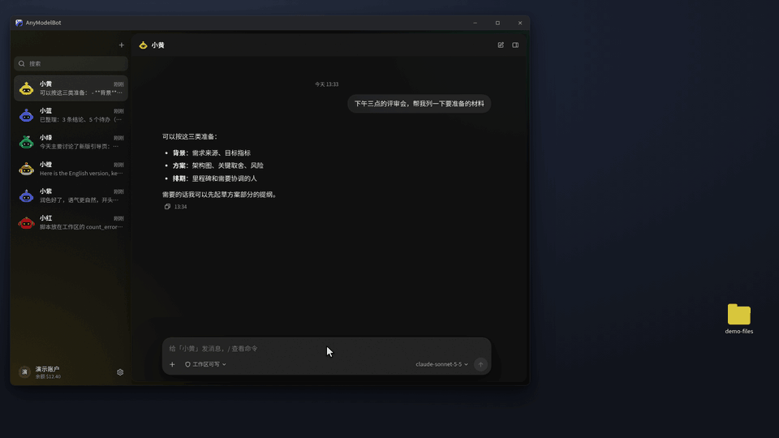
</p>

<p align="center">
  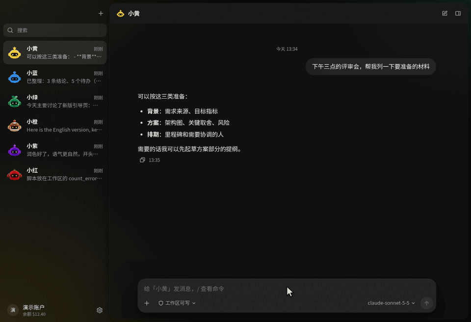
</p>

## 🌐 任意模型，通過 Modelflare 或官方 API

- **登入一次**，你的 Modelflare 模型就會自動出現。
- **或者用自己的官方 API Key。** 支援 OpenAI、Anthropic、Google Gemini、xAI、DeepSeek、Kimi、GLM、Qwen、MiniMax 和 Mistral。Key 只存在你的裝置上，模型請求直接發給廠商，不經過 Modelflare，費用由廠商收取。生圖和生影片目前只能通過 Modelflare 使用。
- **一個選擇器，覆寫所有模型。** GPT、Claude、Gemini、Grok、DeepSeek、Kimi、GLM 等，每個都標出上下文長度、能力和參考價。
- **按對話切換**，也可以給每個機器人設預設模型；記憶整理、上下文交接這類背景小任務，還能單獨指定一個模型。
- **三個 API 域名。** `modelflare.dev`、`origin.modelflare.dev` 和 `cf.modelflare.dev` 均可選擇；可在設定中測速，AnyModelBot 不會自動切換。
- **依用量付費。** 錢包餘額、低餘額提醒、每日用量、每個機器人的預算 Key 都內建。AnyModelBot 本身沒有訂閱費。

<p align="center">
  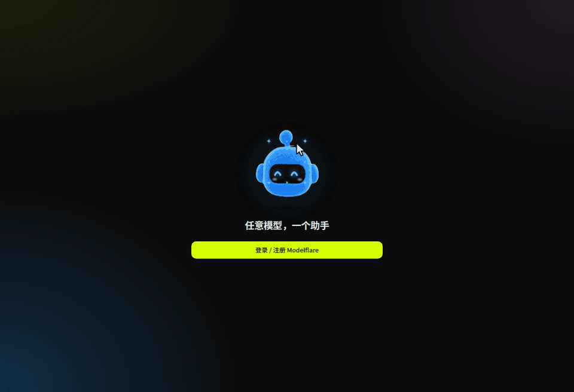
</p>

<p align="center">
  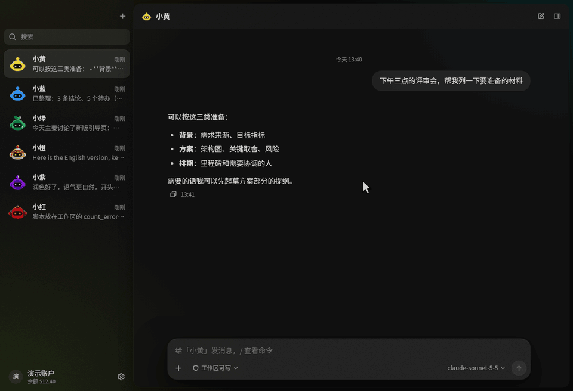
</p>

## 🧠 有記憶，隨處可達

- **記憶會延續。** 關於你本人的事記在所有機器人共用的「關於我」裡，說一次都知道，可在設定中查看、修改和撤銷；位址、電話、電子信箱先問你再記。機器人和群也各有自己的記憶，以 Markdown 儲存，互不混用；看起來像密碼、金鑰的內容不會被記住。
- **長對話也能用下去。** 上下文快滿之前，上下文管家會壓縮，或開一個新段並帶上交接摘要。
- **帳號全域共用。** 微信、飛書、Telegram、Slack、Discord 的聊天帳號在「設定 › 聊天管道」裡加一次，所有機器人共用，每個管道可以加多個、起別名。在通訊軟體裡發一次 `/bot 名字` 就換一個機器人聊。
- **連線應用程式。** 左下角大頭貼選單裡的「應用程式與技能」內建飛書、騰訊文件、釘釘、高德地圖、語雀、Notion、GitHub、Linear、Atlassian、Canva 的連接器，也可以新增自訂 MCP（遠端服務或本機指令）。連一次，預設所有機器人都能用，可以按機器人、按工具收窄。唯讀直接用，寫入先問你，刪除和對外傳送每次都問。
- **微信和飛書。** 微信掃碼連線，飛書機器人支援串流回覆卡片；微信還能收發圖片和檔案。
- **Telegram、Slack、Discord。** 在 設定 › 聊天管道 裡填 token 連線，不需要公用網路位址；回覆邊寫邊顯示，能收發圖片和檔案。目前只處理單聊，核准和提問回覆文字。
- **四種執行方式。** 桌面版、命令列、Docker，以及 `127.0.0.1:3600` 的本機網頁控制台。

<p align="center">
  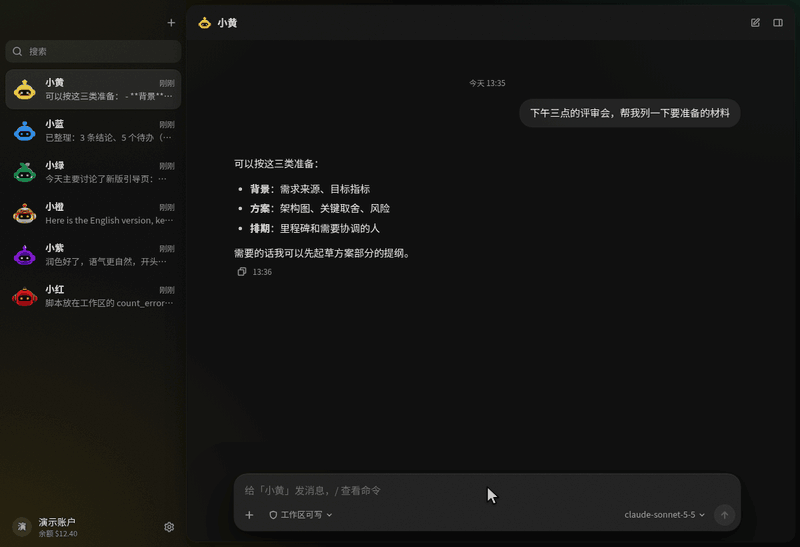
</p>

<p align="center">
  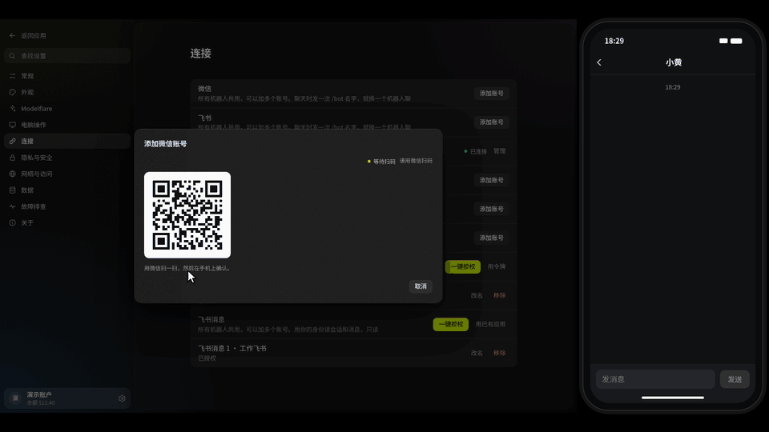
</p>

## 🔒 本機優先，也好看

- **資料留在你手裡。** 對話、記憶、檔案和 API Key 都存放在你的裝置上。本機控制台只監聽 `127.0.0.1`，並且要帶存取權杖才能開啟（桌面版每次啟動都會產生新的權杖）。
- **只聽主人的。** 機器人預設只回應主人（掃碼登入的微信；飛書、Telegram、Slack、Discord 連上後第一個給它傳送訊息的人，也就是你）和你允許的人。其他人傳送訊息只會收到一句提示，不會呼叫模型；你在資訊面板裡，或在聊天裡回覆「同意 編號」放行。
- **回覆不會丟。** 回覆先存到本機再發；網路斷了會自動重試，應用程式重新啟動後接著發；你在微信裡超過 24 小時沒說話時，回覆先留著，等你下次傳送訊息時一起送到。
- **遙測保持關閉。** 內建電腦操作驅動的遙測已關閉，內建閘道以關閉自動更新的方式執行。
- **應用程式內更新。** 從 0.1.29 起，桌面安裝版預設開啟「設定 → 一般 → 自動下載更新」。新版本在背景下載，完成後提示「重新啟動並更新」，由你點選並在任務空閒時安裝；關閉切換開關後可手動下載。0.1.28 及更早版本需要先手動安裝一次 0.1.29 或更高版本。Docker 和原始碼部署仍手動升級。從 0.1.30 起，升級後第一次開啟會說明這次更新了什麼；側欄帳號旁的更新按鈕可直接下載，準備好後點選重新啟動更新，「設定 → 關於」裡隨時可以看更新紀錄。
- **淺色、深色或跟隨系統。** 六個機器人角色，眼睛會跟著你的滑鼠轉。
- **系統匣與開機時自動啟動。** 關閉視窗會收到系統匣；macOS 和 Windows 支援開機時自動啟動。

<p align="center">
  
</p>

> [!NOTE]
> 功能是否可用取決於你選擇的模型、作業系統和授予的權限。電腦操作需要桌面對話，macOS 上的電腦操作為 Beta。模型請求會發給你選定的供應商（用官方 API Key 時直連，否則經過 Modelflare），詳見[工作原理與隱私](#-工作原理與隱私)。

# 🆚 對比 Grok Bot / OpenAI dots / Claude Duet

2026 年下半年，xAI 的 [Grok Bot](https://x.ai/bot)、OpenAI 的 [dots](https://openai.com/index/introducing-dots/) 和 Anthropic 的 Claude Duet 接連發布。它們也是常駐背景、替你做事的 AI，需要你拍板時再來問你。AnyModelBot 做的是同一類事，換了一種做法：開放原始碼、執行於你自己的裝置上、任意模型都能用。

| | AnyModelBot | Grok Bot | OpenAI dots | Claude Duet |
| :--- | :--- | :--- | :--- | :--- |
| 開放原始碼 | ✅ MIT | — | — | — |
| 執行位置 | 你自己的電腦或伺服器 | xAI 的雲端電腦 | OpenAI 的雲端電腦 | Anthropic 的雲端 |
| 能用的模型 | GPT、Claude、Gemini、Grok 等（經 Modelflare 或官方 API） | 以 xAI 的 Grok 模型為主 | OpenAI 的模型 | Claude（Opus 5.5） |
| 費用 | 應用程式免費，模型按 token 計費 | 訂閱 | ChatGPT Pro / Business Premium 訂閱 | Claude Pro / Max 訂閱 |
| 在哪找它 | 桌面應用程式（Windows、macOS、Linux）、Docker、微信、飛書、Telegram、Slack、Discord | 桌面應用程式、iPhone | ChatGPT、Slack、Teams | iOS、Android、claude.ai |
| 現在能用嗎 | 直接下載 | 測試版 | 部分地區開放 | 研究預覽，美國候補名單 |

AnyModelBot 同樣能在背景做事：交代的任務可以在背景跑完，再把結果發到你用的聊天管道；需要你核准或回答時，它會出現在側欄的「需要你」裡。機器人做的每一步都看得見，越出工作區的操作先問你。

> [!NOTE]
> 其他產品的資訊來自 2026 年 10 月的公開報道，可能已有變化，以各家官方說明為準。Grok Bot、dots、Claude Duet 分別是 xAI、OpenAI、Anthropic 的產品和商標，AnyModelBot 與它們沒有關聯。

# 🔐 工作原理與隱私

<picture>
  <source media="(prefers-color-scheme: dark)" srcset="docs/assets/diagrams/data-flow-dark.svg">
  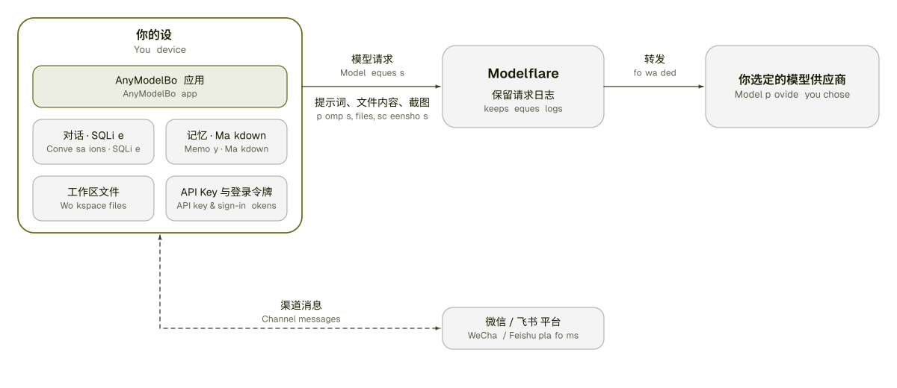
</picture>

| 留在你的裝置上 | 會離開你的裝置 |
| :--- | :--- |
| 對話與對話（本機 SQLite 資料庫） | 模型回答所需的提示詞、檔案內容和工具結果，發給你選定的供應商（用官方 API Key 時直連，否則經過 Modelflare） |
| 記憶（Markdown 檔案） | 你讓機器人用電腦操作看螢幕時的螢幕螢幕截圖 |
| 每個機器人工作區裡的檔案 | 你通過聊天管道收發的訊息，會經過對應的平台 |
| 你的 API Key 和登入權杖 | 你登入 Modelflare 的過程，發生在 modelflare.dev |
| 連線應用程式 | 你連線應用程式（飛書、Notion、GitHub 等）或新增自訂 MCP 後，機器人會讀寫其中的內容，讀到的內容也會進入模型請求 |

Modelflare 會保留請求記錄；保留什麼、保留多久，見它的[信任中心](https://modelflare.dev/trust?utm_source=anymodelbot&utm_campaign=amb_readme)。我們不聲稱能做到萬無一失：凡是你發給模型的內容，都會離開你的裝置。完整清單見 [docs/privacy.md](./docs/privacy_zh-TW.md)。

<picture>
  <source media="(prefers-color-scheme: dark)" srcset="docs/assets/diagrams/architecture-dark.svg">
  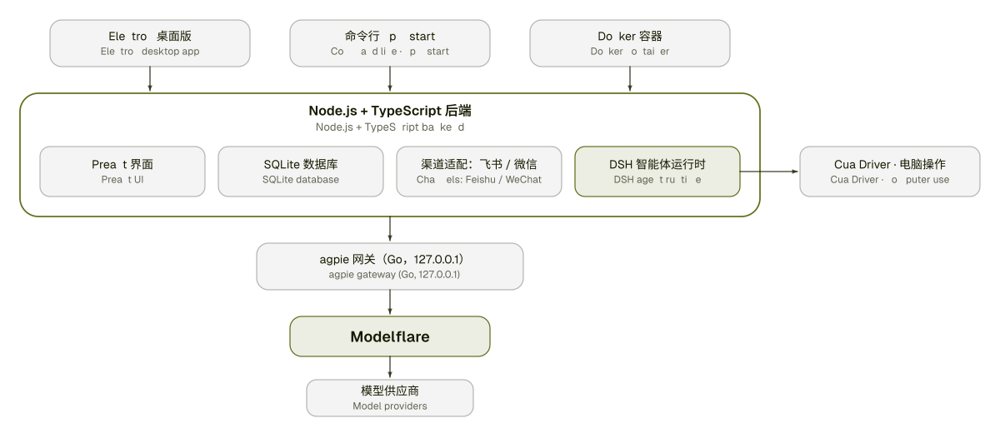
</picture>

| 層 | 技術 |
| :--- | :--- |
| 介面 | Preact + htm，無建置步驟 |
| 後端 | Node.js 22.13+、TypeScript、`node:sqlite` |
| 桌面外殼 | Electron，帶系統匣 |
| 模型閘道 | [magpie](https://github.com/yetone/magpie)（Go，MIT），隨應用程式封裝並由應用程式啟動 |
| AI 代理執行階段 | [DeepSeek Harness](https://github.com/deepseek-ai/deepseek-harness)（MIT），作為獨立程序執行 |
| 電腦操作 | [Cua Driver](https://github.com/trycua/cua)，隨應用程式封裝 |
| 管道 | 飛書（持續連線 + 串流卡片）、微信（iLink）、Telegram（長輪詢）、Slack（Socket Mode）、Discord（Gateway） |
| 連線應用程式 | 內建連接器：飛書、騰訊文件、釘釘、高德地圖、語雀、Notion、GitHub、Linear、Atlassian、Canva；自訂 MCP：Streamable HTTP（相容 SSE）、本機指令 |
| 測試與 CI | Vitest、GitHub Actions |

# 📝 路線圖

我們正在探索的方向。它們不是承諾，順序也不是排期。每個版本實際改了什麼，見[更新紀錄](./CHANGELOG_zh-TW.md)。

- [x] **排程任務**：讓機器人按時間表自己做事（已上線，就是上面的規則）。
- [x] **應用程式內群聊**：在應用程式裡建群，拉多個機器人一起聊。
- [ ] **聊天管道裡的群聊**：目前各聊天管道只處理一對一對話。
- [x] **多語言介面**：支援簡體中文、繁體中文（台灣）、英語、日語、韓語、俄語、西班牙語、葡萄牙語（巴西）和土耳其語，可在設定中切換。
- [ ] **macOS 電腦操作**：在更多真機上驗證 direct 模式，讓它脫離 Beta。
- [ ] **電子信箱、日曆和事件觸發**：連接電子信箱和日曆帳號，規則除了按時間跑，也能在事情發生時馬上跑（例如收到某人的郵件、快開會時）。由外部內容觸發的執行權限更低，防止別人寫的內容給機器人下指令。
- [ ] **常駐執行、備份和移轉**：電腦關機時規則不會跑。讓普通使用者也能一鍵部署到自己的伺服器，把對話、記憶和帳號搬過去，也能備份和還原。
- [ ] **自己新增 MCP**：目前只能用內建的工具和帳號。開放後，可以自己連接 GitHub、Linear 等服務。
- [ ] **機器人之間協作**：讓一個機器人把活交給另一個，例如用不同的模型寫稿和審稿，花費分開算。
- [ ] **語音訊息轉寫**：Telegram 的語音訊息目前聽不到內容，微信靠平台內附的轉寫。
- [ ] **獨立的手機應用程式**：目前可以從微信、飛書、Telegram、Slack、Discord 找到你的機器人。

有別的想法？歡迎提 [issue](https://github.com/modelflare-ai/AnyModelBot/issues) 或發起[討論](https://github.com/modelflare-ai/AnyModelBot/discussions)。我們決定要做的事項，會用 [`roadmap`](https://github.com/modelflare-ai/AnyModelBot/labels/roadmap) 標籤跟蹤。

# 🤝 參與貢獻

歡迎提交 bug 報告、修復、文件和想法。

1. 先查看已有的 [issue](https://github.com/modelflare-ai/AnyModelBot/issues) 和[討論](https://github.com/modelflare-ai/AnyModelBot/discussions)。帶 [`good first issue`](https://github.com/modelflare-ai/AnyModelBot/labels/good%20first%20issue) 標籤的 issue 適合入門。
2. Fork 儲存庫，從 `master` 新增分支。
3. 本機執行並修改：

   ```bash
   npm install
   npm run setup          # 拉取並編譯內建閘道
   npm run electron:dev   # 開發模式執行桌面版
   npm run typecheck && npm test
   ```

4. 向 `master` 提交 Pull Request，寫清楚改了什麼、為什麼改。比小修復大的改動，請先開 issue，我們先對齊方案。

完整說明見[貢獻指南](./CONTRIBUTING_zh-TW.md)。如果要報告安全問題，請按 [SECURITY.md](./SECURITY_zh-TW.md) 處理，不要公開提 issue。

# 🔗 相關專案

- [Modelflare](https://modelflare.dev/?utm_source=anymodelbot&utm_campaign=amb_readme)：AnyModelBot 模型背後的 AI API 閘道。
- [magpie](https://github.com/yetone/magpie)：隨應用程式封裝的 Go 閘道（MIT）。
- [DeepSeek Harness](https://github.com/deepseek-ai/deepseek-harness)：AI 代理執行階段（MIT）。
- [Cua](https://github.com/trycua/cua)：電腦操作驅動。
- [kimi-computer-use](https://github.com/songkeys/kimi-computer-use)：macOS 的電腦操作橋接。
- [openclaw-weixin](https://github.com/Tencent/openclaw-weixin)：我們移植的微信管道實現（MIT）。
- [DS Bot](https://github.com/Fei2411/DS-Bot)：記憶與上下文管家的設計來源（Apache-2.0）。

完整的授權條款與聲明見 [THIRD_PARTY_NOTICES.md](./THIRD_PARTY_NOTICES_zh-TW.md)。

# 💬 社群

- **提問與想法：** [GitHub Discussions](https://github.com/modelflare-ai/AnyModelBot/discussions)
- **Bug 與功能建議：** [GitHub Issues](https://github.com/modelflare-ai/AnyModelBot/issues)
- **需求與意見回饋：** 帳號選單 → 需求與意見回饋（使用場景與建議、遇到問題、企業與合作；登入 Modelflare 後成為你的私有工單，聯繫方式只在你同意時附帶）
- **即時交流：** [Discord](https://discord.gg/umBN6wX3zJ) · [Telegram](https://t.me/+Tx6Payfzxqk2ZGVl)
- **郵件聯繫：** [support@anymodel.bot](mailto:support@anymodel.bot)
- **Modelflare 動態：** [X 上的 @modelflare_dev](https://x.com/modelflare_dev)

# 🚀 貢獻者

<a href="https://github.com/modelflare-ai/AnyModelBot/graphs/contributors">
  
</a>

# ⭐️ Star 趨勢

<a href="https://www.star-history.com/#modelflare-ai/AnyModelBot&Date">
  <picture>
    <source media="(prefers-color-scheme: dark)" srcset="https://api.star-history.com/svg?repos=modelflare-ai/AnyModelBot&type=Date&theme=dark" />
    <source media="(prefers-color-scheme: light)" srcset="https://api.star-history.com/svg?repos=modelflare-ai/AnyModelBot&type=Date" />
    
  </picture>
</a>

# 📜 授權條款

AnyModelBot 以 [MIT 授權條款](./LICENSE)發布。隨附的第三方軟體保留各自的授權條款，見 [THIRD_PARTY_NOTICES.md](./THIRD_PARTY_NOTICES_zh-TW.md) 和 [`LICENSES/`](./LICENSES) 目錄。

<!-- link & badge references -->
[release-shield]: https://img.shields.io/github/v/release/modelflare-ai/AnyModelBot?include_prereleases&label=release&logo=&style=flat-square&labelColor=161a00&color=d7ff00
[downloads-shield]: https://img.shields.io/github/downloads/modelflare-ai/AnyModelBot/total?logo=github&logoColor=d7ff00&style=flat-square&labelColor=161a00&color=d7ff00
[stars-shield]: https://img.shields.io/github/stars/modelflare-ai/AnyModelBot?logo=github&logoColor=d7ff00&style=flat-square&labelColor=161a00&color=d7ff00
[license-shield]: https://img.shields.io/github/license/modelflare-ai/AnyModelBot?logo=opensourceinitiative&logoColor=d7ff00&style=flat-square&labelColor=161a00&color=d7ff00
[ci-shield]: https://img.shields.io/github/actions/workflow/status/modelflare-ai/AnyModelBot/ci.yml?branch=master&label=CI&logo=githubactions&logoColor=d7ff00&style=flat-square&labelColor=161a00&color=d7ff00
[platform-shield]: https://img.shields.io/badge/platform-Windows%20%7C%20macOS%20%7C%20Linux%20%7C%20Docker-d7ff00?style=flat-square&labelColor=161a00
[pricing-shield]: https://img.shields.io/badge/pricing-pay--as--you--go-d7ff00?style=flat-square&labelColor=161a00
[modelflare-shield]: https://img.shields.io/badge/Modelflare-modelflare.dev-d7ff00?style=flat-square&labelColor=161a00
[x-shield]: https://img.shields.io/badge/X-@modelflare__dev-d7ff00?style=flat-square&labelColor=161a00&logo=x&logoColor=d7ff00
[qq-shield]: https://img.shields.io/badge/QQ-1132903119-d7ff00?style=flat-square&labelColor=161a00&logo=qq&logoColor=d7ff00
[telegram-shield]: https://img.shields.io/badge/Telegram-chat-d7ff00?style=flat-square&labelColor=161a00&logo=telegram&logoColor=d7ff00
[discord-shield]: https://img.shields.io/badge/Discord-chat-d7ff00?style=flat-square&labelColor=161a00&logo=discord&logoColor=d7ff00
[win-badge]: https://img.shields.io/badge/Windows-161a00?style=for-the-badge&logo=
[mac-badge]: https://img.shields.io/badge/macOS-161a00?style=for-the-badge&logo=apple&logoColor=d7ff00
[linux-badge]: https://img.shields.io/badge/Linux-161a00?style=for-the-badge&logo=linux&logoColor=d7ff00

[releases-link]: https://github.com/modelflare-ai/AnyModelBot/releases
[stars-link]: https://github.com/modelflare-ai/AnyModelBot/stargazers
[license-link]: https://github.com/modelflare-ai/AnyModelBot/blob/master/LICENSE
[ci-link]: https://github.com/modelflare-ai/AnyModelBot/actions/workflows/ci.yml
[pricing-link]: https://modelflare.dev/pricing?utm_source=anymodelbot&utm_campaign=amb_readme
[modelflare-link]: https://modelflare.dev/?utm_source=anymodelbot&utm_campaign=amb_readme
[x-link]: https://x.com/modelflare_dev
[qq-link]: https://qm.qq.com/q/yHN9KrvlGa
[telegram-link]: https://t.me/+Tx6Payfzxqk2ZGVl
[discord-link]: https://discord.gg/umBN6wX3zJ
