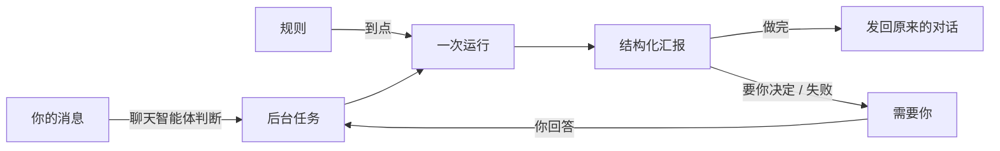

<p align="center">
  <a href="../../README.md">
    
  </a>
</p>

<h1 align="center">AnyModelBot 超级智能体</h1>

<p align="center"><b>交代一句，它在后台做完。需要你的时候，才来找你。</b></p>

<p align="center">
  <a href="../../README.md">项目首页</a> |
  <a href="https://github.com/modelflare-ai/AnyModelBot/releases">下载</a> |
  <a href="../design/background-tasks-and-proactive.md">设计文档</a> |
  <a href="https://github.com/deepseek-ai/dsh-superagent-prototype">dsh-superagent</a> |
  <a href="https://github.com/modelflare-ai/AnyModelBot/issues">问题反馈</a>
</p>

📌 [一个例子](#-先看一个例子) · ⏳ [后台任务](#-后台任务) · 📋 [规则](#-规则说一句按时去做) · 🙋 [需要你](#-需要你) · 🔕 [不打扰](#-不打扰的规矩) · 💰 [权限与花费](#-权限花费与清理) · 🧭 [设计原则](#-设计原则)

---

# 🤖 从聊天到托付

聊天机器人等你开口，答完就停。可很多事不是一问一答：调研要跑半小时，价格要每天盯，周报每周一要写。你想交代一句就去忙别的，有结果、要你拍板的时候再听它说。

AnyModelBot 的超级智能体做的就是这件事。它由三样东西组成：

| | 是什么 | 例子 |
| :--- | :--- | :--- |
| **后台任务** | 交代给机器人的一件事。有自己的会话和文件夹，做完把结果发回你发起的那段对话 | 「帮我调研三家云的 GPU 价格，做个对比」 |
| **规则** | 你用一句话写下的长期吩咐，按时间表去做，有值得说的才告诉你。想先看看，可以让它先观察 | 「每天早上 8 点看看 X 的价格，低于 200 告诉我」 |
| **需要你** | 所有机器人在等你回答、批准或处理的事，集中在一处。没事时不占地方 | 「「GPU 价格调研」在等你回答：报告用中文还是英文？」 |

三样东西背后是同一条原则，来自 DeepSeek 的 [dsh-superagent](https://github.com/deepseek-ai/dsh-superagent-prototype) 原型：**占用尽量少的注意力，带来尽量多的价值。** 一个能替你干活的智能体，也能把你的注意力耗光。所以它只在你要求、或你写下的规则允许时才动手，只在你必须决定、或能用上结果时才开口。

和 AnyModelBot 的其他部分一样，这一切跑在你自己的电脑上，任意模型都能用，按量付费。

# 📌 先看一个例子

周一上午，你在微信里：

```text
10:02  你    帮我调研一下三家云的 A100 价格，做个对比表
10:02  天天  好，后台开始调研三家云的 GPU 价格，好了告诉你，你可以继续聊别的。
10:05  你    明天北京天气怎么样？
10:05  天天  明天晴，最高 18 度……
10:12  天天  ❓「GPU 价格调研」想问你：B 云的报价要登录才能看，先跳过它吗？
             1. 跳过
             2. 我发你截图
             不回复就按跳过做
             （回复编号，或引用这条消息回答）
10:43  天天  GPU 价格调研好了：A100 包月最便宜的是 X 云，约 ¥7,800，对比表已发给你。
             B 云要登录，先跳过了。引用这条消息可以继续问。
10:50  你    「引用：GPU 价格调研好了…」再加上 H100，改成英文
10:50  天天  收到，「GPU 价格调研」继续。
```

这段对话里：

- 机器人判断这件事要跑一阵子，开了后台任务。确认就是那句回复，没有多发一条。
- 任务在自己的会话里跑，聊天照常，天气问题不用排队。
- 报告用什么语言、表格怎么排，它自己定。只问了一个它确实解决不了的问题，还带着默认答案；问完没有停下来等，你没回，它就按默认跳过了 B 云，在结果里说了一声。进展一条也没推给你。
- 结果回到你发起的那段对话。引用它，就是接着问这个任务。

要是晚上 11 点才做完，结果会留到早上 8 点再发。要是你 24 小时没在微信里说话，结果先留着，桌面端看得到，你下次发消息时一起送到。

# ⏳ 后台任务

**怎么开始。** 不用学命令。要跑一阵子的事，比如调研、做报告、写代码、整理文件，机器人会自己放到后台，并在回复里说一句。你也可以直接说「后台做」；想留在聊天里做，就说「前台做」。

**各干各的。** 每个任务有自己的智能体会话和文件夹（`tasks/<名字>-<编号>/`），沿用开始时的模型和权限。聊天永远不等任务：每个机器人同时跑 2 个后台任务，所有机器人合计 4 个。你回答了任务的问题，它会插到队伍最前面。

**接着问。** 三种方式找到同一个任务：

- 微信里**引用**它发来的结果或问题；
- 飞书里**回复**那条消息，结果都回在你的请求下面；
- 在任何地方**点名**：「GPU 那个改成英文」。

任务还在做，你的话会在它的下一步送到；已经做完或失败了，就在同一个任务里接着做，文件和上下文都还在。

**很少问你。** 语言、格式、范围这类事，机器人自己定，在结果里说一句选了什么。只有三种情况才问：猜错会造成损失、花钱或白做大半；需要只有你才有的东西，比如登录、文件、密码；这一步不可撤回，比如付款、删除你的数据、替你给别人发消息。

真要问时分两种：

- **有默认答案的**，比如上面的「B 云要登录，先跳过吗」：马上问你，附一句「不回复就按跳过做」，然后接着做不依赖答案的部分。你的回答在它的下一步送到；你一直没回、它先做完了，就按默认做，在结果里说一声，那个问题自动收回。之后再引用那条问题回答，任务会接着改。
- **只有你能定的**，比如付款、删除：同样马上问你，然后停下来等。

所以晚上 11 点交代的任务，不会因为一个问题空等到早上。

**状态一眼看懂。**

| 状态 | 意思 |
| :--- | :--- |
| 进行中、排队中 | 在做，或在等空位 |
| 进行中，有个问题等你回答 | 问了你一个有默认答案的问题，没停下来 |
| 等你回答、等你批准 | 有一个只有你能定的问题，或一次越界操作，在等你 |
| 预算用完 | 花到了预算，停下来问你要不要继续 |
| 失败 | 自动重试过还是没做成，告诉你卡在哪 |
| 未送达 | 结果没能送到你那里，比如微信窗口关了 |
| 已完成、已停止 | 做完了，还能接着问；或者你让它停了 |

**重启了也不乱。** 应用退出或崩溃时正在跑的任务，下次启动会接着做，并先收到一条说明：上一步可能没做完，哪些后台命令被停了。任务做会改变外部的事（发送、发帖、付款、删除）之前和之后，各在 `.task/journal.md` 记一行；恢复时先看日志和外部系统，再决定要不要重做。机器人自己发出的消息，只会发一次。

**在聊天里管。** 发 `/tasks` 列出后台任务和规则，发 `/stop 编号` 停掉一个。

# 📋 规则：说一句，按时去做

规则是你用一句话写下的长期吩咐，加一个时间表。在聊天里说就行：

> 每天早上 8 点看看 X 的价格，低于 200 告诉我

机器人建好规则，回你一句：

> 已建好规则：每天 08:00 看 X 价格，有值得说的就告诉你。

规则建好就按时去做，不用你再确认一遍：你说的话就是授权。

**两种规则。**

- **检查**：到点让智能体去看、去判断，有值得说的才说。
- **提醒**：「明天下午 3 点提醒我开会」。话和时间都是你定的，到点直接发，不调用模型。

时间表可以是一次、每天、每个工作日、每周几、每隔 N 分钟（至少 15 分钟），或者 cron。界面上会翻译成话，比如「每个工作日 08:00（Asia/Shanghai）」。

**想先看看？** 说「先观察」，或者在规则编辑器里选观察。观察中的规则照常按时运行，区别在这里：

| | 观察 | 执行 |
| :--- | :--- | :--- |
| 按时运行 | ✅ | ✅ |
| 文件 | 只读 | 最多可写自己的工作区 |
| 给你发消息 | 从不 | 按[不打扰的规矩](#-不打扰的规矩)发 |
| 需要批准的操作 | 自动拒绝，记下「需要批准：…」 | 进「需要你」，1 小时没批就算这次失败 |
| 运行记录写什么 | 本会发送、本会保持安静、本会做 | 已发送、保持安静 |

运行记录让你判断它靠不靠谱：

```text
今天 08:00   本会发送：“X 降价了，现在 ¥199（昨天 ¥259）”   约 $0.03
昨天 08:00   本会保持安静（¥259）                          约 $0.02
前天 08:00   失败：页面打不开                                       约 $0.01
10/27 08:00  跳过：电脑没开
```

先观察的规则满 3 次正常运行，「需要你」里会出现一条「规则「看 X 价格」已观察 3 次，需要你来决定是否执行」，下面是它最近一次本会发送的话，点 [改为执行] 或 [继续观察]。这条不推到微信、飞书。选了继续观察，这一版规则不再问；改了规则的原话，再满 3 次会重新问。

**不追旧账。** 电脑关着错过了时间：错过不久的，开机补跑一次；太久的记为「跳过：电脑没开」，不会一口气补一堆。连续失败 3 次的规则自动暂停，出现在「需要你」里。

**观察保证什么。** 不通过 AnyModelBot 给任何人发消息，也不改文件，因为沙箱是只读的。它拦不住命令行工具自己联网，这一点界面上也写明了。

# 🙋 需要你

所有机器人等你处理的事，都在侧栏的「需要你」这一行。没有要处理的事时，这一行不出现。

```text
需要你
● 天天的「GPU 价格调研」在等你回答                     2 分钟前
  B 云的报价要登录才能看，先跳过它吗？
  不回复就按跳过做
  [跳过] [我发你截图] [回复…]

● 天天的「清理旧构建」在等你批准                       5 分钟前
  rm -rf build/
  [批准一次] [拒绝]

● 哒哒的规则「每日价格巡检」连续失败 3 次，已暂停         08:00
  页面打不开：网站可能改版了
  [查看规则]

● 天天的规则「看 X 价格」已观察 3 次，需要你来决定是否执行   08:00
  本会发送：“X 降价了，现在 ¥199（昨天 ¥259）”
  [改为执行] [继续观察]
```

会出现在这里的有：任务的问题和批准、失败、预算用完、没送到的结果、连续失败的规则、先观察且观察够了的规则、过期的微信登录。每一行自带操作，不用跳走。

**在哪回答都行。** 微信里回编号或引用问题，飞书里点卡片按钮，桌面上点「需要你」里的按钮。在一处答了，别处的同一个问题自动收回，不会再推给你。

**桌面通知**只用于「需要你」里的事，只在窗口不在前台时弹，每件事最多一次。

# 🔕 不打扰的规矩

只推三种消息：

| 推送 | 什么时候 | 从不推 |
| :--- | :--- | :--- |
| **能用的结果** | 任务做完；执行中的规则发现了值得说的 | 进展、「还在做」、半成品、重试、重启恢复 |
| **要你做的决定** | 任务的问题或批准，一个对话一次只推一个 | 能按合理默认处理的问题；重复问同一个问题 |
| **要你处理的失败** | 任务自动重试后仍失败；规则连续失败后暂停 | 一次性的网络错误；智能体自己能绕过去的问题 |

另外几条规矩：

- **一条就够。** 每条推送一行，不超过 300 字，不带内部编号和技术细节。想看详情，引用它接着问，或者在桌面端打开。
- **免打扰。** 默认 22:00 到 08:00，这段时间的结果和规则提醒留到早上再发。你 10 分钟内刚说过话，说明你醒着，就不拦。时段可以在设置里改。
- **每天有上限。** 每个对话每天最多主动发：微信 3 条，飞书 5 条。超出的合成一条摘要，第二天早上发。
- **挨着的合成一条。** 2 分钟内要发的几条，合成一条摘要，一项一行。
- **随时暂停。** 机器人设置 › 主动消息 ›「暂停后台工作」：任务、规则和主动消息都先停下，聊天照常。也可以直接跟机器人说一声。

# 💬 微信的 24 小时，老实说

微信只允许机器人在你最近一次发消息后的 24 小时内给你发消息，每次最多 10 条。AnyModelBot 把这当成硬规矩，不去绕：

- **留着，不丢。** 发不出去的结果先留着，桌面端「需要你」里看得到，也会弹一次桌面通知。
- **你一开口就送到。** 你下次在微信里发消息，留着的先合成一条「你不在时：…」发给你，然后才是这次的回复。
- **到期前提醒一次。** 窗口关闭前约 2 小时，如果之后还有东西要发给你，机器人会说一句：「接下来还有 2 条提醒要发给你（明早 8:00 天气、周一 9:00 周报）。回个「ok」我就能继续按时提醒你。」每个窗口最多一次，免打扰时不发，没东西要发就不发，可以在设置里关掉。
- **给结果留配额。** 有任务在跑时，会给结果预留发送次数，聊天回复不会把配额用光。
- **建规则时就说清楚。** 发到微信的规则，建的时候就告诉你这个限制。对时间敏感的提醒，建议发到飞书或桌面。

飞书没有这个限制。应用关着的时候飞书里发来的消息，下次启动会补收，需要给飞书应用开 `im:message.history:readonly` 权限。

# 🔍 看得见，但不啰嗦

推送很少，但你随时可以看。信息面板的「任务」组列着这个机器人的任务和规则；一个都没有时，这一组不出现。

点开一个任务：

```text
GPU 价格调研                                              [停止]
● 已进行 12 分钟，有个问题等你回答
来自      微信 · 今天 10:02「帮我调研一下三家云的 A100 价格…」
问题      B 云的报价要登录才能看，先跳过它吗？
          不回复就按跳过做
最新进展  已比较 3 家，正在核对 B 云的包年价
预算      约 $0.08 / $1.00                                 [改]
文件夹    tasks/gpu-prices-3f2a1c  2.1 MB                  [打开]
第 1 次运行，已进行 12 分钟                                   ▸
```

- **来自**：哪个渠道、什么时候、你的原话。点一下回到那段对话。
- **处理过程**：每次运行的每一步，读了什么、跑了什么命令，折叠着，想看再展开。
- **导出**：任务和规则的完整记录，都能导出成 Markdown。

聊天里发起任务的那条消息下面，也有一个小标签「后台任务「GPU 价格调研」进行中」，点开是同样的详情。

在聊天里也一样：机器人干活时在步骤之间说的话，按顺序显示在回复里；读了什么、跑了什么命令，折叠在「处理过程」里。它交付的文件点一下就打开，桌面版用系统默认程序，网页版在新标签页；图片直接显示在对话里，点开看大图。

# 💰 权限、花费与清理

**权限只会收紧，不会放大。**

| 谁在干活 | 能动什么 | 越界操作 |
| :--- | :--- | :--- |
| 聊天 | 机器人的权限档位 | 聊天里弹审批卡片 |
| 后台任务 | 建任务那一刻机器人的权限档位 | 进「需要你」，12 小时内有效 |
| 观察中的规则 | 只读 | 自动拒绝，记下来 |
| 执行中的规则 | 最多可写工作区，完全权限的机器人也一样 | 进「需要你」，1 小时内有效 |

递归删除这类危险操作，不管什么档位，都会先问你。

**每件事都有预算。** 花费按 Modelflare 的公开价格估算，标着「约」，以账单为准。

| | 默认预算 | 花到了怎么办 |
| :--- | :--- | :--- |
| 后台任务 | $1.00 | 停下来问你：「已用约 $1.00，再给 $1 继续？」 |
| 规则每次运行 | $0.10 | 这次停下，记一次失败 |
| 规则每月 | $3.00 | 暂停到下个月 1 号，或者你在「需要你」里再给 $3 |

- 任务每次运行最长 4 小时，等你回答的时间不算；规则每次最长 15 分钟。
- 给机器人设了 Modelflare 预算时，余额低于 20%，后台工作先停下，剩下的留给聊天。
- 没有公开价格的模型不估算花费，只受时间限制。
- 预算可以在任务详情和规则编辑器里改。

**用完会清理。** 任务和运行记录保留 30 天。任务文件夹 30 天没动过会自动清理，不打扰你；任务详情里提前几天就显示清理日期，点「保留」就再留 30 天。

# 🧭 设计原则

这几条改编自 dsh-superagent 的设计哲学。界面上的每一处取舍，都照它们来：

1. **占用尽量少的注意力，带来尽量多的价值。** 每条消息、每个通知、每个设置、每个面板元素，都要说得出自己为什么存在。
2. **只在被要求、或你写下的规则允许时才动手。** 你的话就是授权，不用再确认一遍。
3. **只在你必须动手、或能用上结果时才开口。** 能自己定的自己定，说一句选了什么；真要问，一次只问一个具体的问题。老实汇报：草稿不是「做完了」，失败就是失败。
4. **概念少，设置少。** 一个值适合几乎所有人，就用默认值。你用话描述的行为，写成提示词，而不是做成开关。
5. **一切正常时，什么都不显示。**

# 🔧 工作原理



- **应用说了算。** 任务、时间表、送达和预算都由 AnyModelBot 自己管，[DeepSeek Harness](https://github.com/deepseek-ai/deepseek-harness) 只负责跑会话。每个机器人一个智能体进程，任务和规则在里面各开各的会话。
- **结构化汇报。** 后台会话用 `task_report` 工具汇报状态：进展、要你、做完、失败，附一句给你看的话，最多一个问题。「需要你」看的是这些字段，不去猜自由文本。
- **时间表在应用里。** 规则的定时由应用管，智能体进程没起来也照样到点；电脑睡眠醒来后会重新计算。
- **送达走发件箱。** 每条主动消息先存到本地再发，按渠道的规矩排队、合并、留存。重启后接着发，发过的不会再发。
- **小内存也能长期跑。** 智能体进程开过很多会话后，会在完全空闲时重启一次，把积累的内存还回去，不打断任何工作。

完整的设计见[设计文档](../design/background-tasks-and-proactive.md)（英文）。

# 🙏 从 dsh-superagent 学到的

DeepSeek 开源的 [dsh-superagent](https://github.com/deepseek-ai/dsh-superagent-prototype) 是一个面向团队、盯着一个 GitHub 仓库的主动编程智能体，配套文章是《Exploring Super-agent Design: Towards a More Autonomous Agent System》。AnyModelBot 是一个人的助手，所以我们拿来了它的骨架，留下了只有团队才需要的部分。

| dsh-superagent | AnyModelBot |
| :--- | :--- |
| 工单的阶段表，第一条匹配的算数 | 任务的状态表 |
| 重启后标记中断，附一条恢复说明，从最老的开始恢复 | 任务重启后接着做 |
| 给人的消息留一个专用位子，排在新任务前面 | 你回答问题时，任务插到最前面 |
| 后台命令跑完前占着位子，命令结束时唤醒会话 | 任务做完前的「收尾」 |
| 接受模式里的「观察」：只记下本会接受什么 | 规则可选的观察模式 |
| 一个结构化的问题，原样转给人 | `task_report` 的问题，进「需要你」 |
| 只为「做好了、要决定、做不了」发消息，一句话，不报进展 | 不打扰的规矩 |
| 面板先回答「现在有什么要我处理」，正常时不占地方 | 「需要你」 |

没有拿的：Source、Trigger、Thread、Eval、Mandate 复核、Subscription、GitHub PR 生命周期和 Policy 版本。一个人的助手只听主人明确说的话，「要不要放到后台」由聊天智能体判断，这就是它的 Eval。

# 📝 接下来：工作负载

这是我们正在探索的方向，不是承诺。

每个人要盯的东西都不一样，所以 GitHub 这类集成不该写死在核心里。我们打算把它做成**工作负载**：一份你自己配置的组合，写明

- **听什么**：一个事件来源，比如某个 GitHub 仓库的新 issue；
- **怎么处理**：用话写的规则；
- **准备什么**：任务文件夹怎么准备，比如先拉一份代码；
- **发到哪**：结果回到哪段对话。

GitHub 会是第一个模板。规则已经留好了「事件触发」的接口，工作负载会建在它上面。设计会先公开讨论，再动手。

有想法？欢迎提 [issue](https://github.com/modelflare-ai/AnyModelBot/issues) 或发起[讨论](https://github.com/modelflare-ai/AnyModelBot/discussions)。

# 🚀 试试看

1. [下载 AnyModelBot](https://github.com/modelflare-ai/AnyModelBot/releases)，登录 Modelflare。
2. 在应用、微信或飞书里，交代机器人一件要跑一阵子的事，或者直接说「后台做」。
3. 说一句「每天早上 8 点……」，建一条规则，有值得说的它会告诉你。

> [!NOTE]
> 功能是否可用取决于你选择的模型、操作系统和授予的权限。花费都是估算，以 Modelflare 账单为准。微信的主动消息受 24 小时窗口限制，见[上文](#-微信的-24-小时老实说)。

AnyModelBot 以 [MIT 许可证](../../LICENSE)发布。
