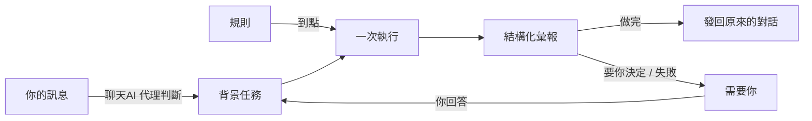

<p align="center">
  <a href="../../README_zh-TW.md">
    
  </a>
</p>

<h1 align="center">AnyModelBot 超級 AI 代理</h1>

<p align="center"><b>交代一句，它在背景做完。需要你的時候，才來找你。</b></p>

<p align="center">
  <a href="../../README_zh-TW.md">專案首頁</a> |
  <a href="./superagent.md">简体中文</a> |
  <a href="https://github.com/modelflare-ai/AnyModelBot/releases">下載</a> |
  <a href="../design/background-tasks-and-proactive.md">設計文件</a> |
  <a href="https://github.com/deepseek-ai/dsh-superagent-prototype">dsh-superagent</a> |
  <a href="https://github.com/modelflare-ai/AnyModelBot/issues">問題意見回饋</a>
</p>

📌 [一個例子](#-先看一個例子) · ⏳ [背景任務](#-背景任務) · 📋 [規則](#-規則說一句按時去做) · 🙋 [需要你](#-需要你) · 🔕 [不打擾](#-不打擾的規矩) · 💰 [權限與花費](#-權限花費與清理) · 🧭 [設計原則](#-設計原則)

---

# 🤖 從聊天到托付

聊天機器人等你開口，答完就停。可很多事不是一問一答：調查研究要跑半小時，價格要每天盯，週報每週一要寫。你想交代一句就去忙別的，有結果、要你拍板的時候再聽它說。

AnyModelBot 的超級 AI 代理做的就是這件事。它由三樣東西組成：

| | 是什麼 | 例子 |
| :--- | :--- | :--- |
| **背景任務** | 交代給機器人的一件事。有自己的對話和資料夾，做完把結果發回你發起的那段對話 | 「幫我調查研究三家雲的 GPU 價格，做個對比」 |
| **規則** | 你用一句話寫下的長期吩咐，按時間表去做，有值得說的才告訴你。想先查看，可以讓它先觀察 | 「每天早上 8 點查看 X 的價格，低於 200 告訴我」 |
| **需要你** | 所有機器人在等你回答、核准或處理的事，集中在一處。沒事時不佔地方 | 「「GPU 價格調查研究」在等你回答：報告用中文還是英文？」 |

三樣東西背後是同一條原則，來自 DeepSeek 的 [dsh-superagent](https://github.com/deepseek-ai/dsh-superagent-prototype) 原型：**佔用盡量少的注意力，帶來盡量多的價值。** 一個能替你做事的AI 代理，也能把你的注意力耗光。所以它只在你要求、或你寫下的規則允許時才動手，只在你必須決定、或能用上結果時才開口。

和 AnyModelBot 的其他部分一樣，這一切執行於你自己的電腦上，任意模型都能用，依用量付費。

# 📌 先看一個例子

週一上午，你在微信裡：

```text
10:02  你    幫我調查研究一下三家雲的 A100 價格，做個對比表
10:02  天天  好，背景開始調查研究三家雲的 GPU 價格，好了告訴你，你可以繼續聊別的。
10:05  你    明天北京天氣怎麼樣？
10:05  天天  明天晴，最高 18 度……
10:12  天天  ❓「GPU 價格調查研究」想問你：B 雲的報價要登入才能看，先跳過它嗎？
             1. 跳過
             2. 我發你螢幕截圖
             不回覆就按跳過做
             （回覆編號，或引用這則訊息回答）
10:43  天天  GPU 價格調查研究好了：A100 包月最便宜的是 X 雲，約 ¥7,800，對比表已發給你。
             B 雲要登入，先跳過了。引用這則訊息可以繼續問。
10:50  你    「引用：GPU 價格調查研究好了…」再加上 H100，改成英文
10:50  天天  收到，「GPU 價格調查研究」繼續。
```

這段對話裡：

- 機器人判斷這件事要跑一陣子，開了背景任務。確認就是那句回覆，沒有多發一條。
- 任務在自己的對話裡跑，聊天照常，天氣問題不用排隊。
- 報告用什麼語言、表格怎麼排，它自己定。只問了一個它確實解決不了的問題，還帶著預設答案；問完沒有停下來等，你沒回，它就按預設跳過了 B 雲，在結果裡說了一聲。進展一條也沒推給你。
- 結果回到你發起的那段對話。引用它，就是接著問這個任務。

要是晚上 11 點才做完，結果會留到早上 8 點再發。要是你 24 小時沒在微信裡說話，結果先留著，桌面版看得到，你下次傳送訊息時一起送到。

# ⏳ 背景任務

**怎麼開始。** 不用學指令。要跑一陣子的事，例如調查研究、做報告、寫程式碼、整理檔案，機器人會自己放到背景，並在回覆裡說一句。你也可以直接說「背景做」；想留在聊天裡做，就說「前景做」。

**各乾各的。** 每個任務有自己的AI 代理對話和資料夾（`tasks/<名字>-<編號>/`），沿用開始時的模型和權限。聊天永遠不等任務：每個機器人同時跑 2 個背景任務，所有機器人合計 4 個。你回答了任務的問題，它會插到隊伍最前面。

**接著問。** 三種方式找到同一個任務：

- 微信裡**引用**它發來的結果或問題；
- 飛書裡**回覆**那則訊息，結果都回在你的請求下面；
- 在任何地方**點名**：「GPU 那個改成英文」。

任務還在做，你的話會在它的下一步送到；已經做完或失敗了，就在同一個任務裡接著做，檔案和上下文都還在。

**很少問你。** 語言、格式、範圍這類事，機器人自己定，在結果裡說一句選了什麼。只有三種情況才問：猜錯會造成損失、花錢或白做大半；需要只有你才有的東西，例如登入、檔案、密碼；這一步不可撤回，例如付款、刪除你的資料、替你給別人傳送訊息。

真要問時分兩種：

- **有預設答案的**，例如上面的「B 雲要登入，先跳過嗎」：馬上問你，附一句「不回覆就按跳過做」，然後接著做不依賴答案的部分。你的回答在它的下一步送到；你一直沒回、它先做完了，就按預設做，在結果裡說一聲，那個問題自動收回。之後再引用那條問題回答，任務會接著改。
- **只有你能定的**，例如付款、刪除：同樣馬上問你，然後停下來等。

所以晚上 11 點交代的任務，不會因為一個問題空等到早上。

**狀態一眼看懂。**

| 狀態 | 意思 |
| :--- | :--- |
| 進行中、排隊中 | 在做，或在等空位 |
| 進行中，有個問題等你回答 | 問了你一個有預設答案的問題，沒停下來 |
| 等你回答、等你核准 | 有一個只有你能定的問題，或一次越界操作，在等你 |
| 預算用完 | 花到了預算，停下來問你要不要繼續 |
| 失敗 | 自動重試過還是沒做成，告訴你卡在哪 |
| 未送達 | 結果無法送到你那裡，例如微信視窗關了 |
| 已完成、已停止 | 做完了，還能接著問；或者你讓它停了 |

**重新啟動了也不亂。** 應用程式結束或崩潰時正在跑的任務，下次啟動會接著做，並先收到一條說明：上一步可能沒做完，哪些背景指令被停了。任務做會改變外部的事（傳送、發文、付款、刪除）之前和之後，各在 `.task/journal.md` 記一行；還原時先看記錄和外部系統，再決定要不要重做。機器人自己發出的訊息，只會發一次。

**在聊天裡管。** 發 `/tasks` 列出背景任務和規則，發 `/stop 編號` 停掉一個。

# 📋 規則：說一句，按時去做

規則是你用一句話寫下的長期吩咐，加一個時間表。在聊天裡說就行：

> 每天早上 8 點查看 X 的價格，低於 200 告訴我

機器人建好規則，回你一句：

> 已建好規則：每天 08:00 看 X 價格，有值得說的就告訴你。

規則建好就按時去做，不用你再確認一遍：你說的話就是授權。

**兩種規則。**

- **檢查**：到點讓AI 代理去看、去判斷，有值得說的才說。
- **提醒**：「明天下午 3 點提醒我開會」。話和時間都是你定的，到點直接發，不呼叫模型。

時間表可以是一次、每天、每個工作日、每週幾、每隔 N 分鐘（至少 15 分鐘），或者 cron。介面上會翻譯成話，例如「每個工作日 08:00（Asia/Shanghai）」。

**想先查看？** 說「先觀察」，或者在規則編輯器裡選觀察。觀察中的規則照常按時執行，區別在這裡：

| | 觀察 | 執行 |
| :--- | :--- | :--- |
| 按時執行 | ✅ | ✅ |
| 檔案 | 唯讀 | 最多可寫自己的工作區 |
| 給你傳送訊息 | 從不 | 按[不打擾的規矩](#-不打擾的規矩)發 |
| 需要核准的操作 | 自動拒絕，記下「需要核准：…」 | 進「需要你」，1 小時沒批就算這次失敗 |
| 執行記錄寫什麼 | 本會傳送、本會保持安靜、本會做 | 已傳送、保持安靜 |

執行記錄讓你判斷它靠不靠譜：

```text
今天 08:00   本會傳送：「X 降價了，現在 ¥199（昨天 ¥259）」   約 $0.03
昨天 08:00   本會保持安靜（¥259）                          約 $0.02
前天 08:00   失敗：頁面打不開                                       約 $0.01
10/27 08:00  跳過：電腦沒開
```

先觀察的規則滿 3 次正常執行，「需要你」裡會出現一條「規則「看 X 價格」已觀察 3 次，需要你來決定是否執行」，下面是它最近一次本會傳送的話，點 [改為執行] 或 [繼續觀察]。這條不推到微信、飛書。選了繼續觀察，這一版規則不再問；改了規則的原話，再滿 3 次會重新問。

**不追舊帳。** 電腦關著錯過了時間：錯過不久的，開機補跑一次；太久的記為「跳過：電腦沒開」，不會一口氣補一堆。連續失敗 3 次的規則自動暫停，出現在「需要你」裡。

**觀察保證什麼。** 不通過 AnyModelBot 給任何人傳送訊息，也不改檔案，因為沙箱是唯讀的。它攔不住命令列工具自己連線上網，這一點介面上也寫明瞭。

# 🙋 需要你

所有機器人等你處理的事，都在側欄的「需要你」這一行。沒有要處理的事時，這一行不出現。

```text
需要你
● 天天的「GPU 價格調查研究」在等你回答                     2 分鐘前
  B 雲的報價要登入才能看，先跳過它嗎？
  不回覆就按跳過做
  [跳過] [我發你螢幕截圖] [回覆…]

● 天天的「清理舊建置」在等你核准                       5 分鐘前
  rm -rf build/
  [核准一次] [拒絕]

● 噠噠的規則「每日價格巡檢」連續失敗 3 次，已暫停         08:00
  頁面打不開：網站可能改版了
  [查看規則]

● 天天的規則「看 X 價格」已觀察 3 次，需要你來決定是否執行   08:00
  本會傳送：「X 降價了，現在 ¥199（昨天 ¥259）」
  [改為執行] [繼續觀察]
```

會出現在這裡的有：任務的問題和核准、失敗、預算用完、沒送到的結果、連續失敗的規則、先觀察且觀察夠了的規則、過期的微信登入。每一行內附操作，不用跳走。

**在哪回答都行。** 微信裡回編號或引用問題，飛書裡點卡片按鈕，桌面上點「需要你」裡的按鈕。在一處答了，別處的同一個問題自動收回，不會再推給你。

**桌面通知**只用於「需要你」裡的事，只在視窗不在前景時彈，每件事最多一次。

# 🔕 不打擾的規矩

只推三種訊息：

| 推播 | 什麼時候 | 從不推 |
| :--- | :--- | :--- |
| **能用的結果** | 任務做完；執行中的規則發現了值得說的 | 進展、「還在做」、半成品、重試、重新啟動還原 |
| **要你做的決定** | 任務的問題或核准，一個對話一次只推一個 | 能按合理預設處理的問題；重複問同一個問題 |
| **要你處理的失敗** | 任務自動重試後仍失敗；規則連續失敗後暫停 | 一次性的網路錯誤；AI 代理自己能繞過去的問題 |

另外幾條規矩：

- **一條就夠。** 每條推播一行，不超過 300 字，不帶內部編號和技術細節。想看詳情，引用它接著問，或者在桌面版開啟。
- **免打擾。** 預設 22:00 到 08:00，這段時間的結果和規則提醒留到早上再發。你 10 分鐘內剛說過話，說明你醒著，就不攔。時段可以在設定中改。
- **每天有上限。** 每個對話每天最多主動發：微信 3 條，飛書 5 條。超出的合成一條摘要，第二天早上發。
- **挨著的合成一條。** 2 分鐘內要發的幾條，合成一條摘要，一項一行。
- **隨時暫停。** 機器人設定 › 主動訊息 ›「暫停背景工作」：任務、規則和主動訊息都先停下，聊天照常。也可以直接跟機器人說一聲。

# 💬 微信的 24 小時，老實說

微信只允許機器人在你最近一次傳送訊息後的 24 小時內給你傳送訊息，每次最多 10 條。AnyModelBot 把這當成硬規矩，不去繞：

- **留著，不丟。** 發不出去的結果先留著，桌面版「需要你」裡看得到，也會彈一次桌面通知。
- **你一開口就送到。** 你下次在微信裡傳送訊息，留著的先合成一條「你不在時：…」發給你，然後才是這次的回覆。
- **到期前提醒一次。** 視窗關閉前約 2 小時，如果之後還有東西要發給你，機器人會說一句：「接下來還有 2 條提醒要發給你（明早 8:00 天氣、週一 9:00 週報）。回個「ok」我就能繼續按時提醒你。」每個視窗最多一次，免打擾時不發，沒東西要發就不發，可以在設定中關掉。
- **給結果留配額。** 有任務在跑時，會給結果預留傳送次數，聊天回覆不會把配額用光。
- **建規則時就說清楚。** 發到微信的規則，建的時候就告訴你這個限制。對時間敏感的提醒，建議發到飛書或桌面。

飛書沒有這個限制。應用程式關著的時候飛書裡發來的訊息，下次啟動會補收，需要給飛書應用程式開 `im:message.history:readonly` 權限。

# 🔍 看得見，但不囉嗦

推播很少，但你隨時可以看。資訊面板的「任務」組列著這個機器人的任務和規則；一個都沒有時，這一組不出現。

點開一個任務：

```text
GPU 價格調查研究                                              [停止]
● 已進行 12 分鐘，有個問題等你回答
來自      微信 · 今天 10:02「幫我調查研究一下三家雲的 A100 價格…」
問題      B 雲的報價要登入才能看，先跳過它嗎？
          不回覆就按跳過做
最新進展  已比較 3 家，正在核對 B 雲的包年價
預算      約 $0.08 / $1.00                                 [改]
資料夾    tasks/gpu-prices-3f2a1c  2.1 MB                  [開啟]
第 1 次執行，已進行 12 分鐘                                   ▸
```

- **來自**：哪個管道、什麼時候、你的原話。點一下回到那段對話。
- **處理過程**：每次執行的每一步，讀了什麼、跑了什麼指令，折疊著，想看再展開。
- **匯出**：任務和規則的完整記錄，都能匯出成 Markdown。

聊天裡發起任務的那則訊息下面，也有一個小標籤「背景任務「GPU 價格調查研究」進行中」，點開是同樣的詳情。

在聊天裡也一樣：機器人做事時在步驟之間說的話，按順序顯示在回覆裡；讀了什麼、跑了什麼指令，折疊在「處理過程」裡。它交付的檔案點一下就開啟，桌面版用系統預設程式，網頁版在新分頁；圖片直接顯示在對話裡，點開看大圖。

# 💰 權限、花費與清理

**權限只會收緊，不會放大。**

| 誰在做事 | 能動什麼 | 越界操作 |
| :--- | :--- | :--- |
| 聊天 | 機器人的權限檔位 | 聊天裡彈核准卡片 |
| 背景任務 | 建任務那一刻機器人的權限檔位 | 進「需要你」，12 小時內有效 |
| 觀察中的規則 | 唯讀 | 自動拒絕，記下來 |
| 執行中的規則 | 最多可寫工作區，完全權限的機器人也一樣 | 進「需要你」，1 小時內有效 |

遞迴刪除這類危險操作，不管什麼檔位，都會先問你。

**每件事都有預算。** 花費按 Modelflare 的公開價格估算，標著「約」，以帳單為準。

| | 預設預算 | 花到了怎麼辦 |
| :--- | :--- | :--- |
| 背景任務 | $1.00 | 停下來問你：「已用約 $1.00，再給 $1 繼續？」 |
| 規則每次執行 | $0.10 | 這次停下，記一次失敗 |
| 規則每月 | $3.00 | 暫停到下個月 1 號，或者你在「需要你」裡再給 $3 |

- 任務每次執行最長 4 小時，等你回答的時間不算；規則每次最長 15 分鐘。
- 給機器人設了 Modelflare 預算時，餘額低於 20%，背景工作先停下，剩下的留給聊天。
- 沒有公開價格的模型不估算花費，只受時間限制。
- 預算可以在任務詳情和規則編輯器裡改。

**用完會清理。** 任務和執行記錄保留 30 天。任務資料夾 30 天沒動過會自動清理，不打擾你；任務詳情裡提前幾天就顯示清理日期，點「保留」就再留 30 天。

# 🧭 設計原則

這幾條改編自 dsh-superagent 的設計哲學。介面上的每一處取捨，都照它們來：

1. **佔用盡量少的注意力，帶來盡量多的價值。** 每則訊息、每個通知、每個設定、每個面板元素，都要說得出自己為什麼存在。
2. **只在被要求、或你寫下的規則允許時才動手。** 你的話就是授權，不用再確認一遍。
3. **只在你必須動手、或能用上結果時才開口。** 能自己定的自己定，說一句選了什麼；真要問，一次只問一個具體的問題。老實彙報：草稿不是「做完了」，失敗就是失敗。
4. **概念少，設定少。** 一個值適合幾乎所有人，就用預設值。你用話描述的行為，寫成提示詞，而不是做成切換開關。
5. **一切正常時，什麼都不顯示。**

# 🔧 工作原理



- **應用程式說了算。** 任務、時間表、送達和預算都由 AnyModelBot 自己管，[DeepSeek Harness](https://github.com/deepseek-ai/deepseek-harness) 只負責跑對話。每個機器人一個AI 代理程序，任務和規則在裡面各開各的對話。
- **結構化彙報。** 背景對話用 `task_report` 工具彙報狀態：進展、要你、做完、失敗，附一句給你看的話，最多一個問題。「需要你」看的是這些欄位，不去猜自由文字。
- **時間表在應用程式裡。** 規則的排程由應用程式管，AI 代理程序沒起來也照樣到點；電腦睡眠醒來後會重新計算。
- **送達走發件箱。** 每條主動訊息先存到本機再發，按管道的規矩排隊、合併、留存。重新啟動後接著發，發過的不會再發。
- **小記憶體也能長期跑。** AI 代理程序開過很多對話後，會在完全空閒時重新啟動一次，把積累的記憶體還回去，不打斷任何工作。

完整的設計見[設計文件](../design/background-tasks-and-proactive.md)（英文）。

# 🙏 從 dsh-superagent 學到的

DeepSeek 開放原始碼的 [dsh-superagent](https://github.com/deepseek-ai/dsh-superagent-prototype) 是一個面向團隊、盯著一個 GitHub 儲存庫的主動程式設計AI 代理，配套文章是《Exploring Super-agent Design: Towards a More Autonomous Agent System》。AnyModelBot 是一個人的助手，所以我們拿來了它的骨架，留下了只有團隊才需要的部分。

| dsh-superagent | AnyModelBot |
| :--- | :--- |
| 工單的階段表，第一條匹配的算數 | 任務的狀態表 |
| 重新啟動後標記中斷，附一條還原說明，從最老的開始還原 | 任務重新啟動後接著做 |
| 給人的訊息留一個專用位子，排在新任務前面 | 你回答問題時，任務插到最前面 |
| 背景指令跑完前佔著位子，指令結束時喚醒對話 | 任務做完前的「收尾」 |
| 接受模式裡的「觀察」：只記下本會接受什麼 | 規則可選的觀察模式 |
| 一個結構化的問題，原樣轉給人 | `task_report` 的問題，進「需要你」 |
| 只為「做好了、要決定、做不了」傳送訊息，一句話，不報進展 | 不打擾的規矩 |
| 面板先回答「現在有什麼要我處理」，正常時不佔地方 | 「需要你」 |

沒有拿的：Source、Trigger、Thread、Eval、Mandate 復核、Subscription、GitHub PR 生命週期和 Policy 版本。一個人的助手只聽主人明確說的話，「要不要放到背景」由聊天AI 代理判斷，這就是它的 Eval。

# 📝 接下來：工作負載

這是我們正在探索的方向，不是承諾。

每個人要盯的東西都不一樣，所以 GitHub 這類整合不該寫死在核心裡。我們打算把它做成**工作負載**：一份你自己設定的組合，寫明

- **聽什麼**：一個事件來源，例如某個 GitHub 儲存庫的新 issue；
- **怎麼處理**：用話寫的規則；
- **準備什麼**：任務資料夾怎麼準備，例如先拉一份程式碼；
- **發到哪**：結果回到哪段對話。

GitHub 會是第一個範本。規則已經留好了「事件觸發」的介面，工作負載會建在它上面。設計會先公開討論，再動手。

有想法？歡迎提 [issue](https://github.com/modelflare-ai/AnyModelBot/issues) 或發起[討論](https://github.com/modelflare-ai/AnyModelBot/discussions)。

# 🚀 試試看

1. [下載 AnyModelBot](https://github.com/modelflare-ai/AnyModelBot/releases)，登入 Modelflare。
2. 在應用程式、微信或飛書裡，交代機器人一件要跑一陣子的事，或者直接說「背景做」。
3. 說一句「每天早上 8 點……」，建一條規則，有值得說的它會告訴你。

> [!NOTE]
> 功能是否可用取決於你選擇的模型、作業系統和授予的權限。花費都是估算，以 Modelflare 帳單為準。微信的主動訊息受 24 小時視窗限制，見[上文](#-微信的-24-小時老實說)。

AnyModelBot 以 [MIT 授權條款](../../LICENSE)發布。
