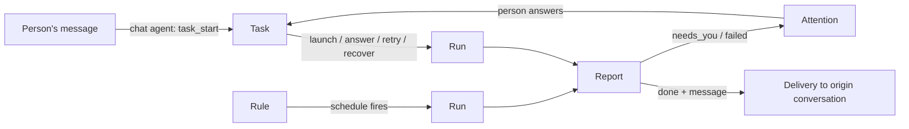
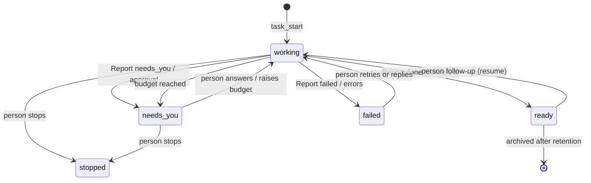
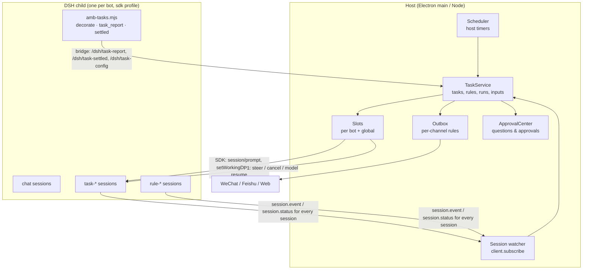

# Background tasks and proactive rules (Phase 3 design)

Status: **3a–3d are built**: tasks, questions and needs-you, delivery, and rules with observe mode (`src/tasks/`, `src/core/delivery.ts`, `dsh-runtime/plugins/amb-tasks.mjs`; tests in `test/tasks.*`, `test/delivery.*`, `test/rules.*`). 3e–3f are still design. Written 2026-10-31 against `master` df22385 and the pinned DSH `0.2.1-rc.4` in `dsh-runtime/`.
Feasibility evidence is in [Appendix A](#appendix-a-feasibility-answers-with-evidence). The spike that produced it is `scripts/spikes/p3-tasks/`.

## Summary

The product owner (PO) confirmed that background work and proactive behaviour are what make AnyModelBot different. This doc covers three features:

1. **Background tasks.** "Build me X" or "research Y and report back" runs in its own DSH session and folder while the user keeps chatting.
2. **Proactive rules.** These are reminders, watchers and scheduled checks that the user writes in words. A new rule starts in **observe** mode: it records what it would have said or done and does not act.
3. **A "needs you" view.** It lists everything across all bots that waits for a person. When everything is healthy it takes no space.

Key decisions:

- **Five new concepts:** Task, Rule, Run, Report and Attention. We don't add Trigger, Eval, Ticket or Subscription; a personal assistant has one owner and explicit requests (see [Domain model](#1-domain-model)).
- **The host is the source of truth.** It owns the tasks, the schedule, delivery and the budget. DSH runs the sessions. One in-child plugin, `amb-tasks.mjs`, decorates the task sessions: it restricts their tools, adds a prompt section and a `task_report` tool, and reports when a session has settled.
- **Scheduling stays in the host.** `@deepseek-ai/dsh-schedule` can't be activated under our `sdk` profile. Even if it could, it would fire into chat sessions that nobody is watching.
- **The human lane never waits.** Chat turns never take a task slot. Tasks run in separate DSH sessions in the same process; the spike measured a 63 ms chat reply while two 4-second task turns ran. When a person answers a task's question, the task wakes on a reserved slot.
- **We push only three things:** a result the user can use, a decision the user must make, and a failure. WeChat may hold even these: iLink allows sends only within 24 h of the user's last message, and at most 10 sends per inbound message. See [WeChat](#wechat-the-hard-constraint).
- **Depends on P1** (the host→child control channel with per-session `steer`, `cancel` and model). Without per-session cancel, stopping one task means killing the bot's DSH process, which also ends the chat and every other task.

## 0. Goals, non-goals and principles

**Goals**

- Long work happens off the chat lane. Its result comes back to the conversation that asked for it, and it survives an app restart without repeating side effects.
- Proactive help that the user can trust before it acts. It starts in observe mode, stays inside a strict attention budget, and every run can be audited.
- Transparency that costs no attention. The user can always look, and we push only what needs them.

**Non-goals (Phase 3)**

- Multi-user teams, delegation between bots, and event sources other than time. Polling covers "watch X" for now.
- Exactly-once side effects outside AnyModelBot. The host can make its own effects (deliveries, cards) idempotent. Effects the agent causes, such as sending an email from a CLI, are made safe on a best-effort basis with a journal and a recovery note (see [restart](#restart-recovery)).

**Principles**, from dsh-superagent `000-philosophy.md`, adapted:

- **Take as little attention as possible and give as much value as possible.** Every message, notification, setting and panel element must earn its place.
- **Act only when asked, or when a written rule allows it.** A rule that judges whether to speak or act starts in observe mode.
- **Speak only when a person must act or can use a result.** Ask one concrete question at a time. Report honestly: a draft is not "done", and a failure is a failure.
- **Use few concepts and few settings.** Use a default when one value suits almost everyone. Write behaviour the user describes in words as prompt text, not as a setting.
- **Healthy takes no space.**

## 1. Domain model



| Concept | What it is | Rules it keeps | Why it exists |
| --- | --- | --- | --- |
| **Task** | A unit of authorized background work. It has its own DSH session (`task-<id>`) and folder (`tasks/<slug>-<id6>/`). | It is created only by a person's request, either through the chat agent's `task_start` or the "new task" button. It holds its origin conversation, a snapshot of the permission preset, the model and the budget. It ends only when it is **done**, when a **person stops** it, or when it fails and is archived. A follow-up from a person can resume a done task. It defines its own stage instead of following the DSH session (see [stage table](#2-states-and-transitions)). | Owns the work, the result and the questions. |
| **Rule** | A standing instruction in the user's own words, plus a schedule and a mode: `off`, `observe` or `act`. | It is created in `observe` mode, except for a fixed reminder (see [observe](#5-observe-mode)). It never acts beyond its mode or its permission cap. It records its `version`, and each run records which version it ran. Three failed runs in a row, or its monthly budget, pause it. | Proactive work with a mandate the user wrote. |
| **Run** | One stretch of work in a session: a task's launch, an answer, a retry or a recovery, or one firing of a rule. | It goes `queued`, `running`, `settling`, then `ended` with an outcome. It holds a slot while running or settling. It stores its activity steps and its cost. A rule gets a fresh session for each run. | The unit of audit, cost and recovery (superagent's Assignment). |
| **Report** | The structured state a Run reports through `task_report`. Its state is `progress`, `needs_you`, `done` or `failed`, with a `message` (user-facing, at most 300 characters), a `question` (one question with options), `summary` (internal) and `files`. | The latest Report is "what the task last said". A `progress` Report is internal and never pushed. In observe mode, `message` is recorded as "would have said". | We classify needs-you from structured fields, never from free text. |
| **Attention** | One thing that waits for a person. Some are stored: a question, or an approval (the existing `approvals` table, extended). Others are derived from state: a failed task, a rule that keeps failing, an undelivered message, an expired channel login, a stuck turn, a budget that ran out. | It is shown once, in "needs you". It is pushed only when the [push rules](#what-is-pushed-and-only-that) allow. It goes away by itself when its cause is gone. | It answers "does anything need me now?" |

**Rejected concepts.** Superagent's model is shaped for a team on GitHub and Feishu. This table lists what we leave out.

| Rejected | Reason |
| --- | --- |
| Trigger, Thread, Eval, Decision | A personal assistant gets explicit requests from its owner. The chat agent decides whether a request is background work (`task_start`), and that is the "eval". Proactive judgement lives inside a Rule run, recorded in its Report. |
| Mandate as an entity | Its job is done by fields on Task and Rule: origin, permission snapshot, budget, mode and rule version. |
| Ticket and Assignment as two names for tasks | We keep the split, as **Task** and **Run**. The Run also covers rule firings. |
| Subscription | Routing is the origin conversation, plus explicit quote or thread replies (see [routing](#follow-ups-and-routing)). |
| Watcher or Reminder as separate concepts | A watcher is a Rule on an interval. A reminder is a Rule whose run only delivers a fixed text. |
| Notification or Delivery as a domain concept | Delivery is an outbox, which is an implementation detail. |

## 2. States and transitions

**Task stage.** The first matching row wins. The user-visible states are the ones the PO named: working, needs you, ready, failed and stopped.

| # | Stage | Condition | Label (zh) | Group |
| --- | --- | --- | --- | --- |
| 1 | `stopped` | A person stopped it | 已停止 | ended |
| 2 | `needs-you/delivery` | Its latest result, question or failure message has not reached the conversation: it failed 3 times, or it is held because the channel needs the person (WeChat window closed or no quota) | 未送达 | needs you |
| 3 | `needs-you/answer` | An open question or approval | 等你回答 · 等你批准 | needs you |
| 4 | `needs-you/budget` | A run stopped at the task budget | 预算用完 | needs you |
| 5 | `failed` | The latest Report is `failed` or the launch failed, and no person's input since | 失败 | needs you |
| 6 | `ready` | The latest Report is `done`, and no input since | 已完成 | ended (resumable) |
| 7 | `working/queued` | Inputs wait, but no run holds a slot | 排队中 | working |
| 8 | `working` | Otherwise | 进行中 | working |

A person's input after rows 3–6 (an answer, a follow-up, "retry" or "continue") starts a new Run. The task then moves to row 7 or 8. Automatic inputs, such as a job wake-up or a recovery after restart, never lift rows 2–5. Recovery applies only to runs that were running.

**Run.** `queued → running ⇄ settling → ended`.

| Outcome | Meaning |
| --- | --- |
| `done` | Ended with a `done` Report, with or without a message |
| `needs_you` | Ended with a question; the task waits |
| `failed` | Ended with a `failed` Report, an error after 3 transient retries, or no Report after one nudge |
| `budget` | Cancelled at the run or task budget |
| `stopped` | A person stopped the task |
| `interrupted` | The app or DSH restarted mid-run; a `recover` run follows if the task should continue |
| `skipped` | Rule only: the app wasn't running, or the slots were busy past the grace period |

**Rule.** The mode is `off`, `observe` or `act`. The rule is visible in "needs you" only when it is paused because of failures or budget, or when it has failed two runs in a row.



## 3. Execution



### Sessions and folders

- **One session per task:** `task-<id>`. The host creates, resumes and prompts it through the SDK it already uses: `harness.session(id)`, `setWorkingDirectory(folder)`, `client.prompt` and `resumeSession`. This makes the SDK server the single owner of the session registry, and it drains the session at shutdown. Don't mix this with plugin-side `agents.create` for the same id: both work, but two owners would collide.
- **One fresh session per rule run:** `rule-<id>-<n>`. Continuity comes from the host, which includes the last 3 Reports in the run input, and from the rule's folder in act mode. This keeps context bounded, and observe and act runs get different permissions.
- **Folders** live in the bot workspace: `tasks/<slug>-<id6>/` and `rules/<slug>/`. They must be inside it, because DSH's `workspace-write` root and our bwrap shim both cover only the bot workspace. A folder is a convention, not a security boundary. Every session in the bot shares one sandbox root, the same as in superagent.
- **Decoration.** On `agent/created`, `amb-tasks.mjs` recognizes the `task-` or `rule-` prefix and fetches its config from the host (`/dsh/task-config`). It then:
  - denies tools with `agent.ctx.tools.restrict({ deny })`. The list always includes `present`, `ask_user_question`, `task_start` and `rule_create`, plus the per-mode lists in [permissions](#7-permissions). It must contain only registered names: `restrict` throws on an unknown tool.
  - adds a system-prompt section with the task brief and the work and communication rules.
  - registers `task_report`.
  - guards every tool once the task has ended.

  It does this for sessions created through the SDK and for sessions resumed after a restart (spike A.2).
- **Brief.** The task's first input contains:
  - the user's original message, verbatim;
  - the chat agent's brief (at most 1,500 characters);
  - the last 6 messages of the conversation;
  - paths of attachments under `inbox/`;
  - the bot's memory prefix, as `firstInput` builds it today.

  A brief never replaces the original words.

### How a request becomes a task

The chat agent gets `task_start({ title, brief })`. Its prompt section says to start a task when:

- the work clearly needs more than a few minutes or many steps (build, research, a report), or
- the user asks for it in the background.

It says not to start one for something the agent can answer now. The agent's reply confirms in one sentence what it will do, for example 「好，后台开始调研三家云的 GPU 价格，好了告诉你。」. The confirmation is part of the chat reply, not an extra message. The host refuses `task_start` when the bot has 10 open tasks, when there is no budget, or (in groups) when the sender is not allowed; the group rule is an open question tied to P2's allowlist. The desktop or web "new task" button creates a task the same way.

### Follow-ups and routing

A person's message reaches a task only by explicit reference:

- **Feishu:** a thread reply to the task's message, or a card button.
- **WeChat:** a quote (引用) of the task's message. We store the sent text in the outbox and match the quote against it.
- **Any channel:** the chat agent calls `task_message({ task, text })` when the user names the task ("GPU 那个改成英文").

A follow-up while the task is working is **steered** into it (P1) and lands at its next step. A follow-up to a done task resumes it under the same task. Quoting a task's message also adds the task's latest Report to the chat turn, so "详细说说" is answered by the chat agent from the report without waking the task.

### Concurrency and the reserved human lane

- **Human lane:** chat turns keep working as today. Each conversation has its serial queue, and conversations run in parallel. They never take a task slot and never enter a task's queue. Tasks never enter a conversation's queue.
- **Background lane:** at most `taskSlots` runs per bot (default 2), and at most `maxBackground` across all bots (default 4). A run holds its slot while `running` or `settling`.
- **Reserved slot:** a wake caused by a person may use one extra slot per bot and goes ahead of queued work. Person-caused wakes are an answer, an approval, a follow-up, "retry" and "continue". The priority order is person wake, then task launch, then recovery, then rule run. A rule run that waits longer than its grace period is `skipped`.
- **No measured DSH cap:** the spike ran two task turns and a chat turn in one process at once (A.2). The real limits are the shared model rate limit, CPU and memory for tool processes, and the bot's budget. These are what `taskSlots` protects.

### Background jobs, subagents and settling

When a turn ends, the session can still own shell jobs or subagents. While it does, the Run is `settling` and keeps its slot. DSH wakes the session in a new turn when a job ends (`tool-jobs` `completionDelivery: wakeup`, A.4). When the session is idle and nothing runs for it in the background, the plugin posts `/dsh/task-settled` and the Run ends with its Report. This is the same pattern as superagent's `untilQuiet`.

Settling lasts at most 30 minutes after a turn ends. After that, its jobs are killed and the session is told so at its next turn. If a turn ends without a `task_report`, the host sends one nudge ("report your state with task_report"). If there is still no Report, the Run ends `failed` ("没有给出结果").

### Stop, steer and model (dependency: P1)

- **Stop** uses P1's `cancel(sessionId)`. The task's jobs are killed and its subagents released (superagent's `stopBackground`), and its tools are guarded. Today's only stop is `AgentHost.closeHarness()`, which kills chat and every task of the bot.
- **Steer** uses P1's `steer(sessionId, text)` for follow-ups.
- **Model:** a task keeps the model it started with (P1's per-session model). Without it, `AgentHost.ensure()` would restart DSH on a chat model switch, and it already waits for `active === 0`. Task runs must count as active.

### Restart recovery

The spike shows that a restart keeps some things and loses others (A.5):

- **Survives:** session history, each session's working directory, and the files in the folder.
- **Lost:**
  - the running turn: its user message never reaches the model again;
  - messages still queued in the inbox;
  - background jobs, killed without a completion notice;
  - in-process subagents;
  - pending approvals: `ApprovalCenter.start()` expires them.

The host therefore stores everything it owes a session, and recovers like this:

1. **At start, and on every DSH child exit:** each Run in `running` or `settling` ends `interrupted`.
2. **For each such task:** a `recover` Run is queued, oldest task first and subject to slots. Tasks that wait for a person (stages 2–5) stay as they were, with one exception. A task blocked on an approval lost that approval with its turn, so it is recovered, and the agent asks again if it still needs to.
3. **Inputs:** an input the session never took (no `user/message` event with its message id was seen) is delivered again. An input it took is never delivered again.
4. **The recovery note** is the first message of the new Run. It is model-facing and in English, like our skills:

   > The app restarted while you were working on this task. Your last step may not have finished, and these background jobs were stopped: {jobs}. Before repeating any outside action (sending, posting, paying, deleting, or calling an API that changes something), read `.task/journal.md`, check your folder and check the outside system. Then continue and report with task_report.

5. **The journal:** the task prompt asks the agent to append one line to `.task/journal.md` before and after each outside action. This is best effort: the host can't see the agent's external effects.
6. **The host's own effects are idempotent.** Delivery ids are stable (`<task>:<purpose>:<run>`). A delivery marked `sent` is never sent again. Reports are keyed by `(run, seq)`.
7. **Rule runs** that were interrupted are rerun once if they are still inside their grace period. Otherwise they are `skipped`.
8. **Settings restarts:** today a settings change restarts DSH only when the bot is idle. With tasks running, it waits up to 10 minutes for a safe point (no run mid-turn). Then it restarts and the runs recover.

## 4. Scheduling: the host owns it

**Decision: the host owns scheduling.** Reasons, with details in A.1:

- **It can't load.** `@deepseek-ai/dsh-schedule` needs `sessionController`, which the `sdk` profile doesn't load. Adding the session controller pulls in the Web API stack (`fileUploads` and more).
- **It fires into the original session as a user message, and nobody sees the result.** It calls `agent.followup` with source `schedule`. The host reads a session only during `run()`, so the result of that turn would never reach the user.
- **It runs only while the DSH child runs.** We start the child lazily and restart it often. The host lives in the tray.
- **It lacks what rules need:** observe mode, an attention budget, per-channel delivery, a cost cap and a user-visible run log. It is managed by the model (`schedule_*` tools), not by the user.

**Schedule kinds.**

- `once(at)`
- `daily(time, weekdays?)`
- `weekly(days, time)`
- `every(N minutes)`, with N ≥ 15
- `cron`, under "advanced"

The time zone is the system's IANA zone, stored on the rule when it is created. The schedule is shown back in words for confirmation, for example 「每个工作日 08:00（Asia/Shanghai）」.

**Triggers (as built in 3d).** A rule's trigger is a tagged union: `{kind: "schedule", schedule}` (the host timer below) or `{kind: "event", source, filter?}`. Event rules are started through `RuleEvents.emit(source, event)` (`src/tasks/rule-events.ts`) and run through the same observe/act path. This is only the extension point for user-configured event sources ("workloads", such as a GitHub repo) that come later; no event source, workload config or UI is built yet.

**Mechanics.**

- `rules.next_run_at` holds the next time, and a single timer is set for the earliest one.
- When Electron's `powerMonitor` reports a resume or a clock change, the host recomputes.
- A firing creates a Run with cause `schedule`, which then waits for a slot.

**Missed runs.** The app may have been off or asleep at the due time. A run missed by less than its grace period runs once, at start. The grace period is the smaller of half the interval and 2 h. Anything older is recorded as `skipped (app not running)`. We never catch up a backlog.

**Authoring.**

- The user writes 「每天早上 8 点看看 X 的价格，低于 200 告诉我」.
- The chat agent calls `rule_create({ title, instruction, schedule })`. The instruction is the user's words, verbatim, and the agent supplies the structured schedule. The UI form does the same with the utility model.
- The host creates the rule in `observe` and replies once: 「已建好规则：每天 08:00 看 X 价格。先观察几天，只记录不打扰你；在「任务」里可以改成执行。」

## 5. Observe mode

| | Observe | Act |
| --- | --- | --- |
| Runs on schedule | yes | yes |
| Sandbox | `read-only` (per session; `amb-permission` needs a per-session preset map) | the rule's cap (see [permissions](#7-permissions)) |
| Tools | denied: acting tools (computer use, `generate_image` and `generate_video`, `remember` and `forget`, `present`, `task_start`, `rule_create`) | per rule |
| Approvals | rejected automatically, recorded as "would need approval: …" | → needs you (TTL 1 h) |
| Messages to anyone | **never** | through the outbox and attention budget |
| Recorded | "本会发送：…" / "本会保持安静" / "本会做：…" plus cost and steps | what it said and did |

- **Every new rule starts in observe.** The one exception is a **fixed reminder**, such as 「明天下午 3 点提醒我开会」. The user dictated both the text and the time, so there is nothing to judge. It runs in act and delivers the text without a model turn. (Open question Q6.)
- **Switching modes.** After 3 observed runs, the rule row shows a quiet hint 「已观察 3 次 · 改为执行？」. The hint is never pushed. The user switches in the UI or by telling the bot. Act can go back to observe at any time.
- **Editing the instruction** puts the rule back in observe; this needs PO confirmation (Q7). Editing only the schedule keeps the mode.
- **Tasks a person asked for are never in observe.** An explicit request is its own mandate, as in superagent, where explicit requests work in every accept mode.
- **What observe guarantees:** no message to anyone through AnyModelBot, and no file changes, because the sandbox is read-only. It does not block network calls from shell tools. The prompt forbids outside actions, and the Report lists what the rule would do. We say exactly this in the UI help text.

## 6. Transparency without noise

The PO's guidance: "provide enough transparency for users about what the (proactive) agent is doing, but not very verbose." The rule we follow is that the user can **always look**, and we push **only** what needs them.

### What the user can always see, quietly

Nothing below is ever pushed. It lives in the tasks view, the bot's info panel and the task detail.

| For | Shown |
| --- | --- |
| Task | Title; stage dot and label; how long; cost so far (约 $0.08 / $1.00); the first line of the latest Report as 最新进展; the origin (channel, time and the user's words); the folder (with an "open" action); runs, each with its folded 处理过程 |
| Rule | The user's words; schedule in words; mode; **last run** (time and outcome); **next run**; cost this month; the run log |
| Rule run (observe) | 「本会发送：“…”」, 「本会保持安静」 or 「本会做：…」; cost; steps |
| Rule run (act) | 「已发送：“…”」 (with the delivery state) or 「保持安静」; cost; steps |

### What is pushed, and only that

| Push | When | Never |
| --- | --- | --- |
| **A result the user can use** | A task's `done` Report; a rule hit in act mode | Progress, "still working", partial drafts, retries, recovery after restart |
| **A decision the user must make** | A task question or an approval, one at a time per conversation | A question the agent could answer with a reasonable default; repeating an unchanged question |
| **A failure that needs them** | A task failed after automatic retries, or a rule paused after 3 failures | A one-off network error; a failure the agent can work around |

The acknowledgement of a new task is the chat reply itself, so it costs no extra message. Observe mode pushes nothing.

### Message shapes

Every pushed message is one line, with an optional second line only for a blocker or a limit. Details are on demand: the user quotes or replies 「详情」, or opens the desktop view. Use no internal ids, no technical detail and no plans. Write in the language of the conversation. Emoji: only the existing ❓ for questions and ⚠️ for failures, which WeChat and Feishu need as markers. None for results. The UI strips them, per `ui/design/README.md`.

| Purpose | WeChat (text) | Feishu (card) | Web / desktop |
| --- | --- | --- | --- |
| Ack (part of the chat reply) | 好，后台开始调研三家云的 GPU 价格，好了告诉你，你可以继续聊别的。 | same text | same text, plus a task chip 「后台任务 · GPU 价格调研 · 进行中 ›」 |
| Result | GPU 价格调研好了：A100 包月最便宜的是 X 云，约 ¥7,800，报告已发给你。引用这条消息可以继续问。 | same line; buttons [详情] [继续改] | message in the conversation; the chip turns 已完成; OS notification only if the window isn't focused |
| Question | ❓「GPU 价格调研」想问你：报告用中文还是英文？<br>1. 中文<br>2. 英文<br>（回复编号，或引用这条消息回答） | question card with option buttons, as for `ask_user_question` today | the same card in the conversation and in "needs you" |
| Approval | 需批准（任务「清理旧构建」）：`rm -rf build/` — 回复 y 4821 / n 4821 | the existing approval card, titled with the task | "needs you" row with [批准一次] [拒绝] |
| Failure | ⚠️「GPU 价格调研」没做完：X 云的价格页要登录，我进不去。发我一个能打开的链接，或者回复「停止」。 | same, with buttons [重试] [停止] | "needs you" row |
| Rule hit | X 降价了：现在 ¥199（昨天 ¥259）。 | same | message, with the rule named in small text |
| Digest (2 or more due within 2 min, or over the daily cap) | 2 条提醒：<br>· X 降价到 ¥199<br>· 仓库 Y 的 issue #12 有新回复 | one card with a line per item | one message |
| Held, then delivered when the WeChat window reopens | 你不在时：GPU 价格调研好了（A100 最便宜是 X 云，约 ¥7,800）。 (sent just before the reply to the user's next message) | n/a | n/a |
| Desktop notification | title 「小蓝 需要你」, body 「GPU 价格调研：报告用中文还是英文？」 | | |

### Communication rules and attention budget per channel

These rules apply to every pushed message. Replies within a user's active chat turn are not affected.

- **Coalescing:** messages for the same conversation due within 2 minutes merge into one message.
- **Quiet hours,** default 22:00–08:00 local time. Results and rule hits wait until the end of quiet hours. A question waits too, unless the user wrote to that conversation in the last 10 minutes.
- **Daily cap on unsolicited messages,** per bot per conversation: **WeChat 3**, **Feishu 5**. Beyond the cap, results and rule hits roll into one digest at the next allowed time. Questions count toward the cap; once it is reached, a question waits in "needs you" instead of being pushed. A reply to a question doesn't count.
- **One open pushed question per conversation.** Other tasks' questions wait in "needs you" until the first is answered. This keeps bare-number replies unambiguous on WeChat.
- **Answering a task question.** On WeChat, a message is an answer only when it quotes the question, starts with its 4-digit code, or is a bare option number or label while the question is the bot's latest message. Anything else is ordinary chat. Today, any text answers a pending question (`ApprovalCenter.handleReply`). That is fine for a chat question with a turn waiting on it, but wrong for a task question that can wait for hours.
- **Feishu:** reply in the thread of the request message when one exists. Results and questions are cards.
- **Web/desktop:** an OS notification only for "needs you" items and for results the user asked for, only when the window isn't focused, and at most one per item. The tray badge is the needs-you count.

### WeChat: the hard constraint

iLink lets a bot message a user only with a `context_token` from that user's inbound message. AnyModelBot already treats this as hard.

- In `src/channels/weixin/quota.ts`, each inbound message resets a **24 h window with 10 sends** (`QUOTA_PER_INBOUND`, `QUOTA_WINDOW_MS`). Once the window is over, `remaining()` is 0.
- `WeixinChannel.notifyOwner()` gives up without a token or quota.
- The upstream `openclaw-weixin` plugin also asks the user to "ensure the recipient has recently messaged the bot" for scheduled delivery.

We have not verified whether iLink accepts a send without a fresh token. We must not rely on it, because that risks restrictions on the user's bot account.

What follows:

1. **A task result can be pushed only while the window opened by the user's latest message is open and has quota.** Most tasks finish well within 24 h.
2. **A rule can't reach a WeChat user who hasn't written to the bot in the last 24 h.** No design changes that. We only choose what happens instead:
   - **Reserve quota.** Each live task or act-mode rule bound to a WeChat peer reserves 1 send, and an open question 1 more, up to 3 in total. Chat replies use `remaining − reserved`. The existing long-reply truncation note already handles running out.
   - **Hold, don't drop.** A delivery that can't go out is held, with the reason `window_closed` or `quota`. It shows in "needs you" as 「1 条结果等你在微信里发条消息才能送达」, with [在这里查看]. It also gets one desktop notification.
   - **Piggyback.** On the user's next inbound message, held items for that peer go out first, merged into one 「你不在时：…」 message. Then the chat reply follows.
   - **One "reply ok" nudge, only when it matters** (decided by the product owner, replacing "no keep-alive pings"). About 2 h before the window closes, and only if something is scheduled to reach this user after it closes, the bot sends one quiet line naming what is coming, e.g. 「接下来还有 2 条提醒要发给你（明早 8:00 天气、周一 9:00 周报）。回个「ok」我就能继续按时提醒你。」 It goes out at most once per window, never during quiet hours, uses 1 of the window's 10 sends, and can be turned off per bot. Any reply opens a new window. With nothing scheduled, nothing is sent.
   - **Be honest when a rule is created.** If a rule delivers to WeChat, the rule editor and the creation reply say 「微信只在你 24 小时内发过消息时才能主动发给你；否则会在你下次发消息时一起送到，并显示在桌面端。」 For time-critical rules they suggest Feishu or desktop as the destination.
   - **Fit one message.** A pushed message must fit one WeChat message (at most 4,000 characters; we aim for at most 300) and is never split.

### Activity steps (处理过程)

Tasks reuse `ActivityLog` (`src/agent/activity.ts`) unchanged.

- **Feeding:** a long-lived SDK subscription (`client.subscribe`, re-attached after every DSH start) feeds the task and rule sessions' events into one `ActivityLog` per Run.
- **Storage:** `runs.activity` uses the same JSON as `messages.activity`. The cap is 120 steps per run, keeping the last 120 plus a count of dropped steps.
- **Web:** live steps stream the way `LiveTurn` does today. The task detail shows runs as 「第 2 次 · 回答后继续 · 9 步 · 3 分钟」, each folded like the chat's 用时 line.
- **Chat:** the request message's task chip expands to the same folded steps.
- **WeChat and Feishu:** steps are never pushed. 「详情」 returns the Report's summary in one message.
- **Related fix:** today a chat turn that leaves a background job running stops being observed at idle. The job's wake-up turn is never delivered. The same subscription fixes this for chat sessions.

### Auditing a rule

Each rule has a run log, newest first, with one line per run: time, mode, outcome, cost.

- 今天 08:00 · 观察 · 本会发送：“X 降价了，现在 ¥199（昨天 ¥259）” · 约 $0.03
- 昨天 08:00 · 观察 · 本会保持安静（¥259） · 约 $0.02
- 前天 08:00 · 失败：页面打不开（已重试 3 次） · 约 $0.01
- 10/27 08:00 · 跳过：电脑没开

Expanding a row shows the Report (summary, message, would-do), the steps, the rule version it ran under and the permission it had. The log is kept for 90 days and is exportable as Markdown.

### Calm defaults

| Setting | Default |
| --- | --- |
| New rule mode | observe (except fixed reminders) |
| Background slots | 2 per bot, 4 overall |
| Quiet hours | 22:00–08:00 |
| Unsolicited cap | WeChat 3 per day, Feishu 5 per day, per bot per conversation; overflow becomes a digest |
| Questions | one open pushed question per conversation; no reminders for unanswered questions |
| Progress | never pushed |
| Budgets | task $1.00, rule run $0.10, rule $3.00 per month (Q3) |
| Automatic pause | a rule after 3 failures in a row; background work when the bot's Modelflare budget falls below 20 % |
| Manual pause | one switch per bot (bot settings › 主动消息, the info panel's 「后台工作已暂停」 line, or asking the bot): no new task runs, scheduled rules are logged as skipped and not caught up, pushes wait; chat and running turns carry on |
| Observe → act hint | after 3 observed runs, shown in place, never pushed |
| Desktop notifications | needs-you only, window unfocused, once per item |

### Mock-ups

These use `ui/design/README.md`:

- grouping is a `--well` list (`.list`) with `--line-2` between rows, without borders or nesting;
- small labels are `.t-label`;
- state is a **dot plus text** (`.dot`): green for working, amber for needs you, red for failed, grey for done, off or observe;
- no emoji;
- **nothing is drawn when healthy.**

**Sidebar.** A "需要你" row appears above the bots only when the count is above 0. Bot avatars already have `working` (后台任务) and `waiting` (等你批准) states.

```
┌ side ─────────────────────────────┐
│ [新建]                     [任务]  │   ← 任务: icon button, opens the tasks view
│ ⌕ 搜索                             │
│ ● 需要你                        3  │   ← only when > 0 (amber dot, .badge.count warn)
│ (小蓝) 小蓝         2分钟            │   ← avatar state "waiting"
│        GPU 价格调研等你回答       1  │
│ (红魔) 红魔          正在工作…       │   ← avatar state "working", 1 task running
└───────────────────────────────────┘
```

**Needs you** (main pane). Each row is self-contained, and its actions are inline.

```
需要你
┌─────────────────────────────────────────────────────────────┐
│ ● 小蓝 · GPU 价格调研 · 等你回答                      2 分钟前 │
│   报告用中文还是英文？                                        │
│   [中文] [英文] [回复…]                                       │
│─────────────────────────────────────────────────────────────│
│ ● 小蓝 · 清理旧构建 · 等你批准                        5 分钟前 │
│   rm -rf build/                                              │
│   [批准一次] [拒绝]                                           │
│─────────────────────────────────────────────────────────────│
│ ● 红魔 · 规则「每日 issue 巡检」连续失败 3 次，已暂停     08:00 │   red dot
│   GitHub 返回 401：令牌可能过期了                             │
│   [重试] [打开规则]                                           │
│─────────────────────────────────────────────────────────────│
│ ● 小萌 · 1 条结果未送达微信                              昨天 │
│   你 24 小时内没在微信里发消息，微信不允许机器人先发。          │
│   在微信里给它发任意一条消息即可收到。                          │
│   [在这里查看]                                                │
│─────────────────────────────────────────────────────────────│
│ ● 绿草 · 微信登录已过期                                今天    │   red dot
│   [重新扫码]                                                  │
└─────────────────────────────────────────────────────────────┘
```

Order: questions and approvals first (time-sensitive), then failures, then deliveries, then the system (logins, stuck turns, budget). When the list is empty, there is no sidebar row and no badge. Opening the view directly shows a quiet 「没有需要你处理的事」.

**Tasks view** (main pane; all bots, with a bot filter). Sections appear only when non-empty.

```
任务                                              [全部机器人 ▾] [新任务]
进行中
┌─────────────────────────────────────────────────────────────┐
│ ● GPU 价格调研            小蓝 · 12 分钟 · 约 $0.08          › │   green
│ ● 季度报告 PPT            小蓝 · 等你回答                     › │   amber
└─────────────────────────────────────────────────────────────┘
规则
┌─────────────────────────────────────────────────────────────┐
│ ○ 每天 08:00 · 看 X 价格   观察中 · 下次 明天 08:00            › │   grey
│                            已观察 3 次 · 改为执行？             │   quiet hint, text button
│ ● 每周一 09:00 · issue 周报 执行中 · 上次 周一 · 说了 1 句      › │
└─────────────────────────────────────────────────────────────┘
已完成 · 最近 7 天
┌─────────────────────────────────────────────────────────────┐
│ ○ 整理下载目录            小蓝 · 昨天 18:20 · 约 $0.02          › │
└─────────────────────────────────────────────────────────────┘
```

**Task detail** (the same pane, or a sheet on narrow windows):

```
GPU 价格调研                                          [停止]
● 进行中 · 12 分钟 · 约 $0.08 / $1.00
来自  微信 · 你 10:02 「帮我调研一下三家云的 GPU 价格…」
最新进展  已比较 3 家，正在核对 B 云的包年价
文件夹  tasks/gpu-prices-3f2a1c                       [打开]
运行
  第 1 次 · 开始 · 34 步 · 12 分钟                       ▸   (folded 处理过程)
```

**Rule detail:**

```
每天 08:00 · 看 X 价格                     [观察 | 执行]  [立即运行]
「每天早上看看 X 的价格，降到 200 以下告诉我」
下次 明天 08:00 · 本月 约 $0.41 / $3.00 · 发到 微信（24 小时窗口）
运行记录
  今天 08:00   本会发送：“X 降价了，现在 ¥199（昨天 ¥259）”   约 $0.03  ›
  昨天 08:00   本会保持安静（¥259）                           约 $0.02  ›
```

**Bot info panel:** a "任务" group (a `.list`) after 渠道 and 待审批, with open tasks and rules in one compact row each. It is absent when the bot has neither.

## 7. Permissions

| Work | Sandbox | Approvals | Denied tools (only those registered) |
| --- | --- | --- | --- |
| Chat (today) | bot preset | card in chat, TTL 10 min | none |
| Task (a person asked) | bot preset, snapshotted at creation | → needs you, TTL 12 h, one at a time; the DSH call keeps waiting; the slot is released while it waits | `present`, `ask_user_question` (use `task_report`), `task_start`, `rule_create` |
| Rule run, observe | `read-only` | rejected automatically, recorded | the above plus computer use, `generate_image` and `generate_video`, `remember` and `forget` |
| Rule run, act | `min(bot preset, workspace-write)`; the user can grant "use the bot's preset" per rule | → needs you, TTL 1 h, then rejected and the run fails | computer use and media unless enabled on the rule |

Notes:

- **Full permission.** A task on a bot with full permission inherits it, because the user chose it. The rm -rf gate (`amb-delete-gate.mjs`) still asks, and its question goes to "needs you". A rule never gets full permission by default.
- **The read fence, the bwrap shim and the stripped environment** (no real keys) apply unchanged: task sessions run in the same child.
- **Bridge lookups must know task sessions.**
  - `AgentManager.resolveConversation` falls back to "the only active chat". A task session's approval would go to the wrong conversation. It needs a session-to-task-to-conversation lookup.
  - `mediaOp` refuses when no chat turn is active, so tasks can't generate media until it is changed.
  - `amb-permission.mjs` forces the bot preset onto every session. It needs a per-session preset for observe and act runs.

## 8. Cost controls

- **Estimate:** usage comes from the `assistant/message` events the subscription already sees, multiplied by Modelflare's reference price (`src/account/model-info.ts`). It is stored on `runs` and summed on `tasks` and `rules`. It is labelled 「约」, because the bill is authoritative.
- **Budgets:**
  - **Per task** (default $1.00, adjustable when it is created or later): at 100 %, the turn is cancelled (P1), the stage becomes `needs-you/budget` and the needs-you item reads 「已用约 $1.00，再给 $1 继续？」.
  - **Per rule run** (default $0.10): the run ends `budget`.
  - **Per rule per month** (default $3.00): the rule pauses, and a needs-you item appears.
- **Protecting chat.** When a bot has a Modelflare budget key (`setBotBudget`), background runs stop once its remaining balance falls below 20 % of the limit. The rest stays for chat, and one needs-you item says so. Low account balance uses the existing alert.
- **Time caps:** a task gets 4 h of running time, not counting time waiting for a person. Settling lasts at most 30 minutes after a turn ends. A rule run gets 15 minutes.
- **Model choice:** a task uses the conversation's model. A rule may use the bot's `utilityModel` when it is set (Q5).

## 9. Data model (sqlite, `src/store/db.ts`)

Each kind of state has one writer:

- **TaskService** writes tasks, rules, runs and inputs.
- **The Outbox** writes deliveries.
- **ApprovalCenter** writes approvals.

```sql
CREATE TABLE IF NOT EXISTS tasks (
  id TEXT PRIMARY KEY,                    -- t_<12 hex>
  bot_id TEXT NOT NULL, conversation_id TEXT NOT NULL,
  origin_message_id INTEGER NOT NULL DEFAULT 0, -- messages.id of the request
  origin_ref TEXT NOT NULL DEFAULT '',    -- channel handle to reply under (Feishu message_id); never a secret
  title TEXT NOT NULL, brief TEXT NOT NULL,
  session_id TEXT NOT NULL, folder TEXT NOT NULL,      -- task-<id>, tasks/<slug>-<id6>
  model TEXT NOT NULL DEFAULT '', permission TEXT NOT NULL,
  budget_usd REAL NOT NULL, spent_usd REAL NOT NULL DEFAULT 0,
  report TEXT NOT NULL DEFAULT '',        -- latest Report JSON
  ended_at INTEGER NOT NULL DEFAULT 0, end_reason TEXT NOT NULL DEFAULT '', -- done|stopped|archived
  stopped_by TEXT NOT NULL DEFAULT '',
  created_at INTEGER NOT NULL, updated_at INTEGER NOT NULL);
CREATE INDEX IF NOT EXISTS tasks_open ON tasks(bot_id, ended_at);

CREATE TABLE IF NOT EXISTS rules (
  id TEXT PRIMARY KEY, bot_id TEXT NOT NULL, conversation_id TEXT NOT NULL,
  title TEXT NOT NULL, instruction TEXT NOT NULL,      -- the user's words, verbatim
  kind TEXT NOT NULL DEFAULT 'check',     -- check | remind (fixed text, no model turn)
  schedule TEXT NOT NULL,                 -- JSON {kind, at|time|days|minutes|cron, tz}
  mode TEXT NOT NULL DEFAULT 'observe',   -- off | observe | act
  act_permission TEXT NOT NULL DEFAULT 'workspace', -- workspace | bot
  folder TEXT NOT NULL, version INTEGER NOT NULL DEFAULT 1,
  run_budget_usd REAL NOT NULL DEFAULT 0.1, month_budget_usd REAL NOT NULL DEFAULT 3,
  next_run_at INTEGER NOT NULL DEFAULT 0, failures INTEGER NOT NULL DEFAULT 0,
  paused_reason TEXT NOT NULL DEFAULT '',
  created_at INTEGER NOT NULL, updated_at INTEGER NOT NULL);
CREATE INDEX IF NOT EXISTS rules_due ON rules(mode, next_run_at);

CREATE TABLE IF NOT EXISTS runs (
  id TEXT PRIMARY KEY, bot_id TEXT NOT NULL,
  task_id TEXT NOT NULL DEFAULT '', rule_id TEXT NOT NULL DEFAULT '', -- exactly one is set
  rule_version INTEGER NOT NULL DEFAULT 0, mode TEXT NOT NULL DEFAULT 'act',
  session_id TEXT NOT NULL,
  cause TEXT NOT NULL,       -- launch|answer|followup|retry|continue|recover|schedule|manual
  state TEXT NOT NULL,       -- queued|running|settling|ended
  outcome TEXT NOT NULL DEFAULT '', -- done|needs_you|failed|budget|stopped|interrupted|skipped
  report TEXT NOT NULL DEFAULT '', would TEXT NOT NULL DEFAULT '',
  activity TEXT NOT NULL DEFAULT '',      -- ActivityStep[] JSON (≤120 + dropped count)
  tokens_in INTEGER NOT NULL DEFAULT 0, tokens_out INTEGER NOT NULL DEFAULT 0, cost_usd REAL NOT NULL DEFAULT 0,
  error TEXT NOT NULL DEFAULT '',
  queued_at INTEGER NOT NULL, started_at INTEGER NOT NULL DEFAULT 0, ended_at INTEGER NOT NULL DEFAULT 0);
CREATE INDEX IF NOT EXISTS runs_live ON runs(state, queued_at);
CREATE INDEX IF NOT EXISTS runs_task ON runs(task_id, queued_at);
CREATE INDEX IF NOT EXISTS runs_rule ON runs(rule_id, queued_at);

-- What the host owes a session. It survives restarts, because DSH drops queued inbox messages (A.5).
CREATE TABLE IF NOT EXISTS run_inputs (
  id TEXT PRIMARY KEY, task_id TEXT NOT NULL DEFAULT '', rule_id TEXT NOT NULL DEFAULT '', run_id TEXT NOT NULL DEFAULT '',
  kind TEXT NOT NULL,        -- brief|answer|followup|note|recovery|nudge|schedule
  text TEXT NOT NULL, from_person INTEGER NOT NULL DEFAULT 0,
  message_id TEXT NOT NULL DEFAULT '',    -- DSH inbox id once handed over
  delivered_at INTEGER NOT NULL DEFAULT 0, taken_at INTEGER NOT NULL DEFAULT 0, -- taken = seen as user/message
  created_at INTEGER NOT NULL);
CREATE INDEX IF NOT EXISTS run_inputs_open ON run_inputs(task_id, taken_at);

-- Outbox for pushed messages. If P2's outbox lands first, these columns move there.
CREATE TABLE IF NOT EXISTS deliveries (
  id TEXT PRIMARY KEY,       -- stable: <task|rule run>:<purpose>[:n]
  bot_id TEXT NOT NULL, conversation_id TEXT NOT NULL,
  task_id TEXT NOT NULL DEFAULT '', rule_id TEXT NOT NULL DEFAULT '', run_id TEXT NOT NULL DEFAULT '',
  purpose TEXT NOT NULL,     -- result|question|approval|failure|rule|digest|reminder
  text TEXT NOT NULL, files TEXT NOT NULL DEFAULT '[]', card TEXT NOT NULL DEFAULT '',
  status TEXT NOT NULL DEFAULT 'pending', -- pending|held|sent|dropped
  held_reason TEXT NOT NULL DEFAULT '',   -- quiet_hours|window_closed|quota|daily_cap|channel_down|question_open
  attempts INTEGER NOT NULL DEFAULT 0, last_error TEXT NOT NULL DEFAULT '',
  due_at INTEGER NOT NULL, sent_at INTEGER NOT NULL DEFAULT 0, created_at INTEGER NOT NULL);
CREATE INDEX IF NOT EXISTS deliveries_due ON deliveries(status, due_at);
```

`approvals` gets new columns (via the existing `COLUMNS` migration list):

| Column | Meaning |
| --- | --- |
| `task_id` | The task that owns the request |
| `run_id` | The run that raised it |
| `blocking INTEGER` | 1 means a DSH call is waiting for the answer; 0 means a task question whose answer becomes a new input |
| `expires_at = 0` (existing column) | No expiry |

`ApprovalCenter.start()` stops expiring non-blocking task questions on restart. Per-bot settings (`taskSlots`, quiet hours, daily caps) go into the existing `bots.settings` JSON (`BotSettings`). `maxBackground` goes into the app config.

## 10. API

**HTTP** (`/amb/api`, same style as `src/web/server.ts`):

| Route | Does |
| --- | --- |
| `GET /tasks?bot=&group=working\|needs\|ended` | List with stage, cost and the latest line |
| `POST /tasks` `{botId, conversationId?, text, budgetUsd?}` | New task from the desktop |
| `GET /tasks/:id` | Detail: origin, Report, runs (without steps), inputs, delivery state |
| `GET /tasks/:id/runs/:run/activity` | Steps of one run |
| `POST /tasks/:id/stop` · `/retry` · `/continue {text}` · `/budget {addUsd}` · `/archive` | Person actions |
| `GET /rules?bot=` · `POST /rules {botId, conversationId, text}` (returns a draft: words, schedule, mode) · `PUT /rules/:id` · `DELETE /rules/:id` | Rules |
| `POST /rules/:id/run` | Run now, in the rule's mode |
| `GET /rules/:id/runs?before=` | Run log |
| `GET /attention` | "Needs you" across bots: `{id, kind, botId, subject, line, actions[], since, severity}` |
| `POST /attention/:id/:action` | answer, approve, deny, retry, open, dismiss (only for kinds that can be dismissed) |
| `GET /agent` (existing) | Adds `attention: n` and `background: {botId: n}` so the 3 s and 6 s UI polls cover the sidebar |

**Model-facing tools.** The plugin registers them by session kind.

| Tool | Session | Shape |
| --- | --- | --- |
| `task_start` | chat | `{title, brief, budget_usd?}` → `{task, accepted}` or a refusal |
| `task_message` | chat | `{task, text}`: steer a working task or resume a done one |
| `task_list` | chat | Open tasks and rules with their stage and latest line, read from the host without waking any task |
| `rule_create` | chat | `{title, instruction, schedule, kind}` → a rule in observe mode, or in act mode for a fixed reminder |
| `task_report` | task and rule | `{state: progress\|needs_you\|done\|failed, summary, message?, question?: {question, options?, multiSelect?}, files?, would?}` |

**Bridge** (child → host; the existing loopback with a per-launch token):

- `POST /dsh/task-config {sessionId}` → `{kind, deny[], section, permission}`
- `POST /dsh/task-report {sessionId, ...Report}`
- `POST /dsh/task-settled {sessionId, killedJobs[]}`
- `/dsh/ask` (existing) resolves task sessions to their task and conversation.

**Control channel** (host → child; **P1**):

- `steer(sessionId, text)`
- `cancel(sessionId, {keepInbox})`
- `setModel(sessionId, model)`
- `inject(sessionId, text)`, which adds to history without waking the session. Used to give the chat session a note such as 「[后台任务「X」已完成] …」 when a result is delivered. Without it, the note is prefixed to the next chat input.
- Optionally `stopBackground(sessionId)`: kill the session's jobs and release its subagents. The plugin can do this when it sees a cancel.

## 11. Failure modes

| Failure | Behaviour |
| --- | --- |
| DSH child crashes or is restarted (settings, `/stop` before P1) | Runs are `interrupted`; `recover` runs start when the child is back; untaken inputs are delivered again; a recovery note is sent ([restart](#restart-recovery)) |
| App quits or the machine sleeps mid-run | Same as above at the next start; rules follow the missed-run policy |
| `resumeSession` fails (history corrupt or missing) | New session `task-<id>-2`, briefed from the host's task record and the last Reports; the run log notes it |
| Model provider 408, 429 or 5xx, or a network error | 3 retries with backoff (15, 30, 60 s); then `failed` → needs you |
| Turn ends without a `task_report` | One nudge; then `failed` (「没有给出结果」) |
| Task loops without progress | The run's time cap and budget stop it; needs you |
| Job runs forever | Killed 30 minutes after the turn ended; the session is told at its next turn |
| Approval or question never answered | Blocking approval: rejected at its TTL; the task fails with 「批准超时」. Task question: stays in needs-you; no reminders; the task is archived after 14 days (Q9) |
| Delivery fails (Feishu API, channel logged out) | Retries at 5 s doubling to 300 s; after 3 failures: needs-you `delivery`. Dropped only when the conversation no longer exists |
| WeChat window closed or no quota | Held, piggybacked on the next inbound, shown in needs-you ([WeChat](#wechat-the-hard-constraint)) |
| A rule floods (bad instruction) | Coalescing, the daily cap, then a digest; 3 failures in a row pause it; the monthly budget pauses it |
| Rule edited during a run | The run finishes under its recorded version; the next run uses the new version |
| Two hosts open the same data dir | On desktop, Electron's `requestSingleInstanceLock()` already prevents it. The headless CLI and Docker build need a data-dir lock before the Scheduler starts (a small addition in 3d) |
| Prompt injection from a web page during a task or rule | Permission caps (observe is read-only; act is capped at workspace), approvals go to needs-you, and denied acting tools. We can't fully prevent network side effects from shell tools, and the UI says so |
| Disk growth (task folders, DSH session JSONL) | Retention: archive done tasks after 30 days, and offer to delete their folders and sessions; sizes are shown in the task detail (Q9) |

## 12. Testing strategy

- **Unit:**
  - the stage function, row by row, like superagent's `stage.spec.ts`;
  - next-run computation, including DST, time zones, `powerMonitor` resume and the missed-run grace;
  - Outbox rules: quiet hours, caps, coalescing, the WeChat window, quota reservation and piggyback;
  - slots, including the reserved person slot and priority order;
  - Report validation;
  - the recovery planner: which runs restart and which inputs are delivered again;
  - `handleReply` routing for task questions (quote, code, bare number, ordinary chat).
- **Integration against the real DSH and a mock model**, extending `test/agent.integration.test.ts` and `scripts/spikes/p3-tasks`:
  - a task gets its own folder and ends `done` with its result delivered;
  - question → answer → resume;
  - stopping one task while chat and another task continue (needs P1);
  - a job wake while settling;
  - restart mid-run: the recovery note arrives once and no input is duplicated;
  - the model-facing tool surface per session kind (no `present` or `ask_user_question` in tasks; `task_report` present; observe denies acting tools);
  - an approval from a task session lands on the right conversation.
- **Channels:** a fake iLink server for the WeChat window and quota (hold, then piggyback); Feishu card actions for answer, retry and stop.
- **UI:** design-gallery cases for the tasks view, needs-you and the chip, in both themes; a test that a healthy state renders no needs-you row and no badge.
- **Time:** a fake-clock run of 3 rules over 48 simulated hours, checking run counts, skips, caps and digests.
- **Dogfooding:** the team runs real rules in observe mode for a week before act ships, and reviews each run log against the [push rules](#what-is-pushed-and-only-that).

## 13. Phased build plan

Estimates are in developer-days and include tests.

| Phase | Scope | Exit demo | Estimate | Depends on |
| --- | --- | --- | --- | --- |
| **3a Task core** | `tasks`, `runs` and `run_inputs` tables; TaskService; `amb-tasks.mjs` (decorate, `task_report`, settled); SDK session watcher; `task_start`, `task_message` and `task_list`; slots and the human lane; stages; result delivery to Web and Feishu, and to WeChat within the window; stop; restart recovery; task chip in chat; minimal list in the info panel | "Research Y" from WeChat runs in the background while chat continues, survives an app restart, and the result arrives in the same chat | 8 | **P1** (cancel, steer, per-session model) |
| **3b Questions and needs-you** | Non-blocking task questions on approval cards (`approvals` columns); approvals from task sessions routed to the right conversation; the needs-you view and sidebar row; tray badge and OS notification; WeChat quote and code answer routing | A task asks 「中文还是英文？」 on WeChat; the user answers by number; the task continues. Needs-you lists it on desktop and is empty after | 5 | 3a |
| **3c Delivery and attention budget** | Outbox (or P2's); quiet hours; per-channel caps; coalescing and digest; WeChat quota reservation, hold and piggyback; delivery retries; failed-delivery attention | A result due at 23:00 arrives at 08:00. With the WeChat window closed, it waits, shows in needs-you, and arrives before the reply to the user's next message | 4 | 3a; coordinate with P2 |
| **3d Rules and observe mode** | `rules` table; host Scheduler with missed-run policy; fresh session per run; observe (read-only, would-have-said) and act; fixed reminders; `rule_create` and the rule editor; run log; observe→act hint; automatic pause | 「每天 08:00 看 X 价格」 runs 3 days in observe with a readable log, then switches to act and pushes one line on a hit | 8 | 3a, 3c |
| **3e Cost controls** | Per-run cost estimate; task, run and rule-month budgets; budget pause and continue; reserve for the bot's Modelflare key; time caps | A task stops at $1 with 「再给 $1 继续？」; continuing works | 3 | 3a, 3d |
| **3f Tasks view and polish** | Full tasks view and detail; rule detail; retention and cleanup; Markdown export of run logs; docs and help text | Matches the mock-ups; healthy shows nothing | 4 | 3b–3e |

**Total: about 32 developer-days.** 3a and 3b are the minimum to show the differentiator. 3d is the riskiest product-wise; observe mode is what makes it safe to ship.

## 14. Decisions (product owner, 2026-10-31)

The product owner accepted the recommendations below; item 8 is their own refinement.

1. **Who decides "background":** both. The chat agent starts a task for long work and says so in one line (「这个要跑一会儿，我放到后台做，好了告诉你」). The user can also say 「后台做」, or 「前台做」 to keep it in chat.
2. **Concurrency:** 2 background runs per bot, 4 overall. Chat never waits behind them.
3. **Budgets:** task $1.00, rule run $0.10, rule $3.00 per month. At the limit we pause and ask (shown in "needs you"); we never stop silently.
4. **Quiet hours:** 22:00–08:00 in the user's time zone, on by default, per user. A rule can override them.
5. **Models for rules:** checks run on the cheaper utility model; the main model only writes the actual result.
6. **Fixed reminders** skip observe mode.
7. **Observe → act:** after 3 good observed runs we suggest switching to act. Editing a rule's instruction sends it back to observe for one run.
8. **WeChat 24 h window:** the "reply ok" nudge described in [WeChat: the hard constraint](#wechat-the-hard-constraint). Held messages show in "needs you" and go out with the user's next message, and desktop notifications are the reliable channel for time-sensitive rules.
9. **Retention:** tasks and run logs are kept 30 days. Task folders are kept until the task is deleted and cleaned up after 30 idle days; the user is told first.
10. **Feishu groups:** only the owner and allowed people (P2's allowlist) may start tasks and rules.
11. **`/tasks`** chat command: yes, to list and stop tasks and rules.
12. **Permission cap:** act-mode rules are capped at `workspace-write`, even on full-permission bots.

## 14a. Open questions as originally asked

1. **Who decides "background"?** Is it the chat agent (`task_start` when work is long), only an explicit phrase from the user (「后台做」), or both? Proposal: the agent decides and says so in its reply, and the user can say 「直接做」 to keep the work in chat.
2. **Concurrency defaults:** 2 background runs per bot and 4 overall?
3. **Budget defaults:** task $1.00, rule run $0.10, rule $3.00 per month. At the limit, should we ask (proposal) or stop silently?
4. **Quiet hours:** 22:00–08:00 by default? Should they be per user or per bot? Should questions also wait?
5. **Models for rules:** should rules use the bot's `utilityModel` (cheaper) when it is set?
6. **Fixed reminders:** do 「明天 3 点提醒我…」 reminders skip observe mode, as proposed? They involve no judgement.
7. **Observe → act:** should we suggest act after 3 observed runs? Should editing a rule's instruction send it back to observe?
8. **WeChat:** is it acceptable that a proactive result waits for the user's next WeChat message once the 24 h window is closed, while showing on desktop? Or should rules require Feishu or desktop as their destination? We recommend no keep-alive pings.
9. **Retention:** how long do we keep done tasks, their folders, DSH sessions and run logs? Proposal: 30 days for tasks and 90 days for run logs, with a disk-usage line.
10. **Groups:** in Feishu groups, who may start tasks and rules? Only allowed senders (P2's allowlist)? Who receives the questions?
11. **Chat commands:** should WeChat and Feishu get a `/tasks` command (one message listing open tasks and rules), or is the desktop enough?
12. **Permission cap:** should act-mode rules be capped at `workspace-write` even on full-permission bots, as proposed?

## Appendix A. Feasibility answers with evidence

**Spike.** `node scripts/spikes/p3-tasks/driver.mjs [base|schedule|schedule2|preset]`. It starts the pinned DSH (`dsh-runtime`, `@deepseek-ai/dsh` 0.2.1-rc.4) the way `src/agent/host.ts` does:

- `profile: "sdk"`;
- a generated patch inserting `llm-pi-ai` provider `magpie`, `dsh-tool-ask-user` and `dsh-tool-present`;
- a replaced environment with `DSH_PERMISSION_MODE=workspace-write`;
- bwrap available;
- a scripted Chat Completions mock as the model.

A stand-in plugin, `spike-tasks.mjs`, runs in the child and plays the role of P1's control channel. Numbers below are from a run on Linux on 2026-10-31. DSH started in about 1–2 s.

### A.1 Can `@deepseek-ai/dsh-schedule` run under `sdk`? How does it fire?

**No, not without importing the Web stack. And even if it ran, it isn't what we need. Answer: the host owns scheduling.**

- Variant `schedule` inserts `@deepseek-ai/dsh-schedule`. DSH reports `schedule (@deepseek-ai/dsh-schedule): pending (waiting for service: sessionController)`, and `ctx.get('schedule')` is undefined.
- The `sdk` profile (`dsh-base` + `dsh-sdk-app`) has no `sessionController` and no `workspaceRegistry`. Those come from `dsh-api-session-controller` and `dsh-workspace`, which only `dsh-web-app` loads.
- Variant `schedule2` also inserts `dsh-workspace` and `dsh-api-session-controller`. The workspace service comes up, but the controller is `pending (waiting for service: fileUploads)`. It needs the rest of the Web API stack: `fileUploads`, `remoteAccess`, `typert` and so on. Its `static inject` lists 12 services.
- **How it fires** (`dsh-schedule/lib/types/runtime.js`):
  - one timer to the nearest due task;
  - on fire, `sessionController.resolveAgent(task.sessionId)` restores the **original** session, `agent.followup(createUserMessage({ source: { kind: 'schedule' } }))` posts the reminder and `sessions.flush()` persists it;
  - due recurring reminders of one session are delivered as one batch;
  - on startup, all due tasks fire.

  So a reminder becomes a model turn in the session that created it. In our setup that is a chat session the host only watches during `run()`, so the turn's output would reach no channel. It also has no observe mode, no attention budget and no per-channel rules, and the model manages it through the `schedule_*` tools.

### A.2 Can a plugin create extra sessions with their own folders, run them concurrently, and stop or resume each one?

**Yes. Stopping one session needs P1's control channel; the spike stands in for it.**

- **Services under `sdk`:** present are `agents`, `sessions`, `sessionPersistence`, `workingDirectory`, `jobs`, `subagents`, `tools`, `systemPrompt`, `permissionPresets`, `storageDomain`, `loader` and `sessionProjections`. Absent are `sessionController`, `workspaceRegistry`, `agentPresets` and `schedule`. So `ctx.sessionController.create` and `ctx.workspaceRegistry` are **not available**. Instead:
  - **In process:** `ctx.agents.create({ sessionId, meta: { cwd }, agentOptions })`, which is what the SDK server itself calls. Created `task-a` in `workspace/tasks/a`.
  - **Over the SDK we already use:** `harness.session('task-b').setWorkingDirectory(dir)` followed by `run` or `prompt`. Created `task-b` in `workspace/tasks/b`. **Recommended:** a single owner, which also drains the session at shutdown.
- **Own folder:** `pwd` in each session printed its own folder. `out-A.txt` and `out-B.txt` were written there under the `workspace-write` sandbox, because both folders are inside the bot workspace.
- **Concurrency:** two task turns, each running `sleep 4` in bash, plus one chat turn. The chat replied in **63 ms**, and both task turns finished at **4.1 s** (concurrent, not 8 s).
- **Stop one:** `agent.cancel({kind:'user'})` on `task-a` made it idle in **6 ms**. `task-b` still finished its own slow turn, and chat answered afterwards. The SDK protocol has no cancel or steer (`dsh-sdk-jsonrpc-server` handles only `initialize`, `session/prompt`, `resume`, `wait`, `working-directory get/set` and `shutdown`). That is why P1 is a hard dependency.
- **Resume:** after closing and restarting DSH, `ctx.agents.resume({ resumeSessionId })` (in process) and `harness.resumeSession('task-b')` (SDK) both restored the sessions. Their working directories were kept.
- **The host sees every session:** the SDK client's general `subscribe()` received `session.status` and `turn/*` notifications for `task-a`, a session the plugin created. "The runtime notifies for every session in its context" (`dsh-sdk-client`). A long-lived subscription can therefore observe tasks without `run()`.
- **Per-session tools and prompt** (needed for Q3):
  - `agent.ctx.tools.restrict({ deny: ['present', 'ask_user_question'] })` removed both tools from `task-a`'s model requests only; chat still had all 27.
  - `agent.ctx.tools.register({ name: 'task_report', … })` added a tool to `task-a` only, and the call reached the plugin.
  - `agent.ctx.systemPrompt.section(…)` added a prompt section.
  - Doing this in an `agent/created` listener also covers sessions created over the SDK and sessions resumed after a restart: `task-b` and the resumed `task-a` both lacked the two tools.
  - Gotcha: `restrict` throws on a tool name that isn't registered, for example `present` when the patch doesn't insert it. Deny lists must be filtered to known tools, as superagent's `workOnly` does.
- **Limits:** we found no session cap in DSH. The real limits are:
  - the shared model rate limit and key budget (one bridge, one key per bot);
  - CPU and memory for tool processes;
  - the shared sandbox root (the folder is a convention);
  - DSH restarts end every session of the bot.

### A.3 Agent presets: do they work under `sdk`, and do task workers need them?

**They can be made to work, but they can't remove tools under `sdk`, so we don't need them.** Per-session `tools.restrict` and `systemPrompt.section` (A.2) do the job.

- `agentPresets` is absent under `sdk`.
- Variant `preset` inserts `@deepseek-ai/dsh-agent-preset-registry`, whose dependencies `loader` and `sessionProjections` are present, and one `@deepseek-ai/dsh-agent-preset`. The registry comes up. A session the plugin creates with `agents.create({ …, setup: ctx => presets.mount(ctx, 'amb-task') })` reports `composedPreset = 'amb-task'`.
- The model still saw every globally registered tool. The only difference from chat (25 vs 27 tools) came from the `deny` hook. A preset adds a scoped plugin group, but under `sdk`, `dsh-base` registers the tools globally, and a preset can't remove them.
- Sessions the SDK creates never mount a preset: `ctx.agents.create` is called without `setup`.
- Superagent needs presets because it runs under the Web profile, where tools come from the preset. Its worker preset sets 5-second shell and job-wait limits. We can set per-call timeouts in the prompt or the tool guard if we ever need them.

### A.4 Background jobs and subagents: can a task stay busy until they finish, and be woken by them?

**Woken, yes. "Busy", the host or plugin has to compute.**

- `BG-A` started `sleep 3; echo bgdone-A` with `run_in_background`. The turn ended, and the session became idle with the job still `running` (`jobs.list`).
- When the job finished, DSH opened a **new turn** on its own after **3.1 s**. `dsh-tool-jobs` uses `completionDelivery: 'wakeup'` → `owner.followup(notice)`. The model received 「background job … finished [status: completed, exit code: 0]」.
- The host's subscription saw `running → turn/start → turn/end → idle → running → turn/start → turn/end → idle`.
- Because DSH reports "idle" while jobs run, a Run must stay `settling` while `jobs.list()` shows owned running jobs or `subagents.waitForChildren(agent)` is pending. This is superagent's `untilQuiet`. The SDK's own `session/wait` already waits for subagents, but not for jobs.
- The same mechanism means that today a chat session's background job wakes a turn after `run()` has returned. That reply reaches no one ([activity](#activity-steps-处理过程)).

### A.5 Persistence: what survives a restart, and what must the host store?

Just before closing DSH, `task-a` was mid-turn (`HANG-A2`, a hung model call) with one more message queued (`QUEUED-A`) and a 600 s background job running. After restart and resume:

| | Survived | Evidence |
| --- | --- | --- |
| Session history up to the last finished turn | yes | Later requests contained `TOOLS-A`, `PWD-A`, `SLOW-A`, `REPORT-A`, `BG-A`, the job notice and `LONGBG-A` |
| Working directory per session | yes | Resumed `cwd` was `tasks/a` and `tasks/b` |
| Files in the folder | yes | `out-A.txt` and `out-B.txt` were still there |
| The interrupted turn's message (`HANG-A2`) | **no** | Absent from later model context. Likewise `HANG-A`, whose turn was cancelled earlier |
| Queued inbox message (`QUEUED-A`) | **no** | After resume, `inbox: 0`, and it never reached the model |
| Background job | **no** | `jobs.list` was empty after restart; no completion or kill notice reached the session |
| Automatic continuation | **no** | No model request after resume until the host sent one |
| Subagents | no (in process, per code) | `dsh-subagent-spawn-in-process` |
| Pending approvals and questions | no | `ApprovalCenter.start()` expires them; the DSH call that waited for them is gone |
| Plugin decoration (deny, tools, prompt) | re-applied | `agent/created` fires on resume (A.2) |

**The host must store:**

- tasks, rules and runs with their state;
- every input with its delivered and taken markers. "Taken" is a `user/message` event with that message id; the spike shows untaken inputs are lost;
- which runs were in flight, so they can be marked interrupted and get a recovery note;
- the session id and folder;
- Reports and the run log;
- deliveries with stable ids;
- questions and approvals with task ownership;
- cost.

DSH keeps only conversation history and the working directory.

## Appendix B. What we take from dsh-superagent

| Superagent | Here |
| --- | --- |
| Ticket stage table, first match wins (`core/stage.ts`) | The Task stage table ([section 2](#2-states-and-transitions)) |
| Assignment; restart → "host restarted" + recovery note, oldest first | Run with outcome `interrupted` + `recover` run + recovery note |
| `WorkerSlots` with an extra slot for a person's message, wakes before launches | Background slots with a reserved person slot and priority |
| Background work holds the slot; 30-minute limit after a turn; job ends wake the worker (`executor/background.ts`) | Run `settling`; same limit; same mechanism through `dsh-tool-jobs` |
| Inputs delivered or read; untaken inputs delivered again after a restart (`inputsRead`) | `run_inputs.delivered_at` and `taken_at` |
| Accept mode `observe`: "would accept" recorded, nothing accepted | Rule `observe`: "would have said or done" recorded, nothing sent |
| `human_action`: one structured question; the main session forwards it unchanged | `task_report.question` → Attention → card |
| Communication prompt: message only for ready, decision or inability; one sentence; no progress | [Push rules](#what-is-pushed-and-only-that) and the task prompt section |
| Worker tools exclude asking, presenting and scheduling; tools refused after the end (`WORK_TOOLS`, guard) | `restrict({deny})` and a guard, per session kind |
| Panel: "does anything need me now?" first; healthy takes no space | Needs-you view and sidebar row |
| Left out | Sources, Triggers, Threads, Eval, Mandate revalidation, Subscriptions, GitHub PR life cycle, Policy versions |
